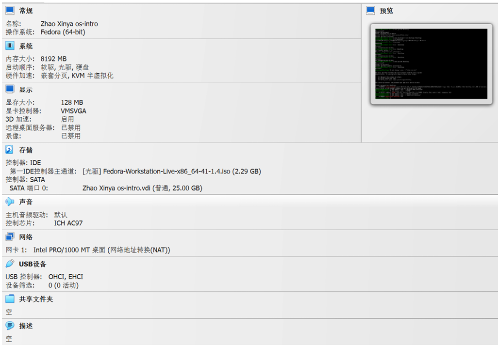
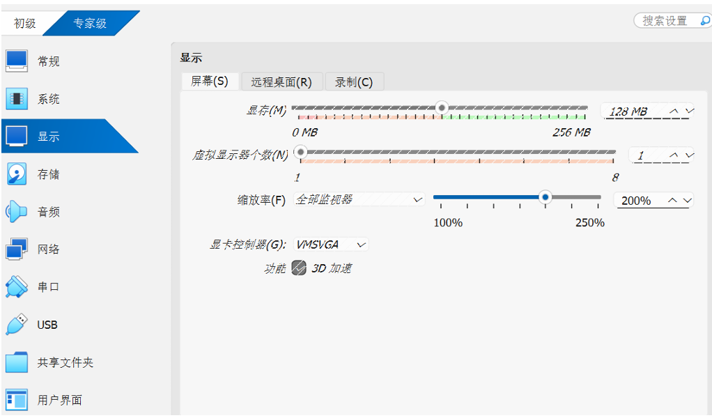
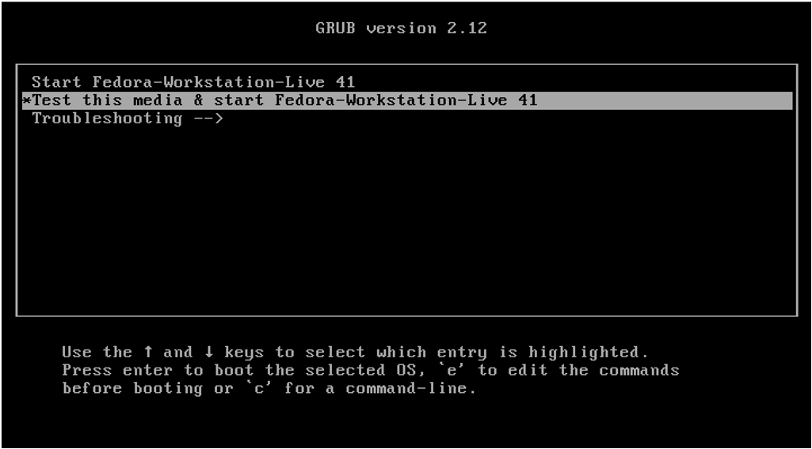
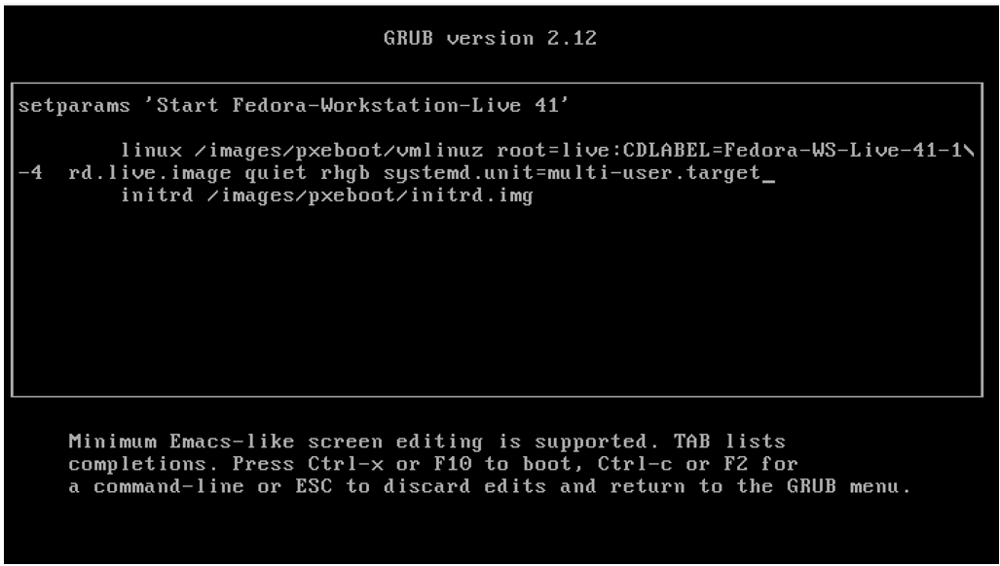
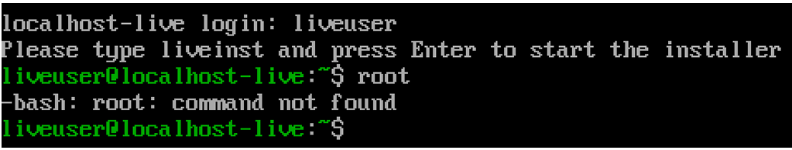
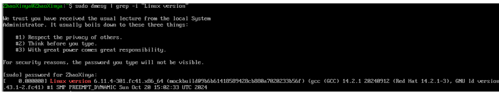
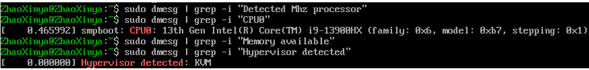
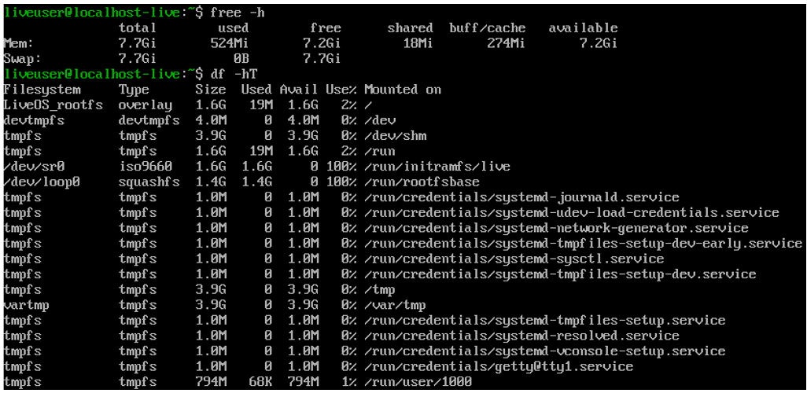

---
author:
  name: Чжао Синья
  email: 1132258332@rudn.ru
  affiliation:
    - name: Российский университет дружбы народов
      country: Российская Федерация
      city: Москва
      address: ул. Миклухо-Маклая, д. 6
title: "Лабораторная работа № 1 (2.1)"
subtitle: "Установка ОС Linux"
license: "CC BY"
date: today
date-format: "YYYY-MM-DD"
abstract: |
  Отчёт по лабораторной работе № 1: установка операционной системы
  Linux Fedora на виртуальную машину VirtualBox.
keywords: [лабораторная работа, Linux, Fedora, VirtualBox]
---

# Цель работы

Целью данной работы является приобретение практических навыков установки операционной системы на виртуальную машину, настройки минимально необходимых для дальнейшей работы сервисов.

# Задание работы

1. Установить дистрибутив Linux Fedora на виртуальную машину.
2. Выполнить первоначальную настройку системы.
3. Настроить раскладку клавиатуры.
4. Установить имя пользователя и имя хоста в соответствии с соглашением об именовании.
5. Установить программное обеспечение для создания документации (pandoc, pandoc-crossref, texlive).
6. Выполнить дополнительное задание: проанализировать последовательность загрузки системы с помощью команды `dmesg`.

# Техническое обеспечение

- Программное обеспечение виртуализации: Oracle VM VirtualBox 7.0.
- Операционная система хоста: Windows.
- Дистрибутив гостевой ОС: Fedora Sway Live (образ `Fedora-Sway-Live-x86_64-41-1.4.iso`).
- Параметры виртуальной машины:
  - имя: `Zhao Xinya os-intro`;
  - тип ОС: Fedora (64-bit);
  - объём оперативной памяти: 8192 МБ;
  - размер виртуального жёсткого диска: 25 ГБ (VDI, динамический);
  - графический контроллер: VMSVGA;
  - 3D-ускорение: включено;
  - сетевой адаптер: Intel PRO/1000 MT Desktop (NAT).

# Соглашения об именовании

В соответствии с соглашением об именовании:

- имя пользователя внутри виртуальной машины: `ZhaoXinya`;
- имя хоста виртуальной машины: `ZhaoXinya`;
- имя виртуальной машины: `ZhaoXinya`.

# Ход выполнения работы

## 1. Создание виртуальной машины

В среде VirtualBox была создана виртуальная машина с именем `Zhao Xinya os-intro`, тип операционной системы — Fedora (64-bit). В качестве установочного образа подключён ISO-файл Fedora Sway Live.

Основные параметры виртуальной машины:

- объём оперативной памяти: 8192 МБ;
- размер виртуального жёсткого диска: 25 ГБ, тип VDI, динамический;
- графический контроллер: VMSVGA;
- включено 3D-ускорение;
- сетевой адаптер: Intel PRO/1000 MT Desktop (NAT).

{#fig-01-01 width=90%}

{#fig-01-02 width=90%}

## 2. Загрузка с LiveCD

Виртуальная машина была запущена с установочного ISO-образа. Загрузчик GRUB предложил несколько вариантов запуска:

- `Start Fedora-Sway-Live 41`
- `Test this media & start Fedora-Sway-Live 41`
- `Troubleshooting -->`

Для проверки целостности образа был выбран пункт `Test this media & start Fedora-Sway-Live 41`. Проверка завершилась успешно:

~~~
The media check is complete, the result is: PASS.
It is OK to use this media.
~~~

{#fig-01-03 width=90%}

## 3. Запуск в текстовом режиме

При попытке загрузки в графическом режиме система выводила ошибку драйвера:

~~~
vmwgfx 0000:00:02.0: [drm] ERROR vmwgfx seems to be running on an unsupported hypervisor.
vmwgfx 0000:00:02.0: [drm] ERROR This configuration is likely broken.
vmwgfx 0000:00:02.0: [drm] ERROR Please switch to a supported graphics device to avoid problems.
~~~

Это связано с несовместимостью графического драйвера VirtualBox с версией ядра Fedora. Для продолжения работы система была загружена в текстовом режиме. В меню GRUB был выбран пункт `Start Fedora-Sway-Live 41`, в строку параметров ядра добавлен параметр `systemd.unit=multi-user.target`.

{#fig-01-04 width=90%}

## 4. Вход в Live-систему

После загрузки в текстовом режиме появилось приглашение входа:

~~~
localhost-live login:
~~~

Вход был выполнен под учётной записью `liveuser` (пароль не задан):

~~~
localhost-live login: liveuser
~~~

{#fig-01-05 width=90%}

## 5. Создание пользователя и настройка хоста

В соответствии с соглашением об именовании был создан пользователь `ZhaoXinya` и установлено имя хоста.

Создание пользователя:

~~~bash
sudo useradd -m -G wheel ZhaoXinya
sudo passwd ZhaoXinya
~~~

Установка имени хоста:

~~~bash
sudo hostnamectl set-hostname ZhaoXinya
~~~

Проверка:

~~~bash
id ZhaoXinya
hostname
~~~

{#fig-01-06 width=90%}

## 6. Установка программного обеспечения для создания документации

Установка pandoc:

~~~bash
sudo dnf -y install pandoc
~~~

Установка дистрибутива TeXlive:

~~~bash
sudo dnf -y install texlive-scheme-full
~~~

Пакет `pandoc-crossref` в стандартном репозитории отсутствует, поэтому он устанавливается вручную: скачивается с сайта проекта, распаковывается и помещается в каталог `/usr/local/bin`. При этом важно, чтобы версия `pandoc-crossref` соответствовала версии `pandoc`.

## 7. Анализ последовательности загрузки системы

В соответствии с дополнительным заданием был выполнен анализ последовательности загрузки системы с помощью команды `dmesg`.

Просмотр журнала загрузки:

~~~bash
sudo dmesg | less
~~~

Поиск необходимой информации:

~~~bash
sudo dmesg | grep -i "Linux version"
sudo dmesg | grep -i "Detected Mhz processor"
sudo dmesg | grep -i "CPU0"
sudo dmesg | grep -i "Memory available"
sudo dmesg | grep -i "Hypervisor detected"
~~~

{#fig-01-07 width=90%}

{#fig-01-08 width=90%}

## 8. Определение типа файловой системы и последовательности монтирования

Тип файловой системы корневого раздела и последовательность монтирования файловых систем были определены с помощью команд:

~~~bash
mount | grep "on / "
cat /etc/fstab
df -hT
~~~

В Live-режиме корневой раздел имеет тип `overlay`:

~~~
LiveOS_rootfs on / type overlay (rw,relatime,seclabel,lowerdir=/run/rootfsbase,upperdir=/run/overlays,workdir=/run/ovlwork,uuid=on)
~~~

Файл `/etc/fstab` в Live-режиме содержит только запись для временного каталога:

~~~
vartmp /var/tmp tmpfs defaults 0 0
~~~

{#fig-01-09 width=90%}

# Выводы

В ходе лабораторной работы были приобретены практические навыки установки операционной системы Linux Fedora на виртуальную машину VirtualBox, а также первоначальной настройки системы. Были созданы пользователь `ZhaoXinya` и хост `ZhaoXinya` в соответствии с соглашением об именовании, установлено программное обеспечение для создания документации (pandoc, texlive).

В процессе работы была выявлена несовместимость графического драйвера VirtualBox (`vmwgfx`) с версией ядра Fedora, из-за чего графический установщик Anaconda не запускался. Работа была продолжена в текстовом режиме Live-системы, где были выполнены все команды, требуемые заданием.

Дополнительное задание позволило проанализировать последовательность загрузки системы и получить информацию о версии ядра, частоте и модели процессора, объёме доступной оперативной памяти, типе гипервизора, типе файловой системы корневого раздела и последовательности монтирования файловых систем.

# Ответы на контрольные вопросы

## 1. Какую информацию содержит учётная запись пользователя?

Учётная запись пользователя содержит:

- имя пользователя (логин);
- идентификатор пользователя (UID);
- идентификатор группы (GID);
- домашний каталог;
- командную оболочку;
- пароль (в зашифрованном виде хранится в файле `/etc/shadow`);
- дополнительную информацию (полное имя, телефон, офис и т.п.) в файле `/etc/passwd`.

## 2. Команды терминала

Для получения справки по команде:

~~~bash
man ls
ls --help
~~~

Для перемещения по файловой системе:

~~~bash
cd /home/ZhaoXinya
cd ..
cd ~
~~~

Для просмотра содержимого каталога:

~~~bash
ls
ls -la
~~~

Для определения объёма каталога:

~~~bash
du -sh /home/ZhaoXinya
~~~

Для создания / удаления каталогов / файлов:

~~~bash
mkdir newdir
rmdir newdir
touch file.txt
rm file.txt
rm -r newdir
~~~

Для задания определённых прав на файл / каталог:

~~~bash
chmod 755 file.txt
chmod u+x file.txt
chown ZhaoXinya file.txt
~~~

Для просмотра истории команд:

~~~bash
history
~~~

## 3. Что такое файловая система?

Файловая система — это часть операционной системы, обеспечивающая организацию, хранение и доступ к файлам и каталогам на носителе информации.

Примеры файловых систем:

- **ext4** — стандартная файловая система для Linux, поддерживает большие объёмы, журналирование, высокую производительность;
- **XFS** — высокопроизводительная журналируемая файловая система, часто используется на серверах;
- **Btrfs** — современная файловая система с поддержкой снапшотов, контрольных сумм и сжатия;
- **FAT32** — старая файловая система, совместимая с большинством ОС, но имеет ограничения по размеру файла (4 ГБ);
- **NTFS** — файловая система Windows, поддерживает права доступа, шифрование, журналирование.

## 4. Как посмотреть, какие файловые системы подмонтированы в ОС?

~~~bash
mount
cat /proc/mounts
df -h
~~~

## 5. Как удалить зависший процесс?

~~~bash
ps aux | grep process_name
kill -9 PID
~~~

Или:

~~~bash
pkill -9 process_name
~~~