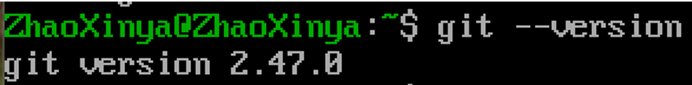
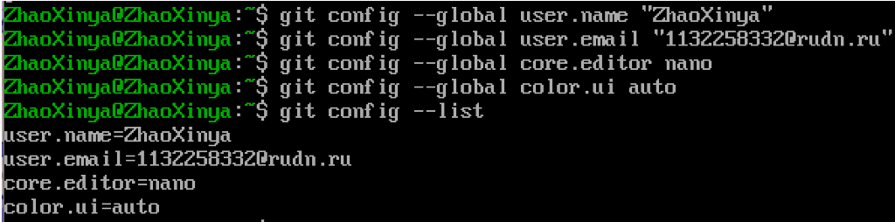
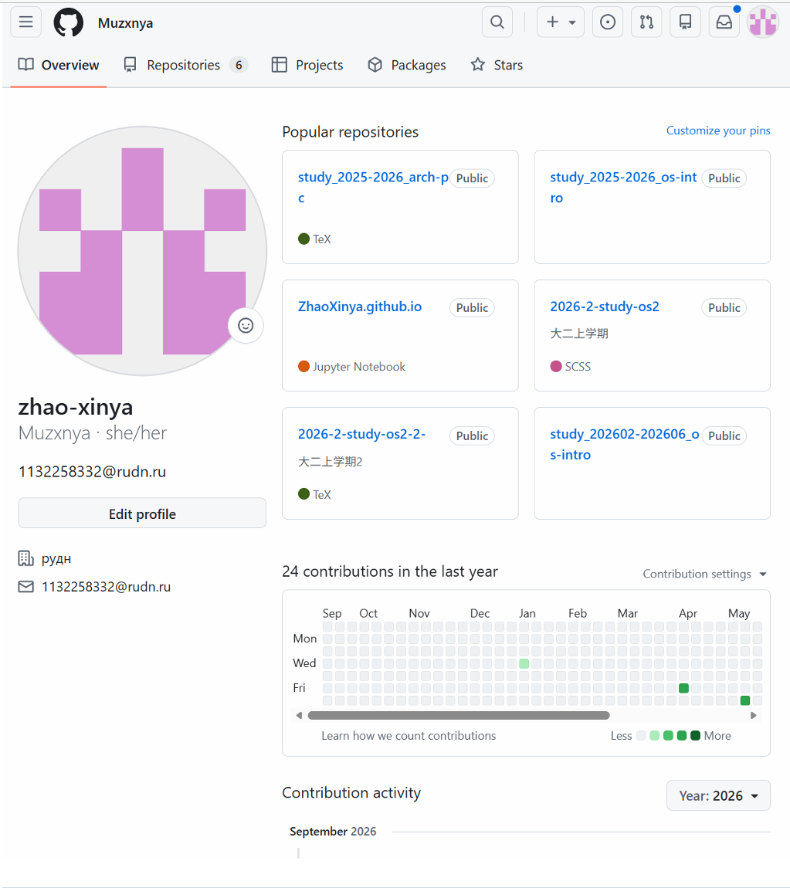
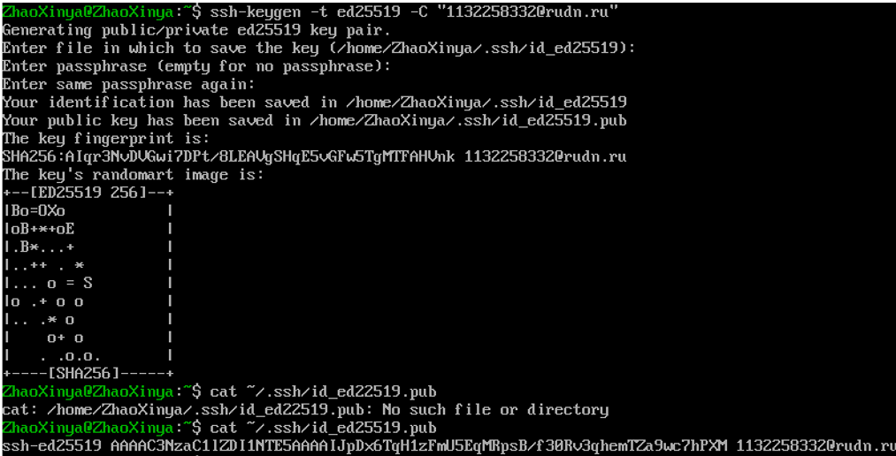
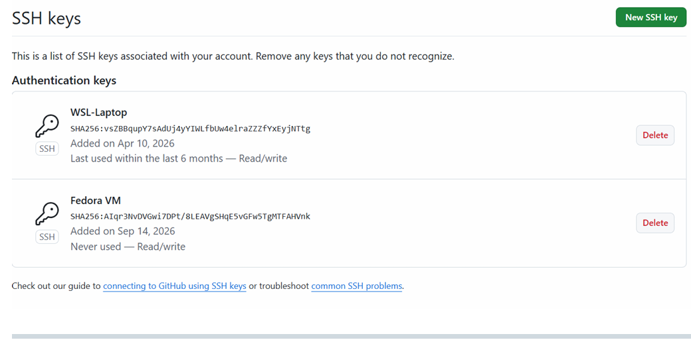
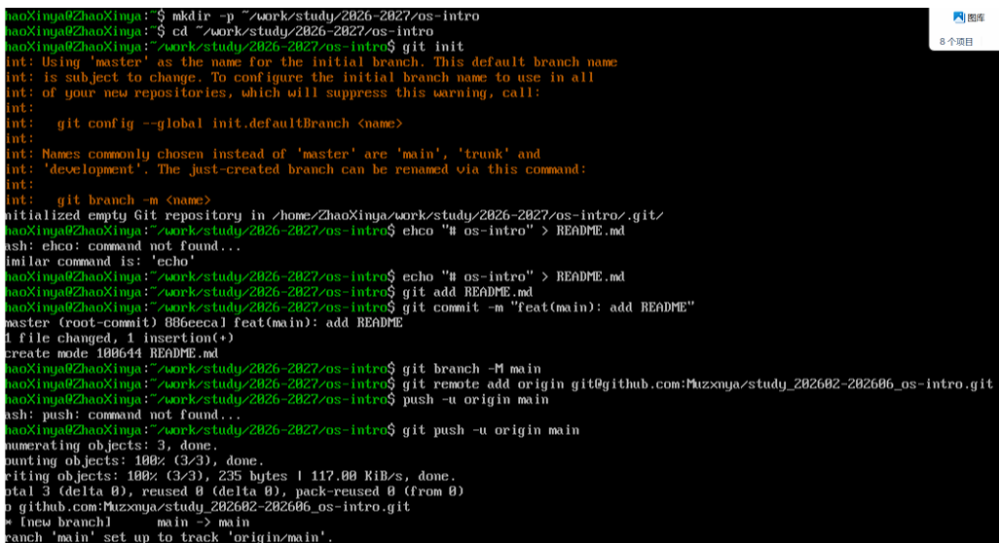
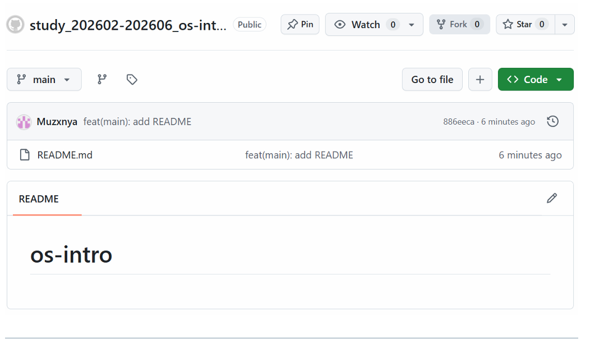

---
author:
  name: Чжао Синья
  email: 1132258332@rudn.ru
  affiliation:
    - name: Российский университет дружбы народов
      country: Российская Федерация
      city: Москва
      address: ул. Миклухо-Маклая, д. 6
title: "Лабораторная работа № 2 (2.2)"
subtitle: "Первоначальная настройка git"
license: "CC BY"
date: today
date-format: "YYYY-MM-DD"
abstract: |
  Отчёт по лабораторной работе № 2: первоначальная настройка системы
  контроля версий Git и работа с удалёнными репозиториями.
keywords: [лабораторная работа, Git, GitHub, SSH]
---

# Цель работы

Приобретение практических навыков по установке и первоначальной настройке системы контроля версий Git, а также по работе с удалёнными репозиториями.

# Задание работы

1. Установить Git.
2. Выполнить первоначальную настройку Git (имя пользователя, электронная почта, редактор, настройки отображения).
3. Создать учётную запись на GitHub и настроить SSH-ключ.
4. Создать первый репозиторий и выполнить базовые операции (add, commit, push).
5. Ознакомиться с основными командами Git.

# Ход выполнения работы

## 1. Проверка наличия и установка Git

Проверка, установлен ли Git в системе:

~~~bash
git --version
~~~

Результат выполнения команды:

~~~
git version 2.47.0
~~~

{#fig-02-01 width=90%}

Если Git не установлен, установка выполняется командой:

~~~bash
sudo dnf -y install git
~~~

## 2. Первоначальная настройка Git

Установка имени пользователя и адреса электронной почты:

~~~bash
git config --global user.name "ZhaoXinya"
git config --global user.email "1132258332@rudn.ru"
~~~

Установка редактора по умолчанию:

~~~bash
git config --global core.editor nano
~~~

Настройка отображения цветов:

~~~bash
git config --global color.ui auto
~~~

Проверка всех настроек:

~~~bash
git config --global --list
~~~

Результат:

~~~
user.name=ZhaoXinya
user.email=1132258332@rudn.ru
core.editor=nano
color.ui=auto
~~~

{#fig-02-02 width=90%}

## 3. Создание учётной записи GitHub

Для работы с удалёнными репозиториями была создана (использована ранее созданная) учётная запись на GitHub:

- имя пользователя: `Muzxnya`;
- отображаемое имя: `zhao-xinya`;
- электронная почта: `1132258332@rudn.ru`.

{#fig-02-03 width=90%}

## 4. Генерация SSH-ключа

Для безопасного подключения к GitHub был сгенерирован SSH-ключ:

~~~bash
ssh-keygen -t ed25519 -C "1132258332@rudn.ru"
~~~

При генерации были приняты значения по умолчанию (путь `/home/ZhaoXinya/.ssh/id_ed25519`, пустая парольная фраза).

Просмотр публичного ключа:

~~~bash
cat ~/.ssh/id_ed25519.pub
~~~

{#fig-02-04 width=90%}

## 5. Добавление SSH-ключа в GitHub

Публичный ключ был добавлен в учётную запись GitHub:

1. Settings → SSH and GPG keys → New SSH key.
2. Title: `Fedora VM`.
3. Key type: `Authentication Key`.
4. Key: содержимое файла `~/.ssh/id_ed25519.pub`.

{#fig-02-05 width=90%}

## 6. Проверка подключения к GitHub

Проверка SSH-соединения с GitHub:

~~~bash
ssh -T git@github.com
~~~

Результат:

~~~
Hi Muzxnya! You've successfully authenticated, but GitHub does not provide shell access.
~~~

Сообщение подтверждает, что SSH-ключ настроен корректно и аутентификация проходит успешно.

{#fig-02-06 width=90%}

## 7. Создание удалённого репозитория на GitHub

На GitHub был создан новый пустой репозиторий:

- имя репозитория: `study_202602-202606_os-intro`;
- без файла README;
- без файла .gitignore;
- без лицензии.

## 8. Создание локального репозитория и первый коммит

Создание рабочего каталога:

~~~bash
mkdir -p ~/work/study/2026-2027/os-intro
cd ~/work/study/2026-2027/os-intro
~~~

Инициализация репозитория:

~~~bash
git init
~~~

Создание файла README.md:

~~~bash
echo "# os-intro" > README.md
~~~

Добавление файла в индекс и создание первого коммита:

~~~bash
git add README.md
git commit -m "feat(main): add README"
~~~

Переименование основной ветки в main:

~~~bash
git branch -M main
~~~

## 9. Подключение удалённого репозитория и отправка изменений

Подключение удалённого репозитория:

~~~bash
git remote add origin git@github.com:Muzxnya/study_202602-202606_os-intro.git
~~~

Отправка изменений на GitHub:

~~~bash
git push -u origin main
~~~

Результат выполнения команды:

~~~
Enumerating objects: 3, done.
Counting objects: 100% (3/3), done.
Writing objects: 100% (3/3), 235 bytes | 117.00 KiB/s, done.
Total 3 (delta 0), reused 0 (delta 0), pack-reused 0
To github.com:Muzxnya/study_202602-202606_os-intro.git
 * [new branch]      main -> main
Branch 'main' set up to track remote branch 'main' from 'origin'.
~~~

{#fig-02-07 width=90%}

## 10. Проверка результата

После выполнения команды `git push` содержимое локального репозитория было проверено на GitHub. В репозитории присутствует файл `README.md` с содержимым `# os-intro`.

{#fig-02-08 width=90%}

## 11. Основные команды Git

В ходе работы были использованы и изучены следующие основные команды Git:

| Команда | Назначение |
|---------|-----------|
| `git init` | Инициализация нового репозитория |
| `git add` | Добавление файлов в индекс |
| `git commit` | Создание коммита |
| `git status` | Просмотр состояния репозитория |
| `git log` | Просмотр истории коммитов |
| `git remote add` | Подключение удалённого репозитория |
| `git push` | Отправка изменений на удалённый сервер |
| `git pull` | Получение изменений с удалённого сервера |
| `git branch` | Работа с ветками |
| `git config` | Настройка параметров |

# Выводы

В ходе лабораторной работы были приобретены практические навыки установки и первоначальной настройки системы контроля версий Git. Были выполнены:

- настройка имени пользователя и электронной почты;
- генерация SSH-ключа и его добавление в учётную запись GitHub;
- создание удалённого репозитория на GitHub;
- создание локального репозитория и первый коммит;
- подключение удалённого репозитория и отправка изменений.

Освоены основные команды Git: `init`, `config`, `add`, `commit`, `branch`, `remote`, `push`. Полученные навыки будут использоваться при выполнении последующих лабораторных работ, отчёты по которым размещаются в системе контроля версий.

# Ответы на контрольные вопросы

## 1. Что такое система контроля версий?

Система контроля версий (Version Control System, VCS) — это программное обеспечение, которое позволяет отслеживать изменения в файлах и каталогах с течением времени, хранить историю изменений, возвращаться к предыдущим версиям и организовывать совместную работу нескольких разработчиков.

## 2. Что такое Git?

Git — это распределённая система контроля версий, разработанная Линусом Торвальдсом в 2005 году. Каждый разработчик имеет полную локальную копию репозитория, что позволяет работать автономно и синхронизировать изменения с другими участниками.

## 3. Чем отличается Git от других систем контроля версий?

Основные отличия Git:

- распределённость: у каждого пользователя есть полная копия репозитория;
- высокая производительность;
- целостность данных за счёт хеширования содержимого (SHA-1);
- поддержка нелинейной разработки (ветвление и слияние);
- локальные операции выполняются быстро, без обращения к серверу.

## 4. Что такое коммит?

Коммит (commit) — это фиксация изменений в репозитории. Каждый коммит содержит:

- уникальный идентификатор (хеш);
- автора и дату;
- сообщение (описание изменений);
- ссылку на родительский коммит.

## 5. Как настроить Git?

Первоначальная настройка Git выполняется командами:

~~~bash
git config --global user.name "Имя"
git config --global user.email "email@example.com"
git config --global core.editor nano
git config --global color.ui auto
~~~

Проверка настроек:

~~~bash
git config --global --list
~~~

## 6. Как создать SSH-ключ?

~~~bash
ssh-keygen -t ed25519 -C "email@example.com"
~~~

После генерации публичный ключ (`~/.ssh/id_ed25519.pub`) добавляется в настройки GitHub: Settings → SSH and GPG keys → New SSH key.

## 7. Как подключить удалённый репозиторий?

~~~bash
git remote add origin git@github.com:username/repo.git
~~~

Проверка подключённых удалённых репозиториев:

~~~bash
git remote -v
~~~

## 8. Как отправить изменения на удалённый репозиторий?

~~~bash
git push -u origin main
~~~

# Список литературы {.unnumbered}

::: {#refs}
:::