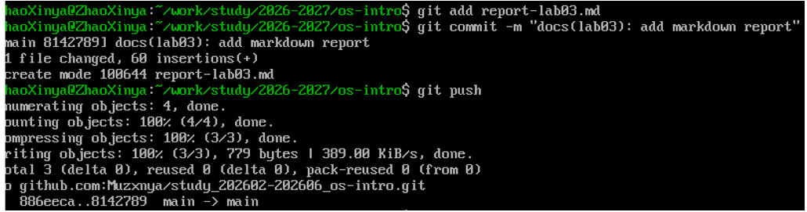
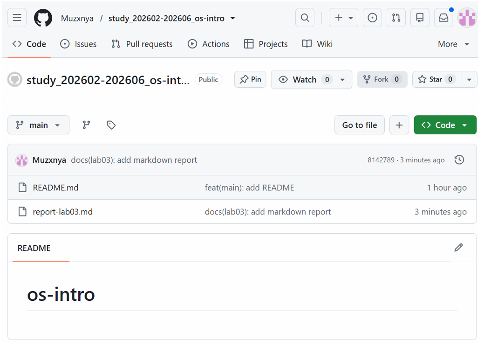

---
author:
  name: Чжао Синья
  email: 1132258332@rudn.ru
  affiliation:
    - name: Российский университет дружбы народов
      country: Российская Федерация
      city: Москва
      address: ул. Миклухо-Маклая, д. 6
title: "Лабораторная работа № 3 (2.3)"
subtitle: "Основы markdown"
license: "CC BY"
date: today
date-format: "YYYY-MM-DD"
abstract: |
  Отчёт по лабораторной работе № 3: изучение основ языка разметки
  Markdown и применение его для оформления отчётов.
keywords: [лабораторная работа, Markdown, Git, GitHub]
---

# Цель работы

Приобретение практических навыков работы с языком разметки Markdown, изучение основных элементов синтаксиса и применение их для оформления отчётов по лабораторным работам.

# Задание работы

1. Изучить основные элементы синтаксиса Markdown.
2. Создать в репозитории файл `report-lab03.md` с примерами использования основных элементов Markdown.
3. Закоммитить изменения и отправить их в удалённый репозиторий на GitHub.
4. Проверить корректность отображения Markdown на GitHub.

# Теоретические сведения

Markdown — это облегчённый язык разметки, созданный Джоном Грубером в 2004 году. Он предназначен для написания структурированного текста, который легко читается в исходном виде и может быть преобразован в HTML, PDF, DOCX и другие форматы.

Основные элементы синтаксиса Markdown:

- заголовки различных уровней;
- маркированные и нумерованные списки;
- выделение текста (курсив, полужирный, моноширинный);
- встроенный код и блоки кода;
- таблицы;
- ссылки и изображения;
- цитаты;
- математические формулы (в расширениях).

# Ход выполнения работы

## 1. Переход в рабочий каталог репозитория

~~~bash
cd ~/work/study/2026-2027/os-intro
~~~

## 2. Создание файла отчёта

Создание файла `report-lab03.md` с примерами основных элементов Markdown:

~~~~bash
cat > report-lab03.md << 'EOF'
# Lab 03 Report

## Markdown Basics

Student: ZhaoXinya
Account: ZhaoXinya
Student ID: 113225832

## 1. Headings

# Heading level 1
## Heading level 2
### Heading level 3

## 2. Lists

### Unordered list

- First item
- Second item
- Third item

### Ordered list

1. First item
2. Second item
3. Third item

## 3. Text formatting

- Italic
- Bold
- Bold italic
- Monospace

## 4. Code

Inline code: git init.

Code block:

    git add README.md
    git commit -m "feat(main): add README"
    git push -u origin main

## 5. Table

| Command | Purpose |
|---------|---------|
| git init | Initialize repository |
| git add | Add files to index |
| git commit | Create commit |
| git push | Push to remote |

## Conclusion

In this lab we studied the main features of the Markdown markup language: headings, lists, text formatting, code, and tables.
EOF
~~~~

Содержимое файла `report-lab03.md` включает примеры всех основных элементов Markdown: заголовков разных уровней, маркированного и нумерованного списков, форматирования текста (курсив, полужирный, полужирный курсив, моноширинный), встроенного кода, блока кода, таблицы.

## 3. Добавление файла в индекс Git

~~~bash
git add report-lab03.md
~~~

## 4. Создание коммита

~~~bash
git commit -m "docs(lab03): add markdown report"
~~~

Результат выполнения команды:

~~~
[main 8142789] docs(lab03): add markdown report
 1 file changed, 60 insertions(+)
 create mode 100644 report-lab03.md
~~~

## 5. Отправка изменений на GitHub

~~~bash
git push
~~~

Результат выполнения команды:

~~~
Enumerating objects: 4, done.
Counting objects: 100% (4/4), done.
Delta compression using up to 32 threads
Compressing objects: 100% (3/3), done.
Writing objects: 100% (3/3), 779 bytes | 389.00 KiB/s, done.
Total 3 (delta 0), reused 0 (delta 0), pack-reused 0
To github.com:Muzxnya/study_202602-202606_os-intro.git
   80eeeca..8142789  main -> main
~~~

{#fig-03-01 width=90%}

## 6. Проверка результата на GitHub

После отправки изменений репозиторий был открыт на GitHub по адресу:

`https://github.com/Muzxnya/study_202602-202606_os-intro`

В репозитории присутствуют файлы:

- `README.md`;
- `report-lab03.md`.

Файл `report-lab03.md` отображается с корректным применением разметки Markdown: заголовки выделены крупным шрифтом, списки отображаются с маркерами и номерами, таблица отображается в виде таблицы, блоки кода — с моноширинным шрифтом и подсветкой.

{#fig-03-02 width=90%}

# Выводы

В ходе лабораторной работы были приобретены практические навыки работы с языком разметки Markdown. Изучены и применены на практике основные элементы синтаксиса: заголовки, списки, выделение текста, вставка кода, таблицы. Полученный файл `report-lab03.md` был добавлен в репозиторий, закоммичен и отправлен на GitHub. Разметка Markdown корректно отображается на GitHub, что подтверждает правильность использования синтаксиса.

Полученные навыки будут использоваться при оформлении отчётов по последующим лабораторным работам, поскольку все отчёты в данном курсе выполняются именно в формате Markdown.

# Ответы на контрольные вопросы

## 1. Что такое Markdown?

Markdown — это облегчённый язык разметки, созданный Джоном Грубером в 2004 году. Он предназначен для написания структурированного текста, который легко читается в исходном виде и может быть преобразован в HTML, PDF, DOCX и другие форматы.

## 2. Какие основные элементы Markdown вы знаете?

Основные элементы Markdown:

- заголовки (от `#` до `####`);
- маркированные и нумерованные списки;
- выделение текста (курсив, полужирный, моноширинный);
- встроенный код и блоки кода;
- таблицы;
- ссылки и изображения;
- цитаты;
- горизонтальные линии;
- переносы строк.

## 3. Как создать заголовок в Markdown?

Заголовок создаётся с помощью символа `#`. Чем больше символов `#`, тем меньше уровень заголовка:

- `# Heading level 1` — заголовок 1-го уровня;
- `## Heading level 2` — заголовок 2-го уровня;
- `### Heading level 3` — заголовок 3-го уровня.

## 4. Как создать список в Markdown?

Маркированный список создаётся с помощью символов `-`:

- Первый пункт
- Второй пункт

Нумерованный список создаётся цифрами:

1. Первый пункт
2. Второй пункт

## 5. Как вставить код в Markdown?

Встроенный код оборачивается в одиночные обратные кавычки: `` `git init` ``.

Блок кода оборачивается в тройные обратные кавычки:

~~~bash
git add README.md
git commit -m "feat(main): add README"
~~~

## 6. Как создать таблицу в Markdown?

Таблица создаётся с помощью символов `|` и `-`:

| Команда | Назначение |
|---------|------------|
| git init | Инициализация репозитория |
| git add | Добавление файлов в индекс |

## 7. Как вставить ссылку в Markdown?

Ссылка создаётся так: `` `[Текст ссылки](https://example.com)` ``.

## 8. Как вставить изображение в Markdown?

Изображение вставляется так: `` `` ``.

## 9. Чем удобен Markdown для оформления отчётов?

Markdown удобен тем, что:

- исходный текст легко читается даже без преобразования;
- текст можно преобразовать в HTML, PDF, DOCX с помощью pandoc;
- удобно использовать в системах контроля версий (Git), поскольку это обычный текстовый файл;
- поддерживается большинством платформ (GitHub, GitLab, Bitbucket и др.);
- легко вставлять формулы, код и таблицы.

# Список литературы {.unnumbered}

::: {#refs}
:::