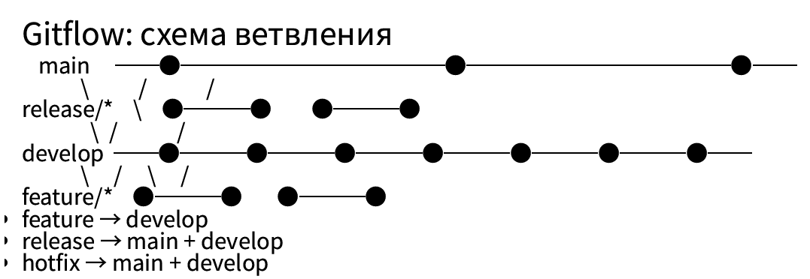
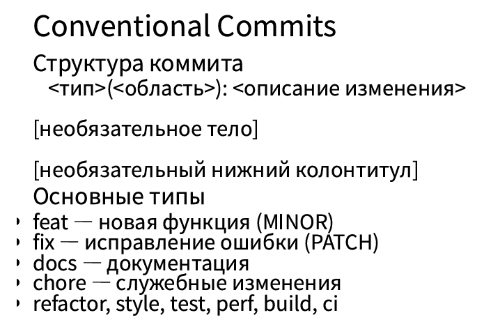

---
author:
  name: Чжао Синья
  email: 1132258332@rudn.ru
  affiliation:
    - name: Российский университет дружбы народов
      country: Российская Федерация
      city: Москва
      address: ул. Миклухо-Маклая, д. 6
title: "Лабораторная работа № 4"
subtitle: "Продвинутое использование git"
license: "CC BY"
date: today
date-format: "YYYY-MM-DD"
---

# Информация

## Докладчик

:::::::::::::: {.columns align=center}
::: {.column width="70%"}

- Чжао Синья
- студент 1 курса
- направление «Компьютерная инженерия»
- Российский университет дружбы народов
- [1132258332@rudn.ru](mailto:1132258332@rudn.ru)

:::
::: {.column width="30%"}

:::
::::::::::::::

::: notes
- Поприветствовать аудиторию.
:::

# Введение

## Цель работы

Получение навыков правильной работы с репозиториями git. Освоение методологии git-flow, семантического версионирования и общепринятых коммитов (Conventional Commits).

## Задание работы

1. Установить необходимое ПО (git-flow, Node.js, npm, commitizen, conventional-changelog).
2. Создать репозиторий `git-extended` на GitHub.
3. Настроить и применить Conventional Commits.
4. Освоить рабочий процесс Gitflow.
5. Применить семантическое версионирование.
6. Создать релизы 1.0.0 и 1.2.3 с генерацией CHANGELOG.

## Рабочий процесс Gitflow

Gitflow Workflow — модель ветвления, предложенная Винсентом Дриссеном.

- `main` — официальная история релизов;
- `develop` — интеграция всех новых функций;
- `feature/*` — разработка отдельных функций;
- `release/*` — подготовка релиза;
- `hotfix/*` — срочные исправления.

{#fig-04-pres-01 width=100%}

## Семантическое версионирование

Формат версии: **МАЖОРНАЯ.МИНОРНАЯ.ПАТЧ**

- **МАЖОРНАЯ** — несовместимые изменения API;
- **МИНОРНАЯ** — новая функциональность без нарушения совместимости;
- **ПАТЧ** — обратно совместимые исправления.

Пример: `1.2.3`

## Conventional Commits

Структура коммита:
<тип>(<область>): <описание изменения>
[необязательное тело]
[необязательный нижний колонтитул]

text

Основные типы:

- `feat` — новая функция (MINOR);
- `fix` — исправление ошибки (PATCH);
- `docs` — документация;
- `chore` — служебные изменения;
- `refactor`, `style`, `test`, `perf`, `build`, `ci`.

{#fig-04-pres-02 width=100%}

## Связь Conventional Commits и SemVer

| Тип коммита | Версия |
|-------------|--------|
| `fix` | PATCH |
| `feat` | MINOR |
| `BREAKING CHANGE` | MAJOR |

Позволяет автоматически генерировать:

- номера версий;
- CHANGELOG.

# Ход работы

## Установка ПО

~~~bash
sudo dnf -y copr enable elegos/gitflow
sudo dnf -y install gitflow
sudo dnf -y install nodejs npm pnpm
pnpm setup
source ~/.bashrc
pnpm add -g commitizen
pnpm add -g conventional-changelog-cli
~~~

Проверка версий инструментов.

## Создание репозитория git-extended

~~~bash
mkdir -p ~/work/git-extended
cd ~/work/git-extended
git init
gh repo create git-extended --public \
  --description "Git repo for educational purposes" \
  --source=. --remote=origin
~~~

Результат:
✓ Created repository Muzxnya/git-extended
✓ Added remote git@github.com:Muzxnya/git-extended.git

text

## Первый conventional commit

~~~bash
git add .
git cz
~~~

Выбрано:

- type: `feat`;
- scope: пропущено;
- short description: `initial commit`.

## Инициализация git-flow

~~~bash
git flow init
~~~

Параметры:

- main: `main`
- develop: `develop`
- feature prefix: `feature/`
- release prefix: `release/`
- hotfix prefix: `hotfix/`
- version tag prefix: `v`

Публикация:

~~~bash
git push --all
~~~

## Релиз 1.0.0

~~~bash
git flow release start 1.0.0
conventional-changelog -p angular -i CHANGELOG.md -s -r 0
git add CHANGELOG.md
git commit -m "chore(site): add changelog"
git flow release finish 1.0.0
git push --all
git push --tags
gh release create v1.0.0 -F CHANGELOG.md -t "Release 1.0.0"
~~~

CHANGELOG для 1.0.0:
1.0.0 (2026-10-07)
Features
initial commit (928c072)

text

## Разработка новой функциональности

~~~bash
git flow feature start feature_branch
echo "New feature content" > feature.txt
git add feature.txt
git cz
git flow feature finish feature_branch
~~~

Коммит:
[develop 7da1cc4] feat: add new feature.txt

text

## Релиз 1.2.3

~~~bash
git flow release start 1.2.3
# обновить версию в package.json → 1.2.3
conventional-changelog -p angular -r 0 > CHANGELOG.md
git add CHANGELOG.md package.json
git commit -m "chore(site): update changelog and version"
git flow release finish 1.2.3
~~~

## Конфликт слияния

При `git flow release finish 1.2.3` возник конфликт:
CONFLICT (add/add): Merge conflict in CHANGELOG.md
Automatic merge failed; fix conflicts and then commit the result.

text

Разрешение:

- вручную удалены маркеры `<<<<<<<<`, `=======`, `>>>>>>>`;
- оставлены обе строки Features;
- `git add CHANGELOG.md`;
- `git commit -m "Merge branch 'release/1.2.3'"`.

CHANGELOG для 1.2.3:
1.2.3 (2026-10-07)
Features
add new feature.txt (7da1cc4)

initial commit (928c072)

text

## Публикация релиза 1.2.3

~~~bash
git tag -a v1.2.3 -m "Release 1.2.3"
git push --all
git push --tags
gh release create v1.2.3 -F CHANGELOG.md -t "Release 1.2.3"
~~~

Результат:
https://github.com/Muzxnya/git-extended/releases/tag/v1.2.3

text

## Список релизов

| Title | Type | Tag Name | Published |
|-------|------|----------|-----------|
| Release 1.2.3 | Latest | v1.2.3 | about 1 minute ago |
| Release 1.0.0 | | v1.0.0 | about 30 minutes ago |

# Заключение

## Выводы

- Освоена методология Gitflow.
- Изучена спецификация Conventional Commits.
- Освоено семантическое версионирование.
- Применена автоматическая генерация CHANGELOG.
- Освоена утилита `gh` для работы с GitHub.
- Получены навыки разрешения конфликтов слияния.

Все релизы опубликованы в репозитории `git-extended`.

## Спасибо за внимание!

Репозиторий: <https://github.com/Muzxnya/git-extended>