---
author:
  name: Чжао Синья
  email: 1132258332@rudn.ru
  affiliation:
    - name: Российский университет дружбы народов
      country: Российская Федерация
      city: Москва
      address: ул. Миклухо-Маклая, д. 6
title: "Лабораторная работа № 4"
subtitle: "Продвинутое использование git"
license: "CC BY"
date: today
date-format: "YYYY-MM-DD"
abstract: |
  Отчёт по лабораторной работе № 4: освоение методологии Gitflow,
  семантического версионирования и общепринятых коммитов.
keywords: [лабораторная работа, Git, Gitflow, SemVer, Conventional Commits]
---

# Цель работы

Получение навыков правильной работы с репозиториями git. Освоение методологии git-flow, семантического версионирования и общепринятых коммитов (Conventional Commits).

# Задание работы

1. Установить необходимое программное обеспечение (git-flow, Node.js, npm, commitizen, conventional-changelog).
2. Создать новый репозиторий `git-extended` на GitHub.
3. Настроить и применить спецификацию Conventional Commits.
4. Освоить рабочий процесс Gitflow: создание функциональных веток, релизных веток, веток исправлений.
5. Применить семантическое версионирование при создании релизов.
6. Создать релизы 1.0.0 и 1.2.3 с автоматической генерацией журнала изменений (CHANGELOG).

# Теоретические сведения

## Рабочий процесс Gitflow

Gitflow Workflow — модель ветвления, предложенная Винсентом Дриссеном. Основные ветки:

- `main` — хранит официальную историю релизов;
- `develop` — ветка для объединения всех новых функций.

Дополнительные ветки:

- `feature/*` — для разработки отдельных функций (создаются от `develop`);
- `release/*` — для подготовки релиза (создаются от `develop`, сливаются в `main` и `develop`);
- `hotfix/*` — для срочных исправлений (создаются от `main`, сливаются в `main` и `develop`).

## Семантическое версионирование

Версия задаётся в виде МАЖОРНАЯ.МИНОРНАЯ.ПАТЧ:

- МАЖОРНАЯ — несовместимые изменения API;
- МИНОРНАЯ — новая функциональность без нарушения обратной совместимости;
- ПАТЧ — обратно совместимые исправления.

## Общепринятые коммиты

Структура коммита:

```
<тип>(<область>): <описание изменения>
<пустая строка>
[необязательное тело]
<пустая строка>
[необязательный нижний колонтитул]
```

Основные типы:

- `feat` — новая функция (MINOR);
- `fix` — исправление ошибки (PATCH);
- `docs` — изменения в документации;
- `chore` — служебные изменения;
- `refactor`, `style`, `test`, `perf`, `build`, `ci`.

# Соглашения об именовании

В соответствии с требованиями курса:

- имя пользователя внутри виртуальной машины: `zhaoxinya`;
- имя хоста виртуальной машины: `zhaoxinya`;
- имя виртуальной машины: `Zhaoxinya2`;
- имя репозитория для эксперимента: `git-extended`;
- имя основного курсового репозитория: `study_202602-202606_os-intro`.

# Ход выполнения работы

## Установка программного обеспечения

Установка git-flow через COPR:

~~~bash
sudo dnf -y copr enable elegos/gitflow
sudo dnf -y install gitflow
~~~

Установка Node.js и npm:

~~~bash
sudo dnf -y install nodejs npm
sudo dnf -y install pnpm
~~~

Настройка pnpm:

~~~bash
pnpm setup
source ~/.bashrc
~~~

Установка commitizen и conventional-changelog:

~~~bash
pnpm add -g commitizen
pnpm add -g conventional-changelog-cli
~~~

Проверка версий:

~~~bash
git --version
git flow version
gh --version
node --version
npm --version
pnpm --version
git-cz --version
conventional-changelog --version
~~~

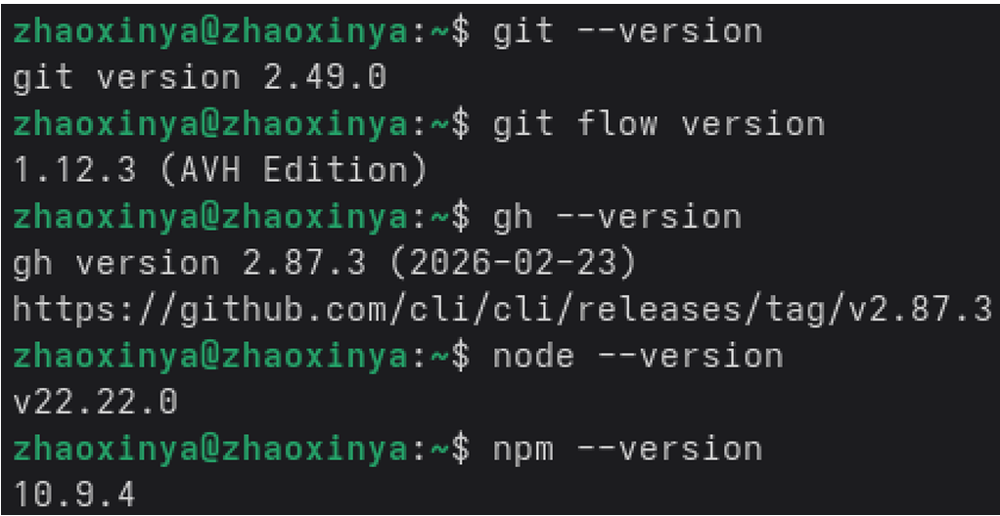{#fig-04-01 width=90%}

## Создание репозитория git-extended

Создание рабочего каталога и инициализация репозитория:

~~~bash
mkdir -p ~/work/git-extended
cd ~/work/git-extended
git init
~~~

Создание репозитория на GitHub с помощью утилиты gh:

~~~bash
gh repo create git-extended --public \
  --description "Git repo for educational purposes" \
  --source=. --remote=origin
~~~

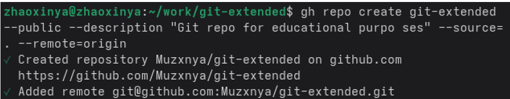{#fig-04-02 width=90%}

Создание файла `package.json` с конфигурацией commitizen:

~~~bash
pnpm init
~~~

## Первый conventional commit

~~~bash
git add .
git cz
~~~

В интерактивном режиме были выбраны параметры:

- type: `feat`
- scope: (пропущено)
- short description: `initial commit`

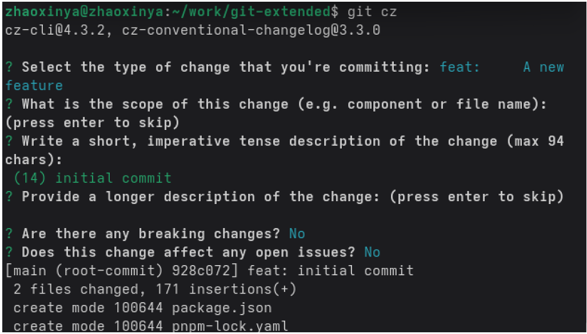{#fig-04-03 width=90%}

## Инициализация git-flow

~~~bash
git flow init
~~~

При инициализации:

- main branch: `main`
- develop branch: `develop`
- feature prefix: `feature/`
- release prefix: `release/`
- hotfix prefix: `hotfix/`
- version tag prefix: `v`

Проверка текущей ветки:

~~~bash
git branch
~~~

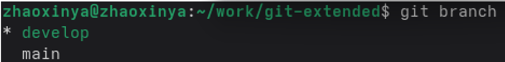{#fig-04-04 width=90%}

Публикация ветки `develop`:

~~~bash
git push -u origin develop
git push --all
~~~

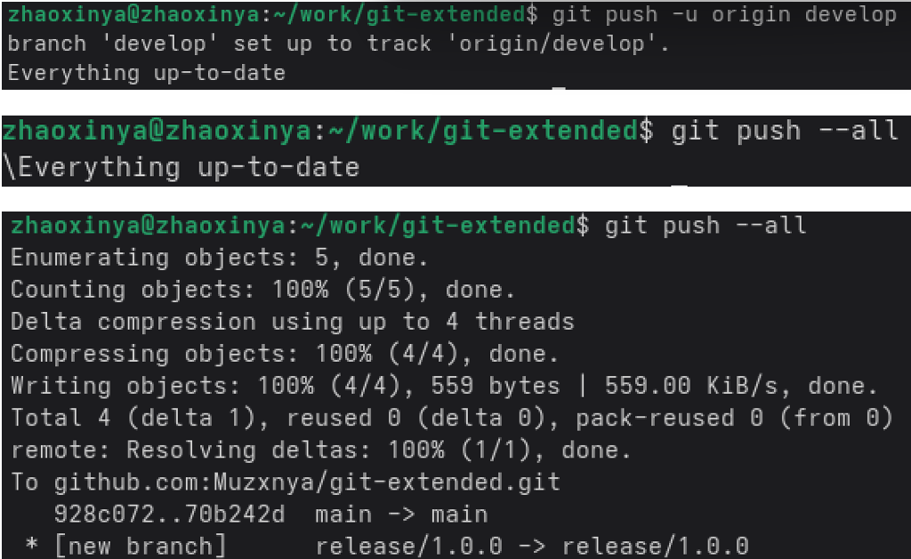{#fig-04-05 width=90%}

## Релиз 1.0.0

Создание релизной ветки:

~~~bash
git flow release start 1.0.0
~~~

Генерация журнала изменений:

~~~bash
conventional-changelog -p angular -i CHANGELOG.md -s -r 0
cat CHANGELOG.md
~~~

Добавление журнала в индекс:

~~~bash
git add CHANGELOG.md
git commit -m "chore(site): add changelog"
~~~

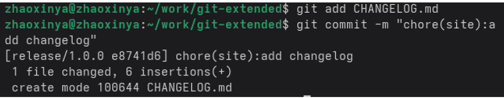{#fig-04-08 width=90%}

Завершение релиза:

~~~bash
git flow release finish 1.0.0
~~~

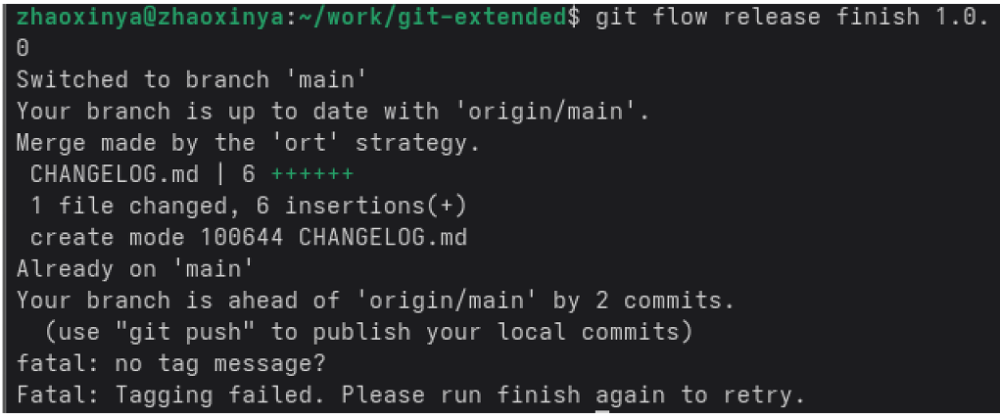{#fig-04-09 width=90%}

Публикация и создание релиза на GitHub:

~~~bash
git push --all
git push --tags
gh release create v1.0.0 -F CHANGELOG.md -t "Release 1.0.0"
~~~

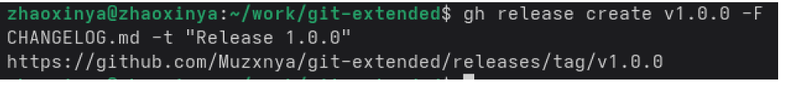{#fig-04-10 width=90%}

## Разработка новой функциональности

Создание функциональной ветки:

~~~bash
git flow feature start feature_branch
~~~

Добавление файла и коммит:

~~~bash
echo "New feature content" > feature.txt
git add feature.txt
git cz
~~~

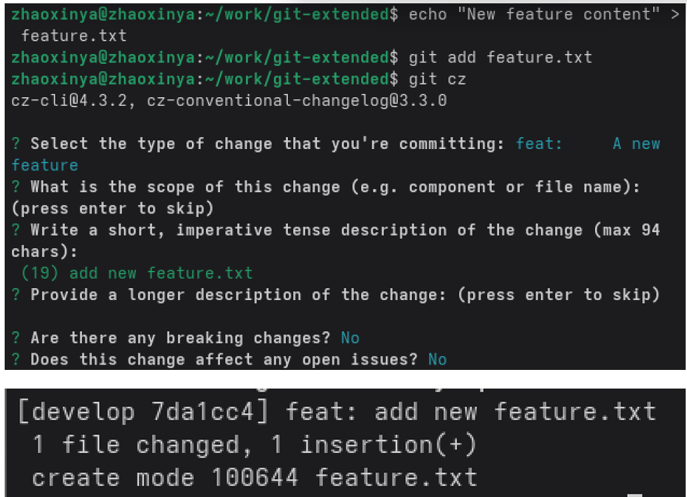{#fig-04-11 width=90%}

Завершение функциональной ветки:

~~~bash
git flow feature finish feature_branch
~~~

## Релиз 1.2.3

Создание релизной ветки:

~~~bash
git flow release start 1.2.3
~~~

Обновление версии в `package.json` до 1.2.3 и генерация обновлённого журнала изменений:

~~~bash
conventional-changelog -p angular -r 0 > CHANGELOG.md
cat CHANGELOG.md
git add CHANGELOG.md package.json
git commit -m "chore(site): update changelog and version"
~~~

Завершение релиза:

~~~bash
git flow release finish 1.2.3
~~~

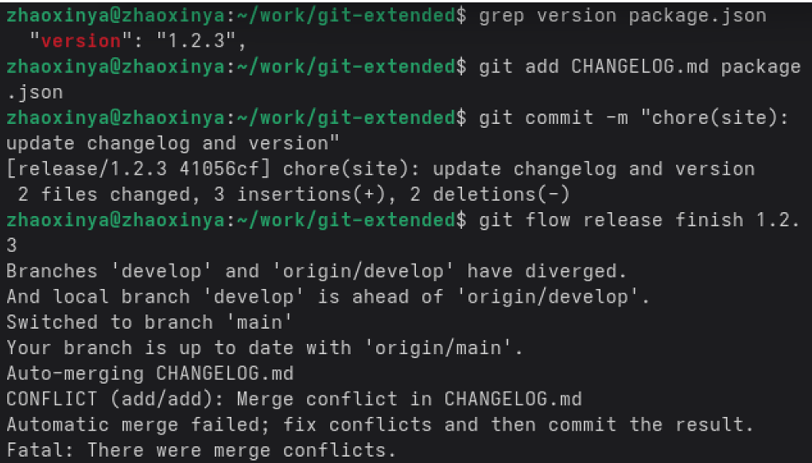{#fig-04-12 width=90%}

При этом возник конфликт слияния в файле `CHANGELOG.md`, который был разрешён вручную: конфликтующие маркеры (`<<<<<<`, `=======`, `>>>>>>`) удалены, оставлены обе строки Features.

После разрешения конфликта:

~~~bash
git add CHANGELOG.md
git commit -m "Merge branch 'release/1.2.3'"
~~~

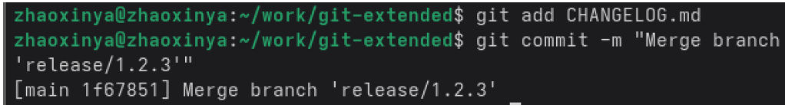{#fig-04-13 width=90%}

Создание тега версии:

~~~bash
git tag -a v1.2.3 -m "Release 1.2.3"
~~~

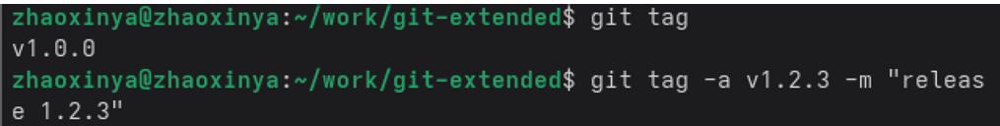{#fig-04-14 width=90%}

Публикация изменений и тегов:

~~~bash
git push --all
git push --tags
~~~

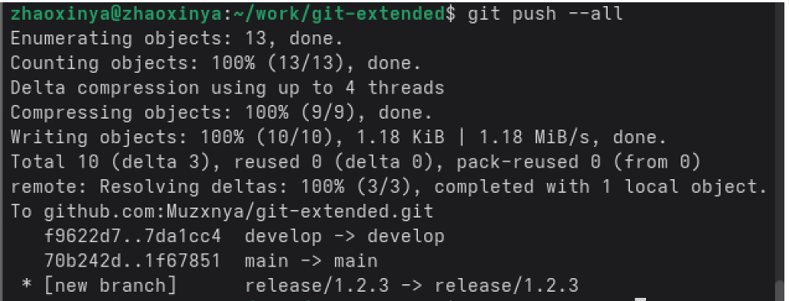{#fig-04-15 width=90%}

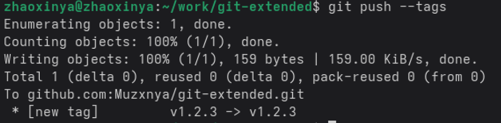{#fig-04-16 width=90%}

Создание релиза на GitHub:

~~~bash
gh release create v1.2.3 -F CHANGELOG.md -t "Release 1.2.3"
~~~

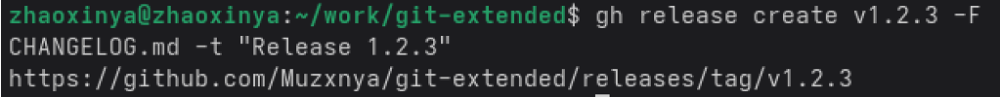{#fig-04-17 width=90%}

## Проверка списка релизов

~~~bash
gh release list
~~~

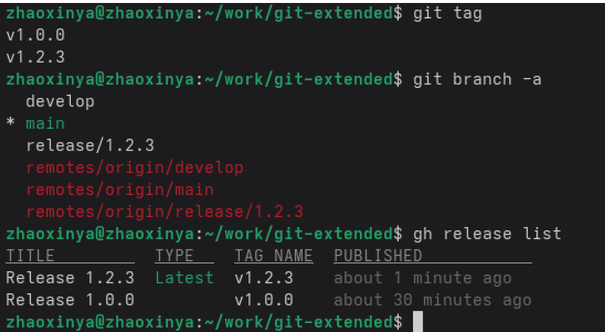{#fig-04-18 width=90%}

# Выводы

В ходе лабораторной работы были получены практические навыки правильной работы с репозиториями git:

- освоена методология Gitflow: работа с ветками `main`, `develop`, `feature/*`, `release/*`;
- изучена спецификация Conventional Commits, применённая при создании коммитов через `git cz`;
- освоено семантическое версионирование: созданы релизы 1.0.0 и 1.2.3;
- применена автоматическая генерация журнала изменений с помощью `conventional-changelog`;
- освоена работа с утилитой командной строки `gh` для создания репозитория и релизов на GitHub;
- получены навыки разрешения конфликтов слияния в Git.

Все релизы успешно опубликованы в репозитории `git-extended`.

# Ответы на контрольные вопросы

## 1. Что такое Gitflow?

Gitflow — модель ветвления Git, предложенная Винсентом Дриссеном. Она предполагает использование двух долгоживущих веток (`main` и `develop`) и временных веток (`feature`, `release`, `hotfix`). Такая модель хорошо подходит для организации рабочего процесса на основе релизов.

## 2. Какие основные ветки используются в Gitflow?

- `main` — официальная история релизов;
- `develop` — ветка для интеграции всех новых функций;
- `feature/*` — для разработки отдельных функций;
- `release/*` — для подготовки релизов;
- `hotfix/*` — для срочных исправлений.

## 3. Что такое семантическое версионирование?

Семантическое версионирование (SemVer) — система нумерации версий вида МАЖОРНАЯ.МИНОРНАЯ.ПАТЧ:

- МАЖОРНАЯ увеличивается при несовместимых изменениях API;
- МИНОРНАЯ — при добавлении новой функциональности без нарушения совместимости;
- ПАТЧ — при обратно совместимых исправлениях.

## 4. Что такое Conventional Commits?

Conventional Commits — спецификация, регламентирующая структуру сообщений коммитов. Формат:

```
<тип>(<область>): <описание>
```

Основные типы: `feat`, `fix`, `docs`, `chore`, `refactor`, `style`, `test`, `perf`, `build`, `ci`.

## 5. Какая связь между Conventional Commits и SemVer?

Коммиты `fix` соответствуют PATCH-версии, `feat` — MINOR-версии. Коммиты с BREAKING CHANGE соответствуют MAJOR-версии. Это позволяет автоматически генерировать номера версий и журнал изменений.

## 6. Что делает команда git flow init?

Инициализирует структуру Gitflow в существующем репозитории: создаёт ветку `develop`, настраивает префиксы для временных веток и префикс тегов версий.

## 7. Что делает команда git flow release start 1.0.0?

Создаёт новую релизную ветку `release/1.0.0` на основе `develop`. В этой ветке ведётся подготовка релиза: обновление версии, генерация журнала изменений, последние исправления.

## 8. Что делает команда git flow release finish 1.0.0?

Завершает релиз: сливает `release/1.0.0` в `main` и `develop`, создаёт тег `v1.0.0`, удаляет релизную ветку.

## 9. Что такое CHANGELOG?

CHANGELOG — файл, содержащий список значимых изменений проекта по версиям. Обычно генерируется автоматически на основе сообщений коммитов (например, с помощью `conventional-changelog`).

## 10. Как создать релиз на GitHub?

~~~bash
gh release create v1.0.0 -F CHANGELOG.md -t "Release 1.0.0"
~~~

# Список литературы {.unnumbered}

::: {#refs}
:::