---
author:
  name: Чжао Синья
  email: 1132258332@rudn.ru
  affiliation:
    - name: Российский университет дружбы народов
      country: Российская Федерация
      city: Москва
      address: ул. Миклухо-Маклая, д. 6
title: "Лабораторная работа № 5"
subtitle: "Настройка рабочей среды"
license: "CC BY"
date: today
date-format: "YYYY-MM-DD"
abstract: |
  Отчёт по лабораторной работе № 5: настройка рабочей среды пользователя
  в Linux. Менеджер паролей pass и система chezmoi.
keywords: [лабораторная работа, pass, chezmoi, GPG, dotfiles]
---

# Цель работы

Приобретение практических навыков настройки рабочей среды пользователя в операционной системе Linux. Освоение менеджера паролей `pass` и системы управления файлами конфигурации `chezmoi`.

# Задание работы

1. Установить и настроить менеджер паролей `pass`.
2. Создать GPG-ключ и инициализировать хранилище паролей.
3. Настроить синхронизацию хранилища паролей с Git.
4. Установить и настроить систему управления файлами конфигурации `chezmoi`.
5. Создать собственный репозиторий `dotfiles` на основе шаблона.
6. Применить конфигурации на локальной машине.
7. Освоить основные команды `chezmoi`.

# Теоретические сведения

## Менеджер паролей pass

`pass` — стандартный менеджер паролей для Unix, разработанный в идеологии Unix. Основные свойства:

- данные хранятся в файловой системе в виде каталогов и файлов;
- файлы шифруются с помощью GPG-ключа;
- поддерживается синхронизация с Git;
- структура базы паролей может быть произвольной.

## Управление файлами конфигурации chezmoi

`chezmoi` — утилита для управления файлами конфигурации домашнего каталога пользователя. Основные сведения:

- сайт: <https://www.chezmoi.io/>;
- репозиторий: <https://github.com/twpayne/chezmoi>;
- состояние файлов конфигурации сохраняется в каталоге `~/.local/share/chezmoi`, который является клоном репозитория `dotfiles`;
- конфигурационный файл `~/.config/chezmoi/chezmoi.toml` специфичен для локальной машины;
- команда `chezmoi apply` вычисляет желаемое содержимое файлов и приводит их в соответствие.

## Шаблоны chezmoi

Шаблоны используют синтаксис Go templates. Файл интерпретируется как шаблон, если:

- имя файла имеет суффикс `.tmpl`;
- файл находится в каталоге `.chezmoitemplates`.

# Соглашения об именовании

В соответствии с требованиями курса:

- имя пользователя внутри виртуальной машины: `zhaoxinya`;
- имя хоста виртуальной машины: `zhaoxinya`;
- имя виртуальной машины: `Zhaoxinya2`;
- имя репозитория для хранения паролей: `password-store`;
- имя репозитория для хранения конфигураций: `dotfiles`.

# Ход выполнения работы

## Проверка имени пользователя и хоста

~~~bash
whoami
hostname
id
~~~

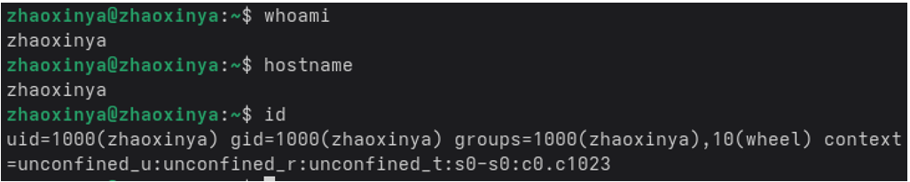{#fig-05-01 width=90%}

## Установка pass

~~~bash
sudo dnf -y install pass pass-otp
~~~

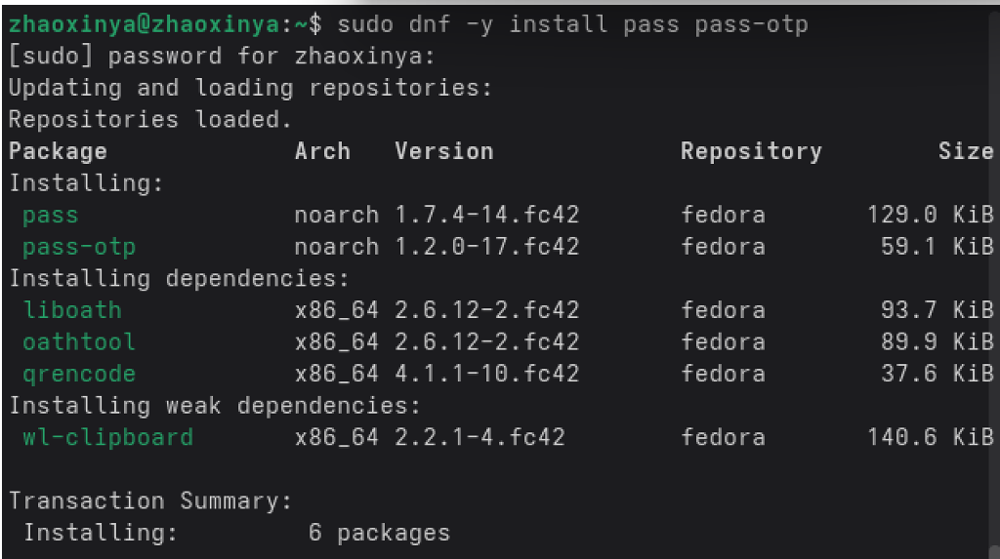{#fig-05-02 width=90%}

Проверка версии:

~~~bash
pass --version
~~~

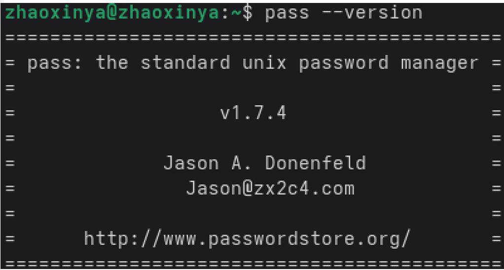{#fig-05-03 width=90%}

## Генерация GPG-ключа

~~~bash
gpg --full-generate-key
~~~

Параметры ключа:

- тип: ECC (sign and encrypt), кривая Curve 25519;
- срок действия: 0 (не истекает);
- Real name: `zhaoxinya`;
- Email address: `1132258332@rudn.ru`.

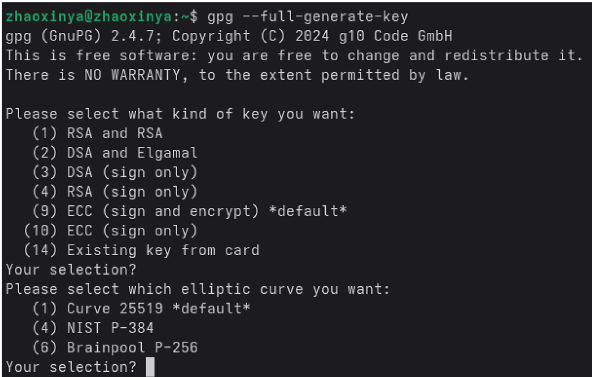{#fig-05-04 width=90%}

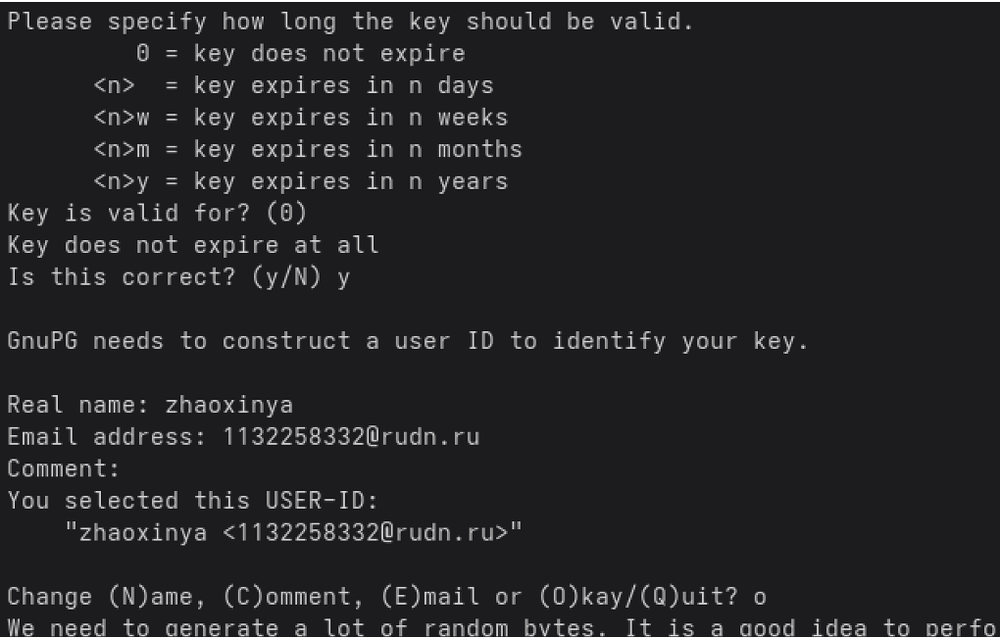{#fig-05-05 width=90%}

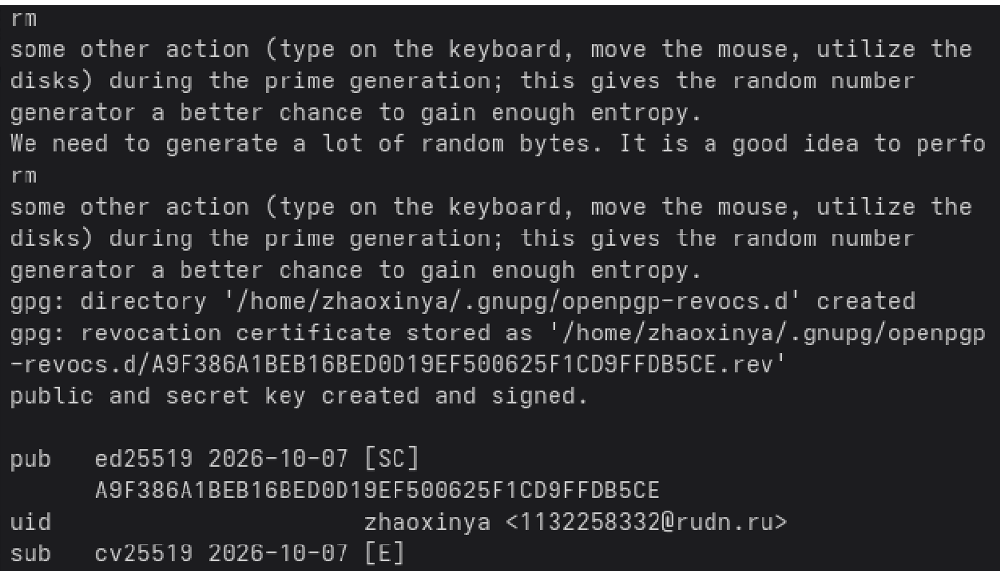{#fig-05-06 width=90%}

После генерации:

~~~bash
gpg --list-secret-keys
~~~

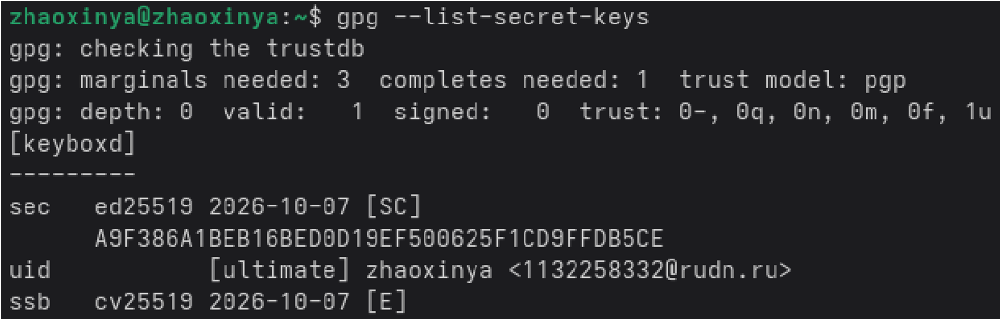{#fig-05-07 width=90%}

## Инициализация хранилища паролей

~~~bash
pass init 1132258332@rudn.ru
~~~

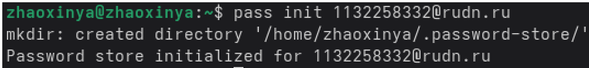{#fig-05-08 width=90%}

## Добавление тестового пароля

~~~bash
pass insert test/example.com
pass
~~~

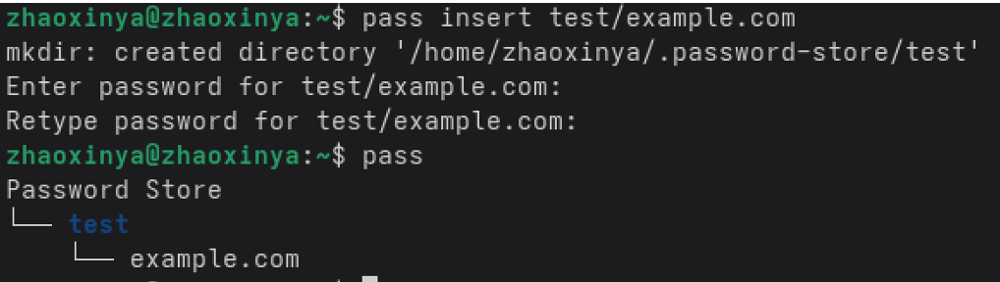{#fig-05-09 width=90%}

Извлечение пароля:

~~~bash
pass test/example.com
~~~

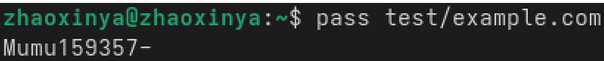{#fig-05-10 width=90%}

## Синхронизация хранилища с Git

Создание приватного репозитория на GitHub:

~~~bash
gh repo create password-store --private --description "Pass password store"
~~~

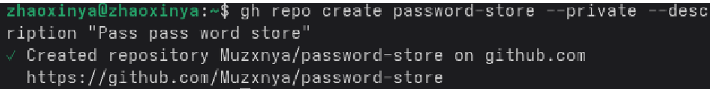{#fig-05-11 width=90%}

Инициализация git и первый push:

~~~bash
pass git init
pass git remote add origin git@github.com:Muzxnya/password-store.git
pass git push -u origin main
~~~

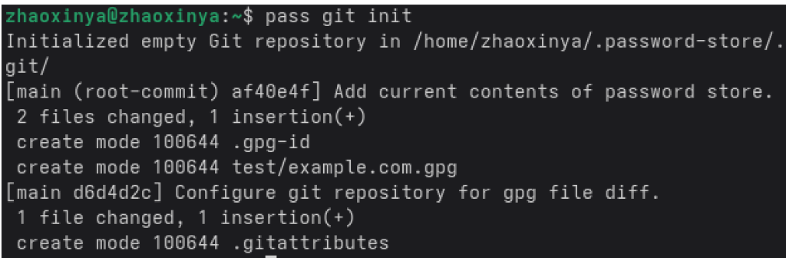{#fig-05-12 width=90%}

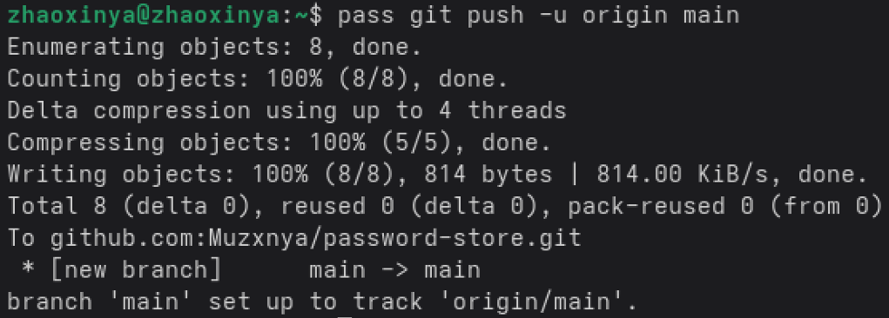{#fig-05-13 width=90%}

## Установка chezmoi

~~~bash
sh -c "$(wget -qO- chezmoi.io/get)"
chezmoi --version
~~~

## Создание репозитория dotfiles

~~~bash
gh repo create dotfiles --template="yamadharma/dotfiles-template" --private
~~~

## Инициализация chezmoi

~~~bash
chezmoi init git@github.com:Muzxnya/dotfiles.git
~~~

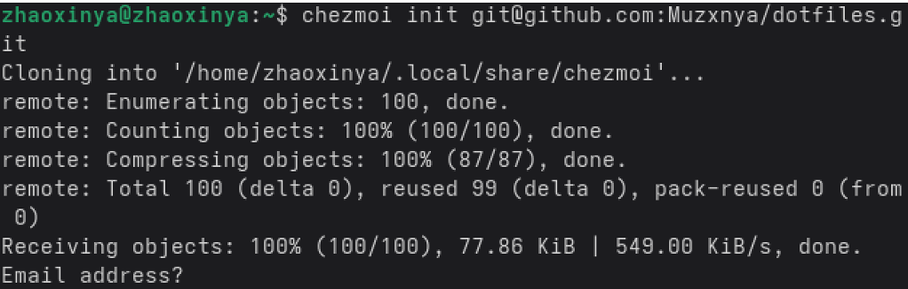{#fig-05-14 width=90%}

Проверка различий, статус, применение:

~~~bash
chezmoi diff
chezmoi status
chezmoi apply -v
~~~

После успешного применения повторный запуск `chezmoi status` не выводит ничего, что означает полное соответствие состояния домашнего каталога репозиторию `dotfiles`.

Проверка управляемых файлов:

~~~bash
chezmoi managed
~~~

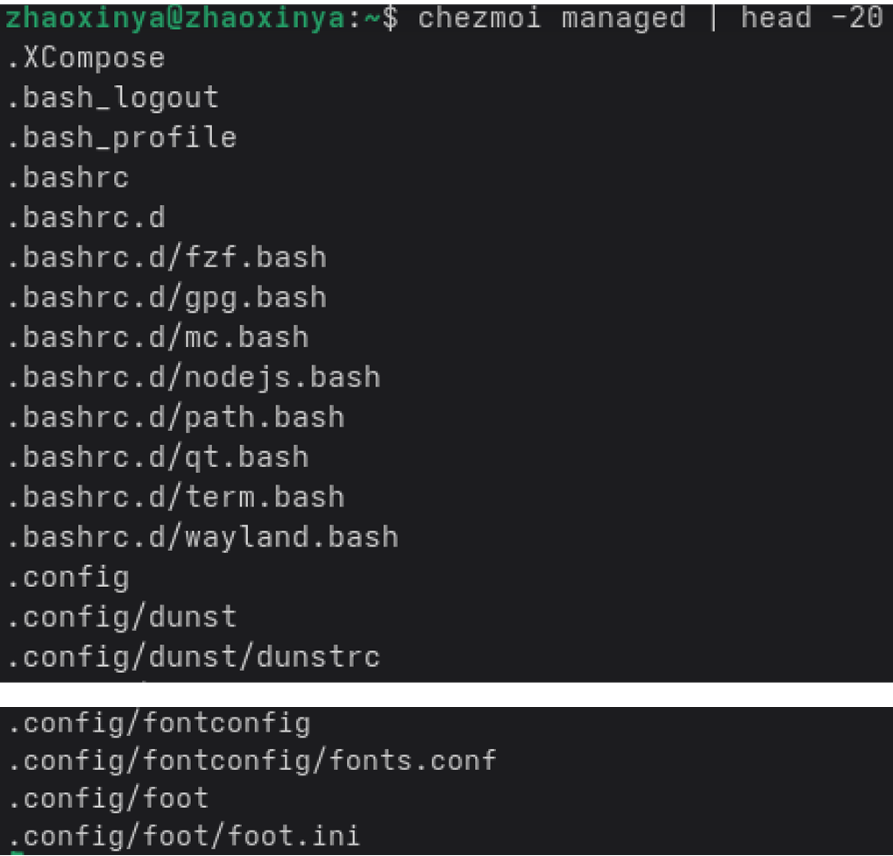{#fig-05-15 width=90%}

Просмотр переменных шаблона:

~~~bash
chezmoi data
chezmoi execute-template '{{ .chezmoi.hostname }}'
~~~

Результат:

~~~
zhaoxinya
~~~

## Ежедневные операции с chezmoi

~~~bash
chezmoi update
chezmoi git pull -- --autostash --rebase && chezmoi diff
chezmoi apply
chezmoi init --apply git@github.com:Muzxnya/dotfiles.git
~~~

## Автоматические commit и push

В файл `~/.config/chezmoi/chezmoi.toml` добавлены параметры:

~~~toml
[git]
    autoCommit = true
    autoPush = true
~~~

При этом следует помнить, что при использовании `autoPush` и публичном репозитории `dotfiles` случайно добавленный секрет будет автоматически опубликован.

# Выводы

В ходе лабораторной работы были приобретены практические навыки настройки рабочей среды пользователя в Linux:

- установлен и настроен менеджер паролей `pass`;
- создан GPG-ключ, применённый для шифрования хранилища;
- инициализировано хранилище паролей, добавлен тестовый пароль;
- настроена синхронизация хранилища паролей с приватным репозиторием на GitHub;
- установлена и настроена система управления файлами конфигурации `chezmoi`;
- создан собственный репозиторий `dotfiles` на основе шаблона;
- освоены основные команды `chezmoi`: `init`, `diff`, `apply`, `status`, `managed`, `data`, `execute-template`, `update`.

Все выполненные действия соответствуют требованиям задания лабораторной работы.

# Ответы на контрольные вопросы

## 1. Что такое менеджер паролей pass?

`pass` — стандартный менеджер паролей для Unix. Данные хранятся в файловой системе в виде дерева каталогов и файлов, каждый файл шифруется GPG-ключом. Поддерживается синхронизация с Git.

## 2. Где хранятся данные менеджера паролей pass?

В каталоге `~/.password-store/`. Каждый пароль хранится в отдельном `.gpg`-файле, структура каталогов может быть произвольной.

## 3. Как инициализировать хранилище pass?

~~~bash
pass init <pgp-id or email>
~~~

## 4. Как добавить новый пароль в pass?

~~~bash
pass insert [OPTIONAL DIR]/[FILENAME]
~~~

Например:

~~~bash
pass insert github/username
~~~

## 5. Как синхронизировать хранилище pass с Git?

~~~bash
pass git init
pass git remote add origin git@github.com:<username>/<repo>.git
pass git push -u origin main
~~~

Дальнейшая синхронизация:

~~~bash
pass git pull
pass git push
~~~

## 6. Что такое chezmoi?

`chezmoi` — утилита для управления файлами конфигурации домашнего каталога пользователя. Позволяет хранить dotfiles в репозитории Git и применять их на разных машинах.

## 7. Где chezmoi хранит исходные файлы?

В каталоге `~/.local/share/chezmoi`, который является клоном репозитория `dotfiles`.

## 8. Что делает команда chezmoi apply?

Вычисляет желаемое содержимое и права доступа для каждого файла и вносит изменения, чтобы домашний каталог соответствовал состоянию репозитория `dotfiles`.

## 9. Что такое шаблоны chezmoi?

Шаблоны используют синтаксис Go templates и позволяют изменять содержимое файла в зависимости от среды (имя хоста, ОС, архитектура и т. п.). Файл считается шаблоном, если его имя заканчивается на `.tmpl` или он находится в каталоге `.chezmoitemplates`.

## 10. Как установить dotfiles на новой машине одной командой?

~~~bash
chezmoi init --apply git@github.com:<username>/dotfiles.git
~~~

## 11. Что такое autoCommit и autoPush в chezmoi?

Это параметры конфигурации, включающие автоматическое создание commit и push изменений в репозиторий `dotfiles` при каждом изменении исходного каталога.

## 12. Почему опасно использовать autoPush с публичным репозиторием?

Потому что любой случайно добавленный секрет (пароль, токен, ключ) будет автоматически опубликован в публичном репозитории.

# Список литературы {.unnumbered}

::: {#refs}
:::