---
author:
  name: Чжао Синья
  email: 1132258332@rudn.ru
  affiliation:
    - name: Российский университет дружбы народов
      country: Российская Федерация
      city: Москва
      address: ул. Миклухо-Маклая, д. 6
title: "Лабораторная работа № 6"
subtitle: "Основы интерфейса взаимодействия пользователя с системой Unix на уровне командной строки"
license: "CC BY"
date: today
date-format: "YYYY-MM-DD"
abstract: |
  Отчёт по лабораторной работе № 6: приобретение практических навыков
  взаимодействия с операционной системой посредством командной строки.
keywords: [лабораторная работа, Unix, командная строка, bash]
---

# Цель работы

Приобретение практических навыков взаимодействия пользователя с системой посредством командной строки.

# Задание работы

1. Определить полное имя домашнего каталога.
2. Выполнить операции с каталогом `/tmp`.
3. Определить наличие подкаталога `cron` в `/var/spool`.
4. Определить владельца файлов и подкаталогов в домашнем каталоге.
5. Создать и удалить каталоги `newdir`, `morefun`, `letters`, `memos`, `misk`.
6. С помощью команды `man` определить опции `ls` для рекурсивного просмотра и сортировки по времени.
7. Изучить основные опции команд `cd`, `pwd`, `mkdir`, `rmdir`, `rm`.
8. Использовать команду `history` для модификации и повторного выполнения команд.

# Теоретические сведения

## Командная строка

Командная строка — способ взаимодействия пользователя с операционной системой посредством ввода команд в текстовом режиме. В UNIX/Linux стандартными командными интерпретаторами являются `sh`, `csh`, `ksh`, `bash`.

## Формат команды

```
<имя_команды> <разделитель> <аргументы>
```

## Команда man

~~~bash
man <команда>
~~~

Клавиши управления:

- `Space` — на страницу вперёд;
- `Enter` — на строку вперёд;
- `b` — на страницу назад;
- `q` — выход.

## Команда cd

~~~bash
cd [путь_к_каталогу]
~~~

Файловая система UNIX — иерархическая система каталогов, подкаталогов и файлов. Корневой каталог обозначается символом `/`.

## Команда ls

~~~bash
ls [-опции] [путь]
~~~

Опция `-l` выводит подробную информацию о файлах и каталогах:

- тип файла;
- права доступа;
- число ссылок;
- владелец;
- размер;
- дата последней ревизии;
- имя файла или каталога.

## Команда mkdir

~~~bash
mkdir имя_каталога1 [имя_каталога2...]
~~~

Опции:

- `-m` (или `--mode`) — установка атрибутов доступа;
- `-p` (или `--parents`) — создание каталога вместе с родительскими каталогами.

## Команда rm

~~~bash
rm [-опции] [файл]
~~~

Опции:

- `-i` — запрос подтверждения удаления;
- `-r` — рекурсивное удаление каталога с содержимым.

## Команда rmdir

Удаляет только пустой каталог. Для удаления каталога с файлами нужно использовать `rm -r`.

## Команда history

~~~bash
history
~~~

Выводит список ранее выполненных команд. Повторный вызов:

~~~bash
!<номер_команды>
~~~

Модификация и выполнение:

~~~bash
!<номер_команды>:s/<что_меняем>/<на_что_меняем>
~~~

# Соглашения об именовании

В соответствии с требованиями курса:

- имя пользователя внутри виртуальной машины: `zhaoxinya`;
- имя хоста виртуальной машины: `zhaoxinya`;
- имя виртуальной машины: `Zhaoxinya2`.

Проверка:

~~~bash
whoami
hostname
id
~~~

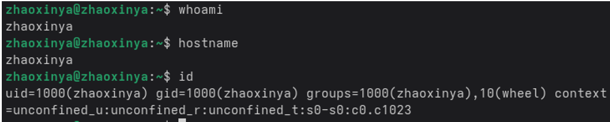{#fig-06-01 width=90%}

# Ход выполнения работы

## 1. Определение полного имени домашнего каталога

~~~bash
pwd
echo $HOME
~~~

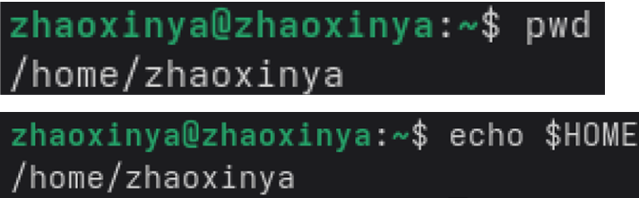{#fig-06-02 width=90%}

Результат: `/home/zhaoxinya`.

## 2. Операции с каталогом /tmp

Переход в каталог `/tmp`:

~~~bash
cd /tmp
pwd
~~~

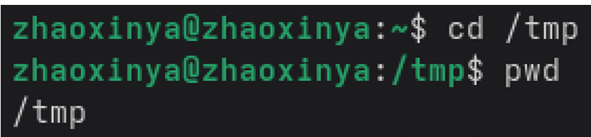{#fig-06-03 width=90%}

Вывод содержимого с разными опциями:

~~~bash
ls
ls -a
ls -l
ls -la
ls -R | head -30
~~~

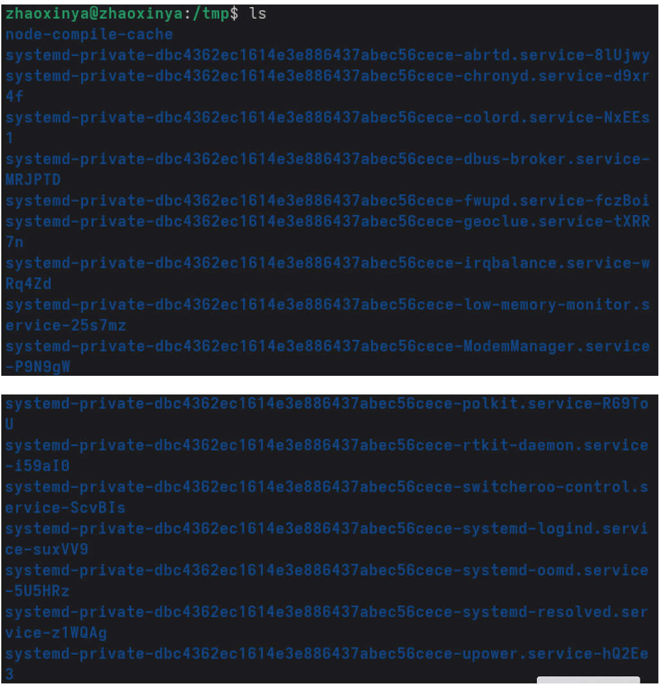{#fig-06-04 width=90%}

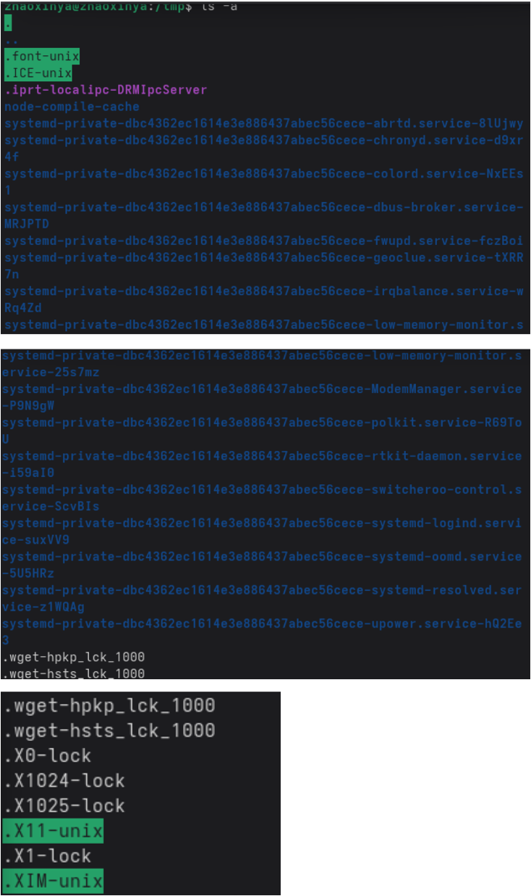{#fig-06-05 width=90%}

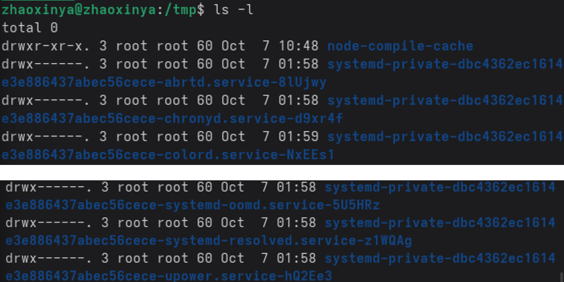{#fig-06-06 width=90%}

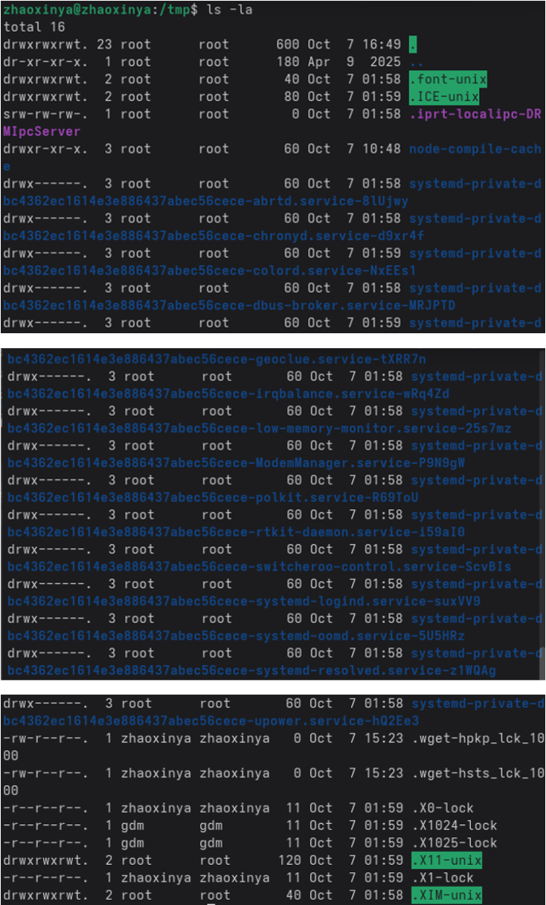{#fig-06-07 width=90%}

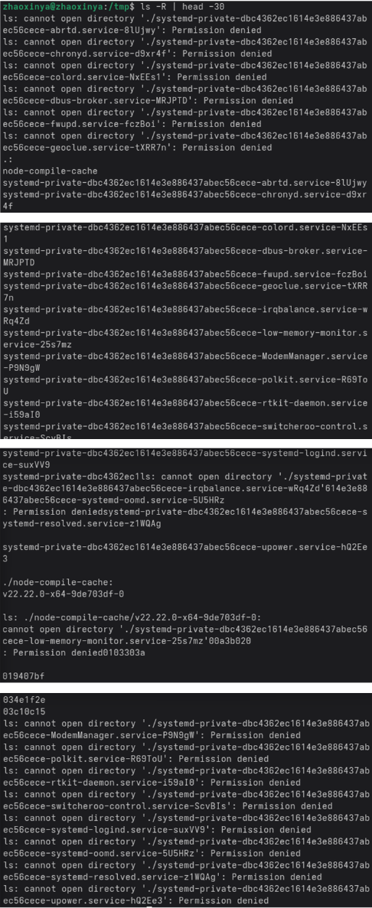{#fig-06-08 width=90%}

Разница:

- `ls` — только имена файлов;
- `ls -a` — включая скрытые файлы;
- `ls -l` — подробная информация;
- `ls -la` — подробная информация включая скрытые;
- `ls -R` — рекурсивный вывод.

Проверка наличия подкаталога `cron`:

~~~bash
ls -d /var/spool/cron 2>/dev/null && echo "cron exists" || echo "no cron"
~~~

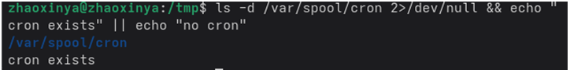{#fig-06-09 width=90%}

Возврат в домашний каталог:

~~~bash
cd ~
pwd
ls -la
~~~

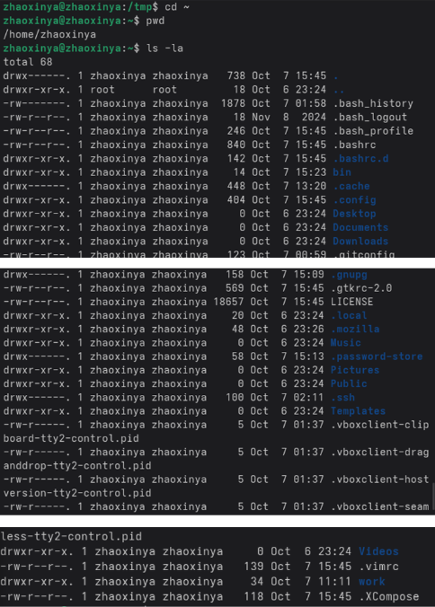{#fig-06-10 width=90%}

Определён владелец файлов и подкаталогов: `zhaoxinya`.

## 3. Создание и удаление каталогов

~~~bash
mkdir ~/newdir
mkdir ~/newdir/morefun
mkdir ~/letters ~/memos ~/misk
ls ~/ | grep -E "letters|memos|misk"
~~~

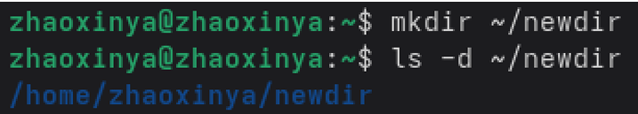{#fig-06-11 width=90%}

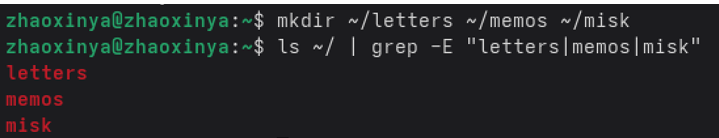{#fig-06-12 width=90%}

~~~bash
rmdir ~/letters ~/memos ~/misk
ls ~/ | grep -E "letters|memos|misk"
~~~

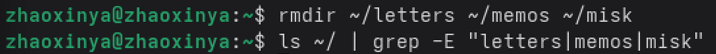{#fig-06-13 width=90%}

Удаление `~/newdir` командой `rm`:

~~~bash
rm ~/newdir
~~~

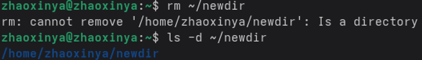{#fig-06-14 width=90%}

Результат:

~~~
rm: cannot remove '/home/zhaoxinya/newdir': Is a directory
~~~

Команда `rm` без опции `-r` не удаляет каталоги.

Удаление подкаталога:

~~~bash
rmdir ~/newdir/morefun
ls -R ~/newdir
~~~

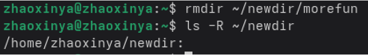{#fig-06-15 width=90%}

## 4. Определение опции ls для рекурсивного просмотра

~~~bash
man ls
~~~

Опция `-R`, `--recursive` — list subdirectories recursively.

## 5. Определение опций ls для сортировки по времени

~~~bash
man ls
~~~

- `-t` — сортировка по времени последнего изменения;
- `-l` — длинный формат.

Комбинация: `ls -lt`.

## 6. Основные опции команд

| Команда | Опции |
|---------|-------|
| `cd` | `-` предыдущий каталог, `~` домашний |
| `pwd` | `-P` физический путь |
| `mkdir` | `-p` родительские, `-m` права |
| `rmdir` | `-p` удалить пустые родительские |
| `rm` | `-i` подтверждение, `-r` рекурсивно, `-f` принудительно |

## 7. Использование истории команд

~~~bash
history
!5
!5:s/ls/ls -la/
~~~

# Выводы

В ходе лабораторной работы были приобретены практические навыки взаимодействия с операционной системой UNIX посредством командной строки:

- изучены основные команды работы с каталогами (`cd`, `pwd`, `ls`, `mkdir`, `rmdir`, `rm`);
- освоено использование различных опций команды `ls`;
- получены навыки получения справки с помощью `man`;
- изучена работа с историей команд (`history`);
- получены навыки создания и удаления каталогов, определения прав владельца.

# Ответы на контрольные вопросы

## 1. Что такое командная строка?

Командная строка — способ взаимодействия пользователя с операционной системой посредством ввода команд в текстовом режиме. В UNIX/Linux стандартными интерпретаторами являются `sh`, `csh`, `ksh`, `bash`.

## 2. Как определить абсолютный путь текущего каталога?

С помощью команды `pwd`:

~~~bash
pwd
~~~

Пример: `/home/zhaoxinya`.

## 3. Как определить только тип файлов и их имена?

~~~bash
ls -F
~~~

Опция `-F` добавляет к имени символ, обозначающий тип файла:

- `/` — каталог;
- `*` — исполняемый файл;
- `@` — символическая ссылка.

## 4. Как отобразить информацию о скрытых файлах?

~~~bash
ls -a
ls -la
~~~

Скрытые файлы в UNIX начинаются с точки.

## 5. Как удалить файл и каталог?

Файл:

~~~bash
rm file.txt
~~~

Каталог:

~~~bash
rm -r dir
~~~

или

~~~bash
rmdir dir
~~~

`rmdir` удаляет только пустые каталоги.

## 6. Как вывести информацию о последних командах?

~~~bash
history
~~~

## 7. Как воспользоваться историей команд для модифицированного выполнения?

~~~bash
!<номер>:s/<что_меняем>/<на_что_меняем>
~~~

Пример:

~~~bash
!3:s/a/F
~~~

## 8. Примеры запуска нескольких команд в одной строке

~~~bash
cd /tmp && ls -la
mkdir a b c && ls
pwd; whoami
~~~

## 9. Что такое символы экранирования?

Символ `\` снимает специальный смысл с метасимвола:

~~~bash
echo \*
echo ab\*cd
~~~

Метасимволы в кавычках:

~~~bash
echo '*'
echo "*"
~~~

## 10. Что выводит ls -l?

`ls -l` выводит:

- тип файла;
- права доступа;
- число ссылок;
- владельца;
- группу;
- размер;
- дату последней ревизии;
- имя.

## 11. Что такое относительный путь?

Путь, начинающийся не от корня, а от текущего каталога.

~~~bash
cd ~/work
ls .
./file.txt
~~~

Абсолютный путь начинается с `/`:

~~~bash
ls /etc/hosts
~~~

## 12. Как получить информацию о команде?

~~~bash
man <команда>
<команда> --help
~~~

## 13. Какая клавиша служит для автоматического дополнения команд?

Клавиша `Tab`.

# Список литературы {.unnumbered}

::: {#refs}
:::