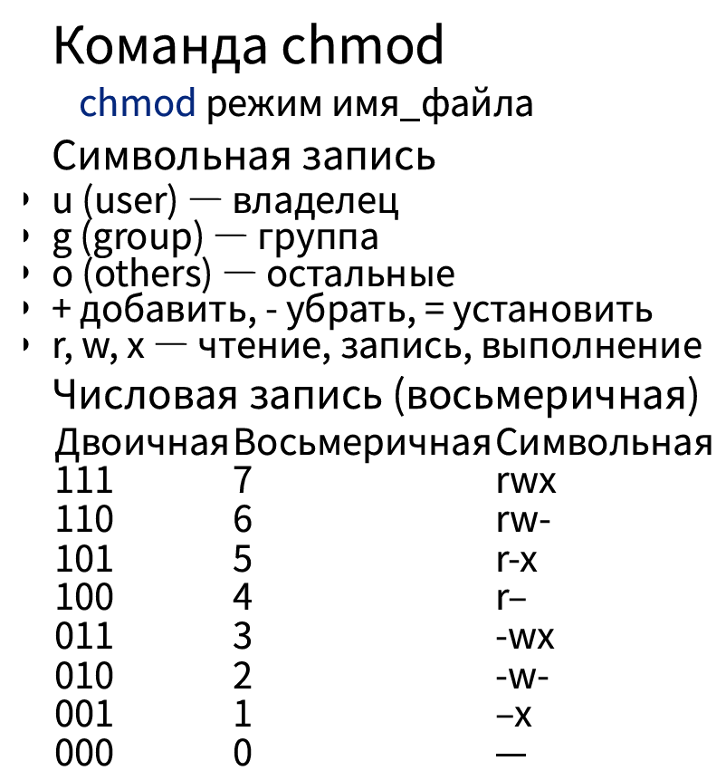
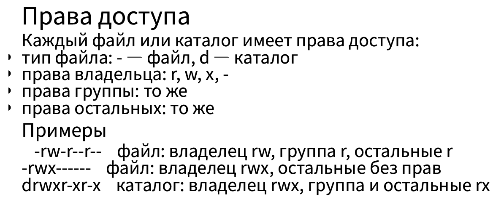

---
author:
  name: Чжао Синья
  email: 1132258332@rudn.ru
  affiliation:
    - name: Российский университет дружбы народов
      country: Российская Федерация
      city: Москва
      address: ул. Миклухо-Маклая, д. 6
title: "Лабораторная работа № 7"
subtitle: "Анализ файловой системы Linux. Команды для работы с файлами и каталогами"
license: "CC BY"
date: today
date-format: "YYYY-MM-DD"
---

# Информация

## Докладчик

:::::::::::::: {.columns align=center}
::: {.column width="70%"}

- Чжао Синья
- студент 1 курса
- направление «Компьютерная инженерия»
- Российский университет дружбы народов
- [1132258332@rudn.ru](mailto:1132258332@rudn.ru)

:::
::: {.column width="30%"}

:::
::::::::::::::

# Введение

## Цель работы

Ознакомление с файловой системой Linux, её структурой, именами и содержанием каталогов.

Приобретение практических навыков:

- по применению команд для работы с файлами и каталогами;
- по управлению процессами;
- по проверке использования диска;
- по обслуживанию файловой системы.

## Задание работы

1. Ознакомиться с основными командами для работы с файлами и каталогами.
2. Освоить команды копирования (`cp`), перемещения и переименования (`mv`).
3. Изучить права доступа и команды изменения прав (`chmod`).
4. Проанализировать файловую систему (`mount`, `/etc/fstab`, `df`, `du`, `fsck`).
5. Выполнить задания по работе с файлами и каталогами.
6. Изучить основные опции команд `mount`, `fsck`, `mkfs`, `kill`.

## Команды для просмотра файлов

~~~bash
touch имя_файла        # создание
cat имя_файла          # просмотр
less имя_файла         # постранично
head [-n] имя_файла    # первые строки
tail [-n] имя_файла    # последние строки
~~~

`less`: `Space` вперёд, `Enter` строка, `b` назад, `h` справка, `q` выход.

## Команда cp

~~~bash
cp [-опции] исходный_файл целевой_файл
~~~

- `-i` — запрос подтверждения при перезаписи;
- `-r` — рекурсивное копирование каталогов.

## Команда mv

~~~bash
mv [-опции] старый_файл новый_файл
~~~

- `-i` — запрос подтверждения перезаписи.

## Права доступа

Каждый файл или каталог имеет права доступа:

- тип файла: `-` — файл, `d` — каталог;
- права владельца: `r`, `w`, `x`, `-`;
- права группы: то же;
- права остальных: то же.

Примеры:

~~~
-rw-r--r--   файл: владелец rw, группа r, остальные r
-rwx------   файл: владелец rwx, остальные без прав
drwxr-xr-x   каталог: владелец rwx, группа и остальные rx
~~~

{#fig-07-pres-01 width=100%}

## Команда chmod

~~~bash
chmod режим имя_файла
~~~

Символьная запись:

- `u` (user) — владелец;
- `g` (group) — группа;
- `o` (others) — остальные;
- `+` добавить, `-` убрать, `=` установить;
- `r`, `w`, `x` — чтение, запись, выполнение.

Числовая запись (восьмеричная):

| Двоичная | Восьмеричная | Символьная |
|----------|--------------|------------|
| 111 | 7 | rwx |
| 110 | 6 | rw- |
| 101 | 5 | r-x |
| 100 | 4 | r-- |
| 011 | 3 | -wx |
| 010 | 2 | -w- |
| 001 | 1 | --x |
| 000 | 0 | --- |

{#fig-07-pres-02 width=100%}

## Файловые системы

Основные файловые системы Linux: ext2fs, ext3fs, ext4, ReiserFS, xfs, fat, ntfs.

~~~bash
mount            # смонтированные ФС
cat /etc/fstab   # таблица монтирования
df -h            # использование диска
du -sh ~         # объём каталога
fsck устройство  # проверка ФС
~~~

## Соглашения об именовании

- Пользователь ВМ: `zhaoxinya`
- Имя хоста: `zhaoxinya`
- Имя виртуальной машины: `Zhaoxinya2`

Проверка:

~~~bash
whoami
hostname
id
~~~

Результат: `zhaoxinya`, `zhaoxinya`, `uid=1000(zhaoxinya) ...`

# Ход работы

## 1. Подготовка файлов

~~~bash
cd ~
touch abc1
echo "content of abc1" > abc1
ls -l abc1
~~~

Результат:

~~~
-rw-r--r--. 1 zhaoxinya zhaoxinya 16 Oct 7 17:42 abc1
~~~

## 2. Команда cp

~~~bash
cd ~
cp abc1 april
cp abc1 may
ls -l april may

mkdir monthly
cp april may monthly
ls monthly

cp monthly/may monthly/june
ls monthly

mkdir monthly.00
cp -r monthly monthly.00
ls monthly.00

cp -r monthly.00 /tmp
ls /tmp | grep monthly
~~~

Результаты:

- `april`, `may` созданы;
- `monthly` содержит `april june may`;
- `monthly.00` содержит `monthly`;
- `/tmp/monthly.00` создан.

## 3. Команда mv

~~~bash
cd ~
mv april july
mv july monthly.00
mv monthly.00 monthly.01
mkdir reports
mv monthly.01 reports
mv reports/monthly.01 reports/monthly
ls reports
~~~

Результат: `monthly`.

## 4. Права доступа (chmod)

~~~bash
cd ~
touch may
chmod u+x may
ls -l may
# -rwxr--r--

chmod u-x may
ls -l may
# -rw-r--r--

mkdir -p monthly_perm
chmod g-r,o-r monthly_perm
ls -ld monthly_perm
# drwx--x--x

chmod g+w abc1
ls -l abc1
# -rw-rw-r--
~~~

## 5. Анализ файловой системы

~~~bash
mount | head -20
~~~

Ключевые строки:

~~~
/dev/sda3 on / type btrfs (rw,relatime,...,subvol=/root)
/dev/sda2 on /boot type ext4
tmpfs on /tmp type tmpfs
~~~

~~~bash
cat /etc/fstab
~~~

Ключевые строки:

~~~
UUID=... /      btrfs  subvol=root,compress=zstd:1  0 0
UUID=... /boot  ext4   defaults                      1 2
UUID=... /home  btrfs  subvol=home,compress=zstd:1  0 0
~~~

~~~bash
df -h
du -sh ~
~~~

Результат:

~~~
/dev/sda3  79G  4.4G  74G   6% /
/dev/sda2 974M  326M  581M  36% /boot
/dev/sda3  79G  4.4G  74G   6% /home

523M  /home/zhaoxinya
~~~

## 6. Задания: работа с файлами

~~~bash
# 3(a)
cp /etc/hosts ~/equipment
# 3(b)
mkdir ~/ski.plases
# 3(c)
mv ~/equipment ~/ski.plases/
# 3(d)
mv ~/ski.plases/equipment ~/ski.plases/equiplist
# 3(e)
cp ~/abc1 ~/ski.plases/equiplist2
# 3(f)
mkdir ~/ski.plases/equipment
# 3(g)
mv ~/ski.plases/equiplist ~/ski.plases/equiplist2 ~/ski.plases/equipment/
ls -R ~/ski.plases/
# 3(h)
mv ~/newdir ~/ski.plases/plans
ls -R ~/ski.plases/
~~~

Структура после задания 3:

~~~
/home/zhaoxinya/ski.plases/:
equipment  plans

/home/zhaoxinya/ski.plases/equipment:
equiplist  equiplist2

/home/zhaoxinya/ski.plases/plans:
~~~

## 7. Права доступа (задание 4)

~~~bash
cd ~/ski.plases
mkdir -p australia play
touch my_os feathers

chmod 744 australia   # drwxr--r--
chmod 711 play        # drwx--x--x
chmod 544 my_os       # -r-xr--r--
chmod 664 feathers    # -rw-rw-r--
~~~

## 8. Задание 5

~~~bash
cd ~/ski.plases
cp feathers file.old
mv file.old play/
cp -r play fun
mv fun play/games
ls -R play/
~~~

Результат:

~~~
play/:
file.old  games

play/games:
file.old
~~~

## Отмена и восстановление прав

~~~bash
# Отмена чтения
chmod u-r feathers
ls -l feathers       # --w-rw-r--
cat feathers         # Permission denied
cp feathers feathers.copy  # Permission denied

# Восстановление
chmod u+r feathers

# Отмена выполнения каталога
chmod u-x play
cd play              # Permission denied

# Восстановление
cd ~
chmod u+x ~/ski.plases/play
ls -ld ~/ski.plases/play
~~~

## 9. Основные опции команд (задание 6)

| Команда | Назначение | Основные опции |
|---------|-----------|----------------|
| `mount` | Монтирование ФС | `-t` тип, `-o` опции, `-a` все |
| `fsck` | Проверка/восстановление ФС | `-y` все «да», `-f` принудительно, `-A` все |
| `mkfs` | Создание ФС | `-t` тип, `-L` метка |
| `kill` | Отправка сигнала процессу | `-9` SIGKILL, `-15` SIGTERM |

# Заключение

## Выводы

- Изучена файловая система Linux (`btrfs` для корня и `/home`, `ext4` для `/boot`).
- Изучены основные команды работы с файлами и каталогами: `touch`, `cat`, `less`, `head`, `tail`, `cp`, `mv`, `rm`, `mkdir`, `rmdir`.
- Изучены команды изменения прав доступа `chmod` (символьная и числовая запись).
- Изучены команды анализа файловой системы: `mount`, `/etc/fstab`, `df`, `du`, `fsck`.
- Практически подтверждено влияние прав доступа на возможность чтения файлов, копирования и входа в каталог.
- Изучены основные опции команд `mount`, `fsck`, `mkfs`, `kill`.

## Спасибо за внимание!

Репозиторий курса: <https://github.com/Muzxnya/study_202602-202606_os-intro>