---
author:
  name: Чжао Синья
  email: 1132258332@rudn.ru
  affiliation:
    - name: Российский университет дружбы народов
      country: Российская Федерация
      city: Москва
      address: ул. Миклухо-Маклая, д. 6
title: "Лабораторная работа № 7"
subtitle: "Анализ файловой системы Linux. Команды для работы с файлами и каталогами"
license: "CC BY"
date: today
date-format: "YYYY-MM-DD"
abstract: |
  Отчёт по лабораторной работе № 7: ознакомление с файловой системой Linux,
  командами работы с файлами и каталогами, правами доступа.
keywords: [лабораторная работа, Linux, файловая система, chmod]
---

# Цель работы

Ознакомление с файловой системой Linux, её структурой, именами и содержанием каталогов. Приобретение практических навыков по применению команд для работы с файлами и каталогами, по управлению процессами, по проверке использования диска и обслуживанию файловой системы.

# Задание работы

1. Ознакомиться с основными командами для работы с файлами и каталогами.
2. Освоить команды копирования (`cp`), перемещения и переименования (`mv`).
3. Изучить права доступа и команды изменения прав (`chmod`).
4. Проанализировать файловую систему (`mount`, `/etc/fstab`, `df`, `du`, `fsck`).
5. Выполнить задания по работе с файлами и каталогами.
6. Изучить основные опции команд `mount`, `fsck`, `mkfs`, `kill`.

# Теоретические сведения

## Команды для просмотра файлов

- `touch имя_файла` — создание пустого файла;
- `cat имя_файла` — просмотр небольших файлов;
- `less имя_файла` — постраничный просмотр;
- `head [-n] имя_файла` — первые строки;
- `tail [-n] имя_файла` — последние строки.

## Команда cp

~~~bash
cp [-опции] исходный_файл целевой_файл
~~~

Опции:

- `-i` — запрос подтверждения при перезаписи;
- `-r` — рекурсивное копирование каталогов.

## Команда mv

~~~bash
mv [-опции] старый_файл новый_файл
~~~

Опция `-i` — запрос подтверждения перезаписи.

## Права доступа

- тип файла: `-` — файл, `d` — каталог;
- права владельца, группы и остальных: `r`, `w`, `x`, `-`.

Примеры:

- `-rw-r--r--` — файл: владелец `rw`, группа `r`, остальные `r`;
- `-rwx------` — файл: владелец `rwx`, остальные без прав;
- `drwxr-xr-x` — каталог: владелец `rwx`, группа и остальные `rx`.

## Команда chmod

Символьная запись:

- `u` — владелец;
- `g` — группа;
- `o` — остальные;
- `+`, `-`, `=` — добавить, убрать, установить.

Числовая запись:

| Двоичная | Восьмеричная | Символьная |
|----------|--------------|------------|
| 111 | 7 | rwx |
| 110 | 6 | rw- |
| 101 | 5 | r-x |
| 100 | 4 | r-- |
| 011 | 3 | -wx |
| 010 | 2 | -w- |
| 001 | 1 | --x |
| 000 | 0 | --- |

## Файловые системы

Основные ФС Linux: ext2fs, ext3fs, ext4, ReiserFS, xfs, fat, ntfs.

~~~bash
mount           # смонтированные ФС
cat /etc/fstab  # таблица монтирования
df -h           # использование диска
du -sh ~        # объём каталога
fsck устройство # проверка ФС
~~~

# Соглашения об именовании

- Пользователь ВМ: `zhaoxinya`
- Имя хоста: `zhaoxinya`
- Имя виртуальной машины: `Zhaoxinya2`

Проверка:

~~~bash
whoami
hostname
id
~~~

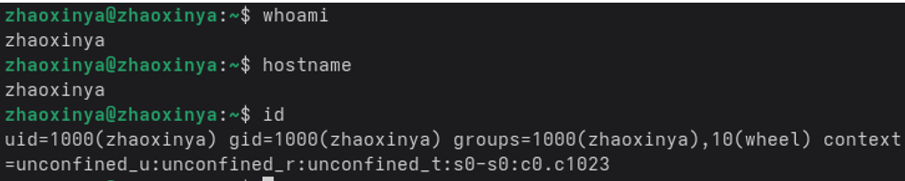{#fig-07-01 width=90%}

# Ход выполнения работы

## 1. Подготовка файлов

~~~bash
cd ~
touch abc1
echo "content of abc1" > abc1
ls -l abc1
~~~

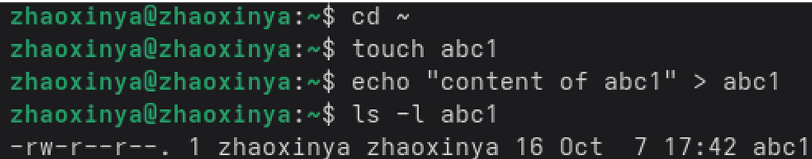{#fig-07-02 width=90%}

## 2. Команда cp

~~~bash
cd ~
cp abc1 april
cp abc1 may
ls -l april may
~~~

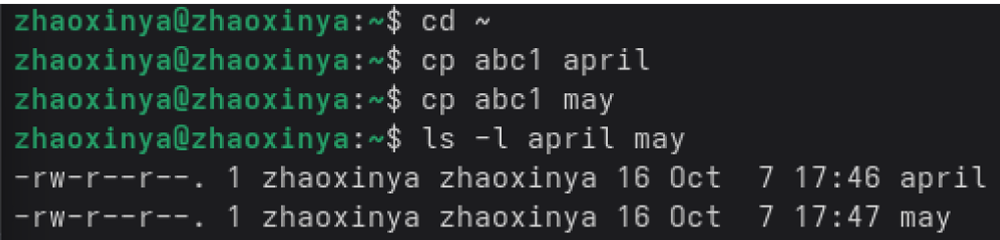{#fig-07-03 width=90%}

~~~bash
mkdir monthly
cp april may monthly
ls monthly
~~~

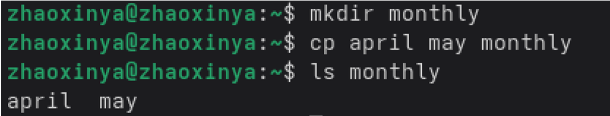{#fig-07-04 width=90%}

~~~bash
cp monthly/may monthly/june
ls monthly
~~~

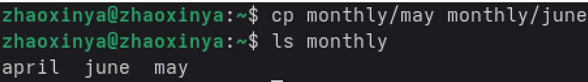{#fig-07-05 width=90%}

~~~bash
mkdir monthly.00
cp -r monthly monthly.00
ls monthly.00
~~~

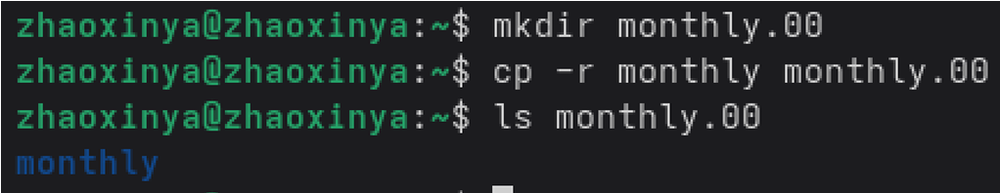{#fig-07-06 width=90%}

~~~bash
cp -r monthly.00 /tmp
ls /tmp | grep monthly
~~~

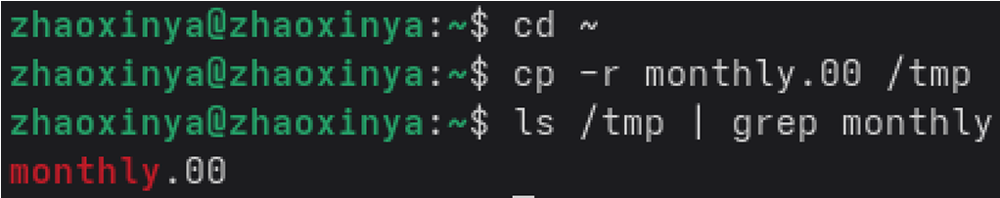{#fig-07-07 width=90%}

## 3. Команда mv

~~~bash
cd ~
mv april july
ls -l july
~~~

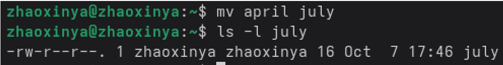{#fig-07-08 width=90%}

~~~bash
mv july monthly.00
ls monthly.00
~~~

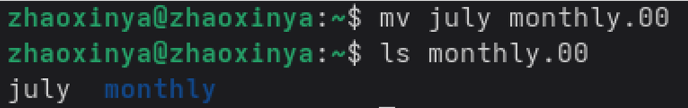{#fig-07-09 width=90%}

~~~bash
mv monthly.00 monthly.01
mkdir reports
mv monthly.01 reports
mv reports/monthly.01 reports/monthly
ls reports
~~~

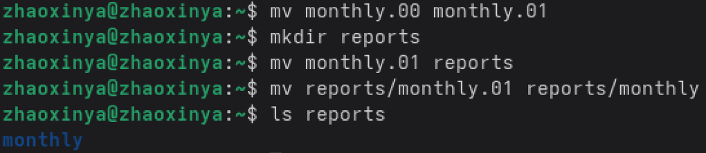{#fig-07-10 width=90%}

## 4. Права доступа (chmod)

~~~bash
cd ~
touch may
chmod u+x may
ls -l may
~~~

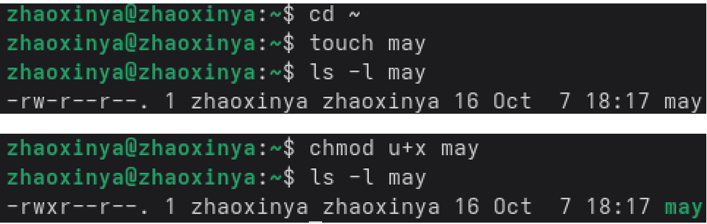{#fig-07-11 width=90%}

~~~bash
chmod u-x may
ls -l may
~~~

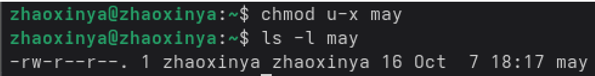{#fig-07-12 width=90%}

~~~bash
mkdir -p monthly_perm
chmod g-r,o-r monthly_perm
ls -ld monthly_perm
~~~

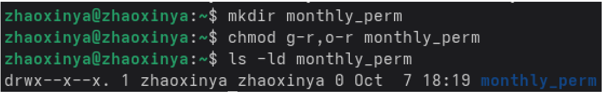{#fig-07-13 width=90%}

~~~bash
chmod g+w abc1
ls -l abc1
~~~

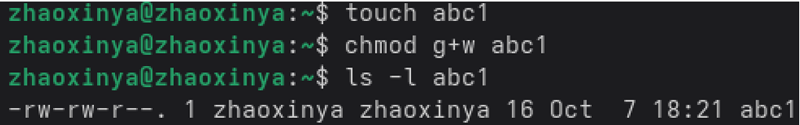{#fig-07-14 width=90%}

## 5. Анализ файловой системы

~~~bash
mount | head -20
~~~

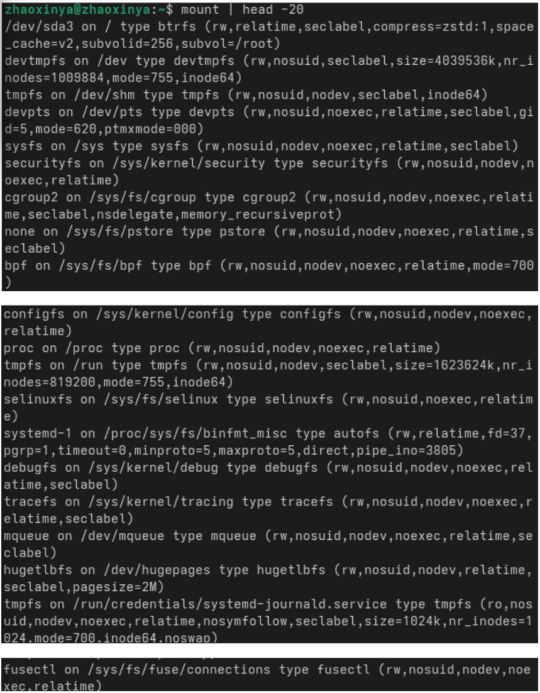{#fig-07-15 width=90%}

~~~bash
cat /etc/fstab
~~~

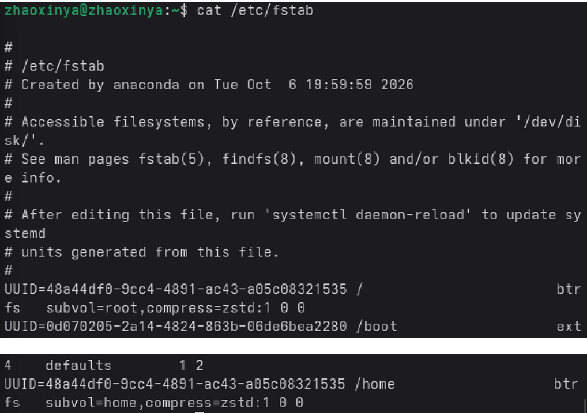{#fig-07-16 width=90%}

~~~bash
df -h
~~~

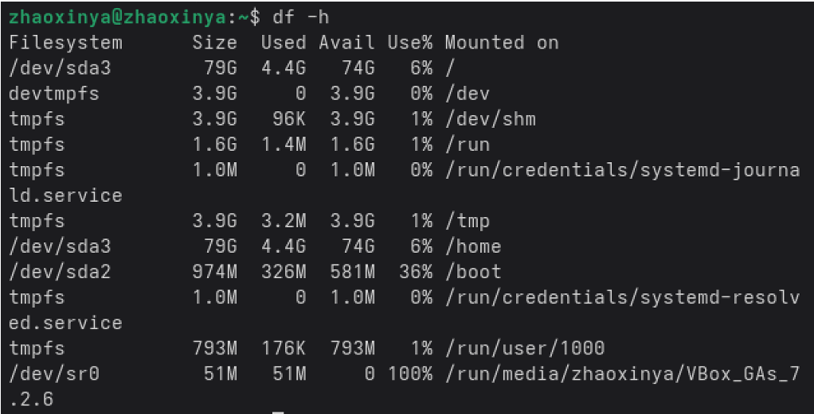{#fig-07-17 width=90%}

~~~bash
du -sh ~
~~~

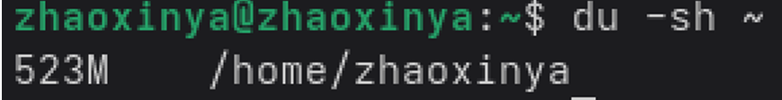{#fig-07-18 width=90%}

## 6. Задания по работе с файлами и каталогами

### 3(a) Копирование /etc/hosts в equipment

~~~bash
cp /etc/hosts ~/equipment
~~~

### 3(b) Создание каталога ski.plases

~~~bash
mkdir ~/ski.plases
~~~

### 3(c) Перемещение equipment

~~~bash
mv ~/equipment ~/ski.plases/
~~~

### 3(d) Переименование в equiplist

~~~bash
mv ~/ski.plases/equipment ~/ski.plases/equiplist
~~~

### 3(e) Копирование abc1 в equiplist2

~~~bash
cp ~/abc1 ~/ski.plases/equiplist2
~~~

### 3(f) Создание каталога equipment

~~~bash
mkdir ~/ski.plases/equipment
~~~

### 3(g) Перемещение файлов в equipment

~~~bash
mv ~/ski.plases/equiplist ~/ski.plases/equiplist2 ~/ski.plases/equipment/
ls -R ~/ski.plases/
~~~

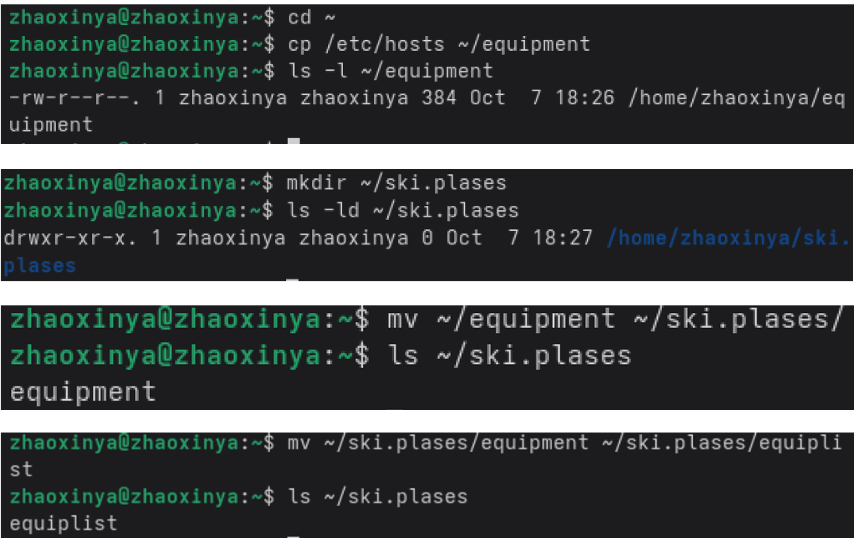{#fig-07-19 width=90%}

### 3(h) Перемещение newdir в plans

~~~bash
mv ~/newdir ~/ski.plases/plans
ls -R ~/ski.plases/
~~~

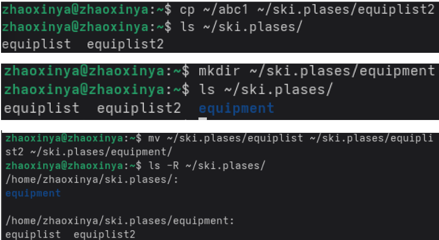{#fig-07-20 width=90%}

## 7. Права доступа (задание 4)

~~~bash
cd ~/ski.plases
mkdir -p australia play
touch my_os feathers

chmod 744 australia
chmod 711 play
chmod 544 my_os
chmod 664 feathers
~~~

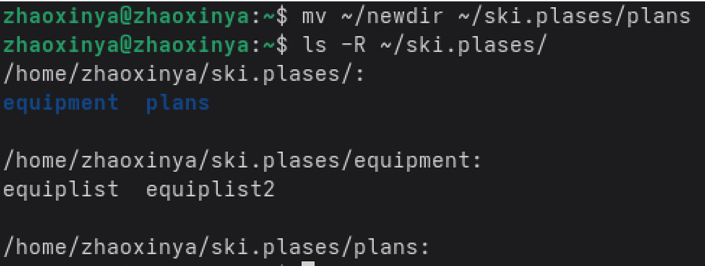{#fig-07-21 width=90%}

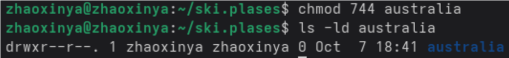{#fig-07-22 width=90%}

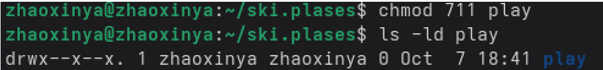{#fig-07-23 width=90%}

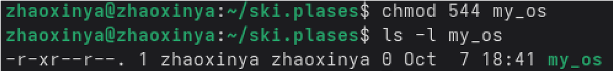{#fig-07-24 width=90%}

## 8. Задание 5

~~~bash
cd ~/ski.plases
cp feathers file.old
mv file.old play/
ls play/
~~~

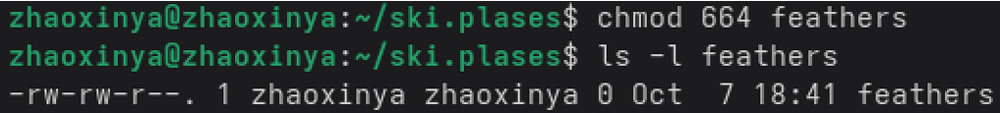{#fig-07-25 width=90%}

~~~bash
cp -r play fun
mv fun play/games
ls -R play/
~~~

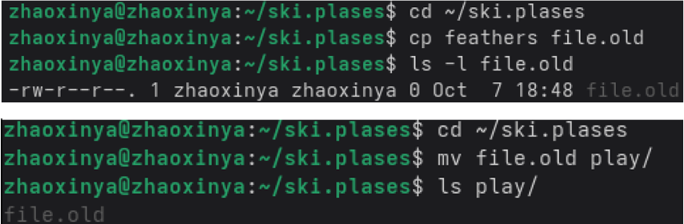{#fig-07-26 width=90%}

## Отмена и восстановление прав

### Отмена чтения

~~~bash
chmod u-r feathers
ls -l feathers
~~~

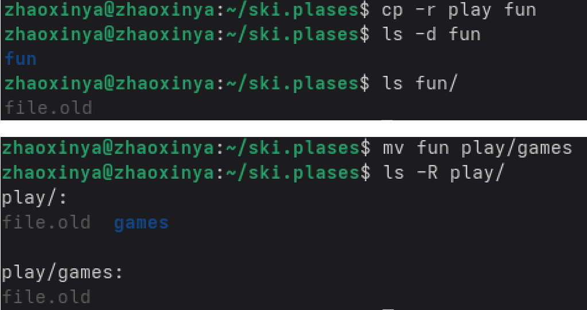{#fig-07-27 width=90%}

~~~bash
cat feathers
~~~

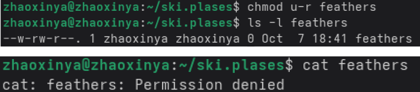{#fig-07-28 width=90%}

~~~bash
cp feathers feathers.copy
~~~

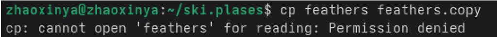{#fig-07-29 width=90%}

### Восстановление чтения

~~~bash
chmod u+r feathers
ls -l feathers
~~~

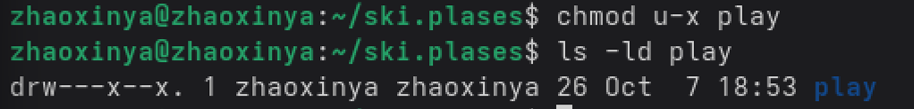{#fig-07-30 width=90%}

### Отмена выполнения каталога

~~~bash
chmod u-x play
ls -ld play
cd play
~~~

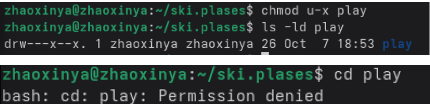{#fig-07-31 width=90%}

~~~bash
cd ~
chmod u+x ~/ski.plases/play
ls -ld ~/ski.plases/play
~~~

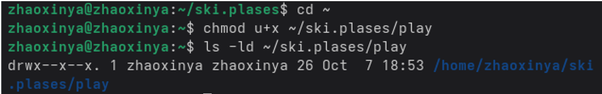{#fig-07-32 width=90%}

## 9. Основные опции команд (задание 6)

| Команда | Назначение | Основные опции |
|---------|-----------|----------------|
| `mount` | Монтирование ФС | `-t` — тип, `-o` — опции, `-a` — все |
| `fsck` | Проверка/восстановление ФС | `-y` — все «да», `-f` — принудительно, `-A` — все |
| `mkfs` | Создание ФС | `-t` — тип, `-L` — метка |
| `kill` | Отправка сигнала процессу | `-9` — SIGKILL, `-15` — SIGTERM |

~~~bash
man mount
~~~

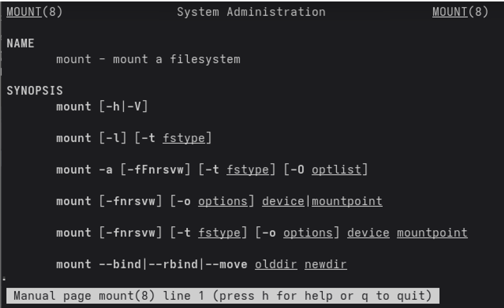{#fig-07-33 width=90%}

~~~bash
man fsck
~~~

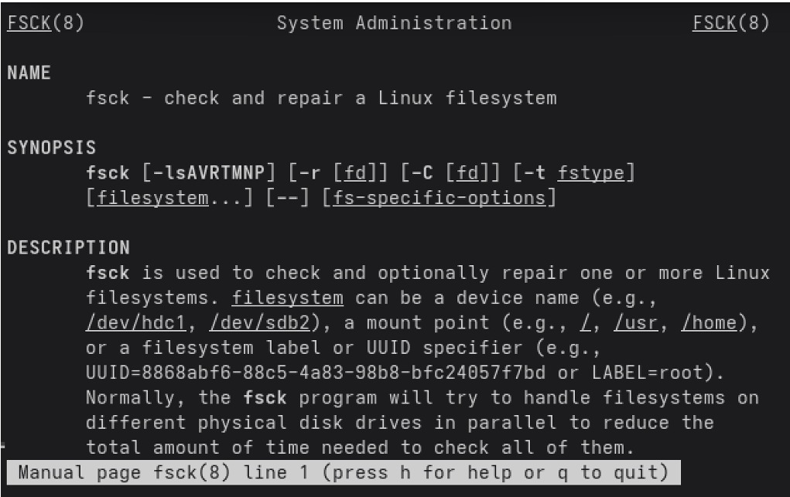{#fig-07-34 width=90%}

~~~bash
man mkfs
~~~

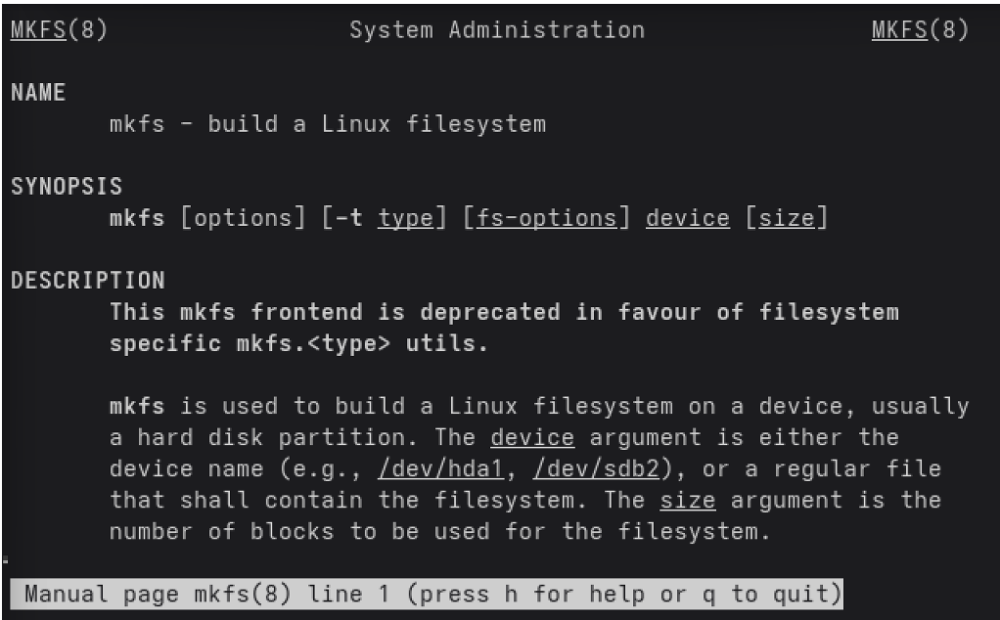{#fig-07-35 width=90%}

~~~bash
man kill
~~~

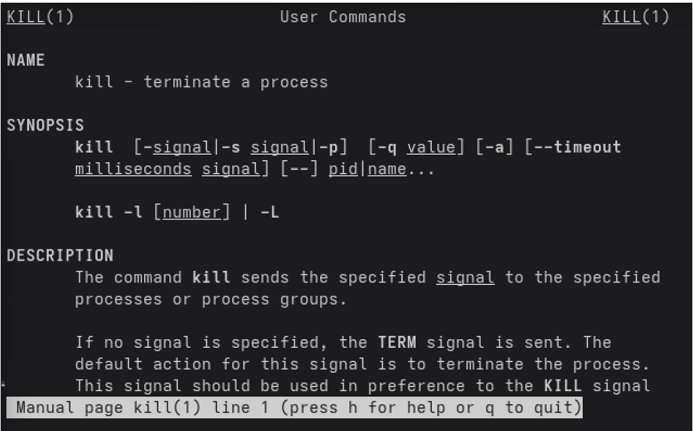{#fig-07-36 width=90%}

# Выводы

В ходе лабораторной работы были изучены:

- файловая система Linux (btrfs для корня и `/home`, ext4 для `/boot`);
- основные команды работы с файлами и каталогами: `touch`, `cat`, `less`, `head`, `tail`, `cp`, `mv`, `rm`, `mkdir`, `rmdir`;
- команды изменения прав доступа `chmod` (символьная и числовая запись);
- команды анализа файловой системы: `mount`, `/etc/fstab`, `df`, `du`, `fsck`;
- работа с правами доступа: изменение прав, влияние отсутствия прав на выполнение операций (`cat`, `cp`, `cd`);
- основные опции команд `mount`, `fsck`, `mkfs`, `kill`.

Практически подтверждено влияние прав доступа на возможность чтения файлов, копирования и входа в каталог.

# Ответы на контрольные вопросы

## 1. Что такое файловая система?

Файловая система — часть операционной системы, обеспечивающая организацию, хранение и доступ к файлам и каталогам на носителе информации.

Примеры: `ext4` (журналируемая, стандартная для Linux), `btrfs` (современная, снапшоты и сжатие), `xfs` (высокопроизводительная), `ntfs` (для Windows), `fat` (совместимая, с ограничениями).

## 2. Какие команды для просмотра файлов вы знаете?

~~~bash
cat file
less file
head -n file
tail -n file
~~~

## 3. Как создать каталог?

~~~bash
mkdir dir
mkdir -p dir1/dir2/dir3
mkdir -m 755 dir
~~~

## 4. Как скопировать файл или каталог?

~~~bash
cp file1 file2
cp -r dir1 dir2
cp -i file1 file2
~~~

## 5. Как переместить или переименовать файл?

~~~bash
mv old new
mv file dir/
~~~

## 6. Как удалить файл и каталог?

~~~bash
rm file
rm -r dir
rmdir dir
~~~

## 7. Как изменить права доступа?

~~~bash
chmod 755 file
chmod u+x file
chmod g-r file
~~~

## 8. Что такое права доступа?

Права доступа определяют, какие действия может выполнять владелец, члены группы и остальные пользователи над файлом или каталогом.

Числовая запись: `r` = 4, `w` = 2, `x` = 1.

## 9. Как посмотреть смонтированные файловые системы?

~~~bash
mount
cat /proc/mounts
df -h
cat /etc/fstab
~~~

## 10. Как определить объём каталога?

~~~bash
du -sh ~
du -a ~
~~~

## 11. Приведите основные возможности команды mv.

- Перемещение файлов и каталогов.
- Переименование.
- Опция `-i` — запрос подтверждения перезаписи.
- Опция `-r` — рекурсивное перемещение (не требуется, но иногда полезно).

## 12. Что такое права доступа? Как они могут быть изменены?

Права доступа определяют, кто и что может делать с файлом или каталогом. Изменяются командой `chmod`:

- символьная запись: `u`, `g`, `o`, `+`, `-`, `=`;
- числовая запись: восьмеричное число.

# Список литературы {.unnumbered}

::: {#refs}
:::