---
author:
  name: Чжао Синья
  email: 1132258332@rudn.ru
  affiliation:
    - name: Российский университет дружбы народов
      country: Российская Федерация
      city: Москва
      address: ул. Миклухо-Маклая, д. 6
title: "Лабораторная работа № 8"
subtitle: "Поиск файлов. Перенаправление ввода-вывода. Просмотр запущенных процессов"
license: "CC BY"
date: today
date-format: "YYYY-MM-DD"
abstract: |
  Отчёт по лабораторной работе № 8: инструменты поиска файлов и фильтрации
  текстовых данных, управление процессами.
keywords: [лабораторная работа, find, grep, процессы, pipe]
---

# Цель работы

Ознакомление с инструментами поиска файлов и фильтрации текстовых данных. Приобретение практических навыков по управлению процессами (и заданиями), по проверке использования диска и обслуживанию файловых систем.

# Задание работы

1. Ознакомиться с перенаправлением ввода-вывода.
2. Освоить работу с конвейерами (pipe).
3. Освоить команды поиска файлов (`find`) и фильтрации (`grep`).
4. Проверить использование диска (`df`, `du`).
5. Освоить управление задачами и процессами (`jobs`, `ps`, `kill`).

# Теоретические сведения

## Три стандартных потока

| Поток | Дескриптор | По умолчанию |
|-------|-----------|--------------|
| stdin | 0 | клавиатура |
| stdout | 1 | терминал |
| stderr | 2 | терминал |

## Перенаправление

~~~bash
1>filename   # stdout → файл (перезапись)
1>>filename  # stdout → файл (добавление)
2>filename   # stderr → файл
2>>filename  # stderr → файл (добавление)
&>filename   # stdout и stderr → файл
~~~

Пример:

~~~bash
echo "hello" > test1.txt
ls /etc/nonexistent 2> err.txt
ls /etc 2>&1 | head -3
~~~

## Конвейер

~~~bash
ls -la | sort > sorting_list
~~~

## Команда find

~~~bash
find путь [-опции]
~~~

Примеры:

~~~bash
find ~ -name "f*" -print
find ~ -name "*.tmp" -exec rm {} \;
find ~ -type d | head -30
~~~

Основные опции:

- `-name шаблон` — по имени;
- `-type f` — только файлы;
- `-type d` — только директории;
- `-exec ... {} \;` — выполнить команду.

## Команда grep

~~~bash
grep строка имя_файла
~~~

Примеры:

~~~bash
grep begin f*
ls -l | grep lab
grep "\.conf" file.txt > conf.txt
~~~

Опции:

- `-i` — игнорировать регистр;
- `-r` — рекурсивно;
- `-v` — инвертировать результат.

## Проверка использования диска

~~~bash
df -h
du -a ~
du -sh ~
~~~

## Управление задачами

~~~bash
gedit &              # запуск в фоне
jobs                 # список задач
kill %номер_задачи   # завершение задачи
~~~

## Управление процессами

~~~bash
ps aux                       # список процессов
ps aux | grep qedit          # найти процесс
kill -9 PID                  # завершить
pkill -f qedit               # завершить по имени
pgrep -a -f gnome-text-editor
~~~

# Соглашения об именовании

- Пользователь ВМ: `zhaoxinya`
- Имя хоста: `zhaoxinya`
- Имя виртуальной машины: `Zhaoxinya2`

Проверка:

~~~bash
whoami
hostname
id
~~~

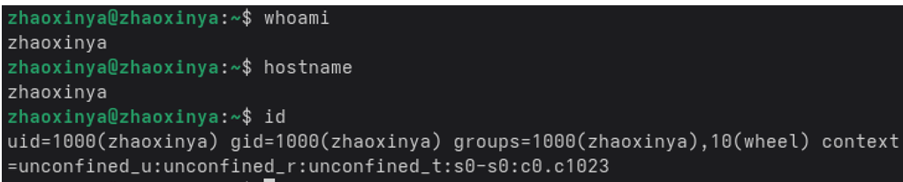{#fig-08-01 width=90%}

# Ход выполнения работы

## 2. Файл file.txt

~~~bash
cd ~
ls /etc > file.txt
ls ~ >> file.txt
head -30 file.txt
~~~

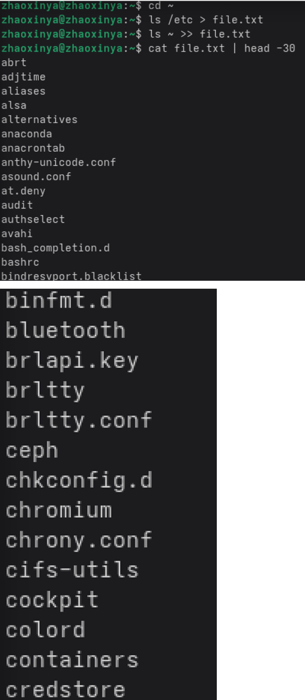{#fig-08-02 width=90%}

Файл `file.txt` содержит содержимое `/etc` и домашнего каталога.

## 3. Файл conf.txt

~~~bash
grep "\.conf" file.txt > conf.txt
cat conf.txt
~~~

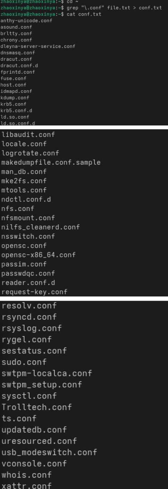{#fig-08-03 width=90%}

## 4. Файлы, начинающиеся с c

~~~bash
ls ~ | grep "^c"
find ~ -maxdepth 1 -name "c*"
ls -d ~/c* 2>/dev/null
~~~

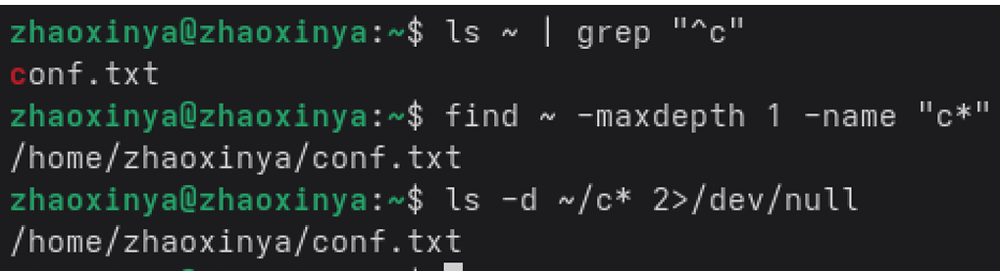{#fig-08-04 width=90%}

## 5. Файлы /etc, начинающиеся с h

~~~bash
ls /etc | grep "^h" | less
~~~

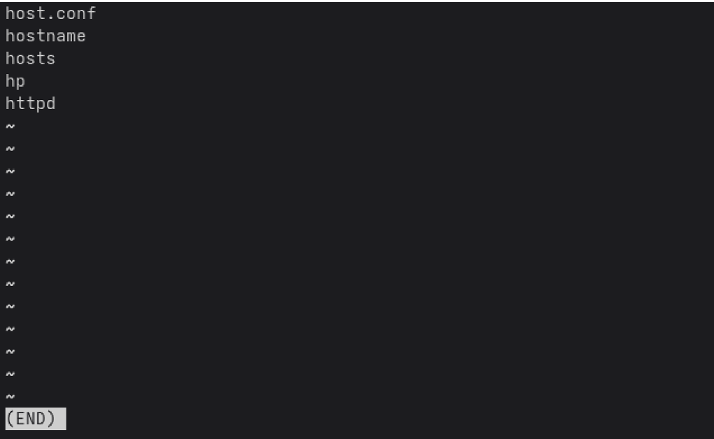{#fig-08-05 width=90%}

## 6. Фоновый поиск log

~~~bash
find / -name "log*" -print > ~/logfile 2>/dev/null &
~~~

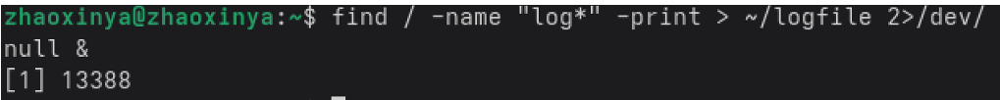{#fig-08-06 width=90%}

Через 5 секунд:

~~~bash
jobs
ls -l ~/logfile
head -20 ~/logfile
~~~

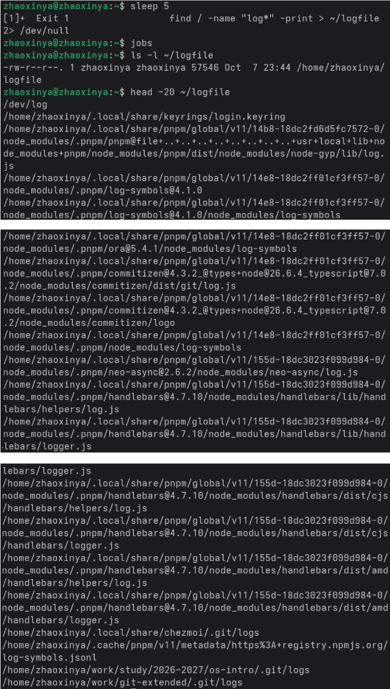{#fig-08-07 width=90%}

## 7. Удаление logfile

~~~bash
rm ~/logfile
ls ~/logfile
~~~

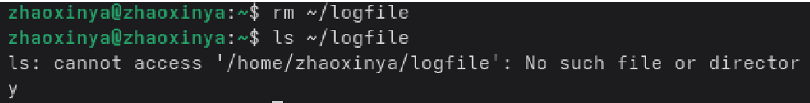{#fig-08-08 width=90%}

## 8. Запуск gnome-text-editor в фоне

~~~bash
gnome-text-editor &
~~~

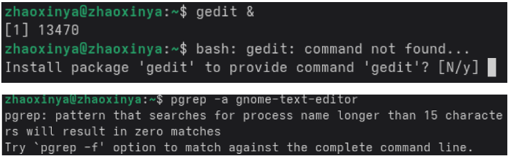{#fig-08-09 width=90%}

Результат: `[1] 13500`.

## 9. Определение PID

~~~bash
ps aux | grep gnome-text-editor | grep -v grep
pgrep -a -f gnome-text-editor
~~~

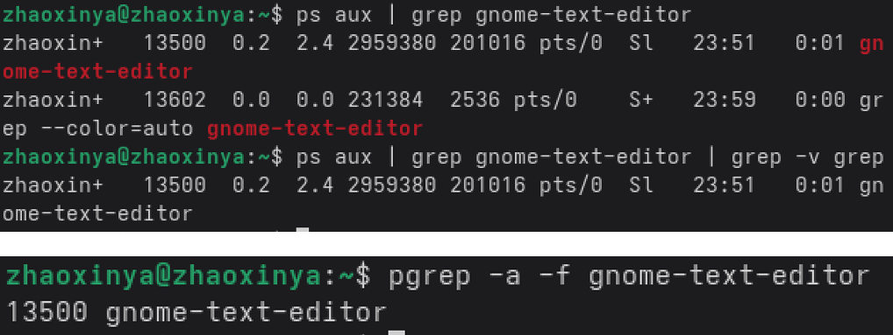{#fig-08-10 width=90%}

## 10. Завершение процесса

~~~bash
kill -9 13500
pgrep -a -f gnome-text-editor
~~~

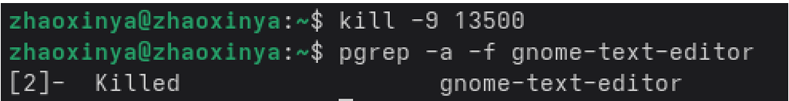{#fig-08-11 width=90%}

Результат: `[2]- Killed gnome-text-editor`.

## 11. df и du

~~~bash
df -h
du -sh ~
~~~

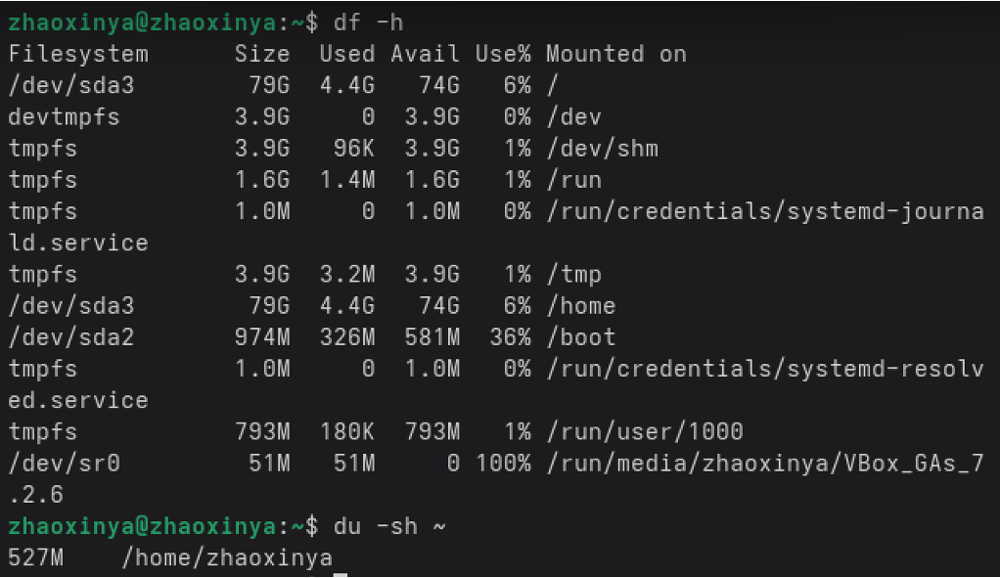{#fig-08-12 width=90%}

## 12. Поиск директорий

~~~bash
find ~ -type d | head -30
~~~

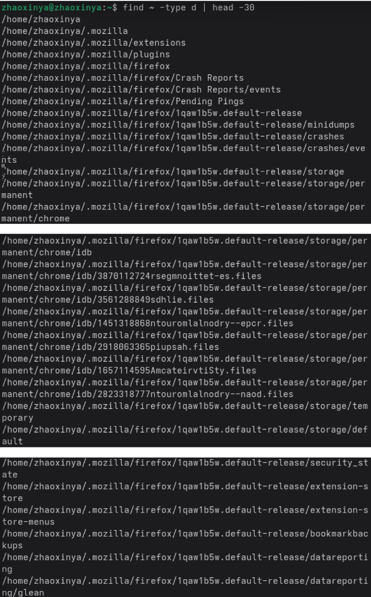{#fig-08-13 width=90%}

# Выводы

В ходе лабораторной работы были изучены:

- перенаправление стандартных потоков ввода-вывода;
- конвейеры для объединения команд;
- команды поиска `find` и фильтрации `grep`;
- проверка использования диска (`df`, `du`);
- управление задачами (`jobs`, `&`) и процессами (`ps`, `kill`);
- удаление процессов по PID и по имени.

# Ответы на контрольные вопросы

## 1. Какие потоки ввода-вывода вы знаете?

- `stdin` (0) — стандартный ввод;
- `stdout` (1) — стандартный вывод;
- `stderr` (2) — вывод ошибок.

## 2. Разница между > и >>

- `>` — перезапись;
- `>>` — добавление.

## 3. Что такое конвейер?

Конвейер передаёт вывод одной команды на вход другой:

~~~bash
ls -la | sort
~~~

## 4. Что такое процесс?

Процесс — выполняющийся экземпляр программы.

## 5. Что такое PID и GID?

- PID — идентификатор процесса;
- GID — идентификатор группы.

## 6. Что такое задачи?

Фоновые процессы текущей оболочки. Управление: `jobs`, `kill %N`.

## 7. top и http

- `top` — интерактивный монитор процессов;
- `httpd` — HTTP-сервер.

## 8. Команды поиска файлов

`find` — по имени и атрибутам; `grep` — по содержимому.

## 9. Поиск по контексту

~~~bash
grep "текст" файл
~~~

## 10. Объём свободной памяти

~~~bash
df -h
~~~

## 11. Объём домашнего каталога

~~~bash
du -sh ~
~~~

## 12. Удаление зависшего процесса

~~~bash
kill -9 PID
pkill -9 имя
~~~

# Список литературы {.unnumbered}

::: {#refs}
:::