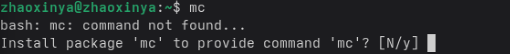
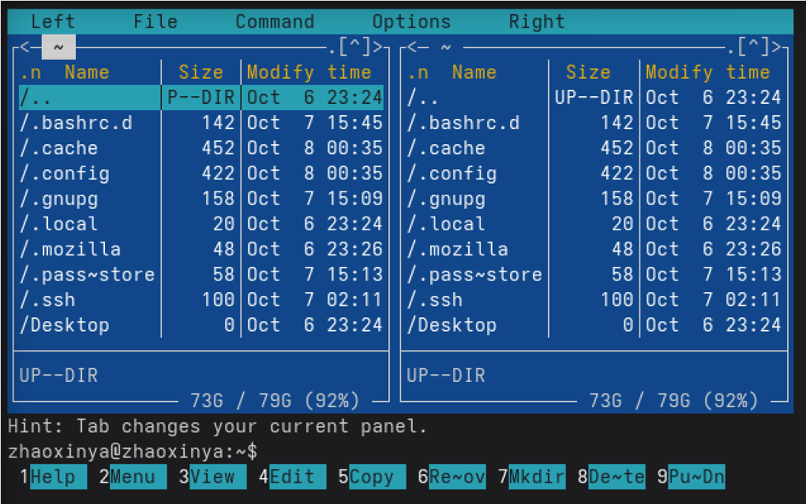
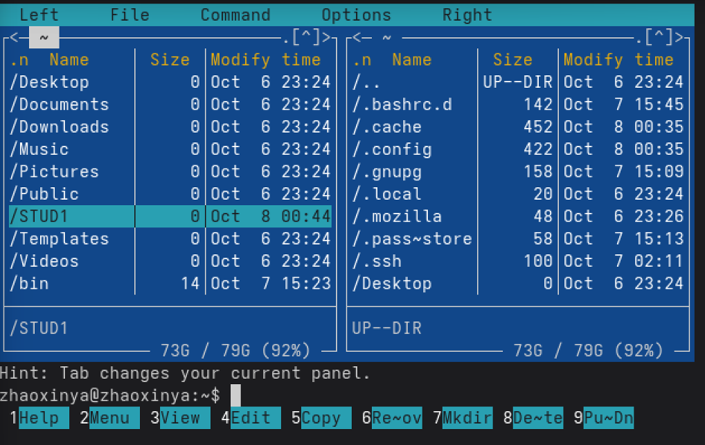
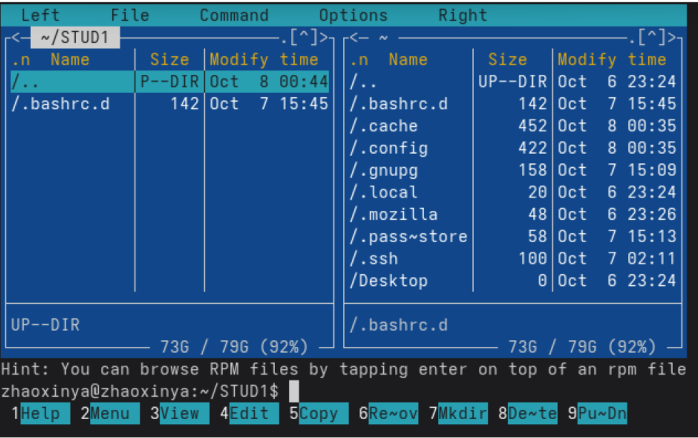
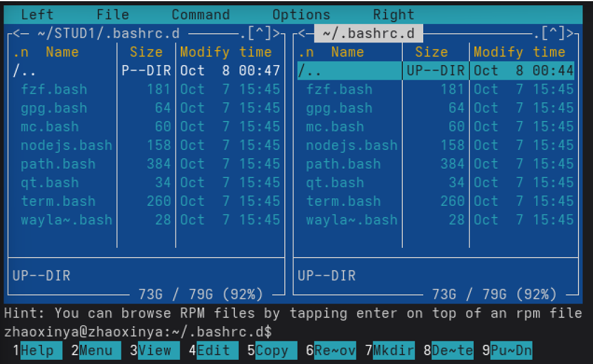
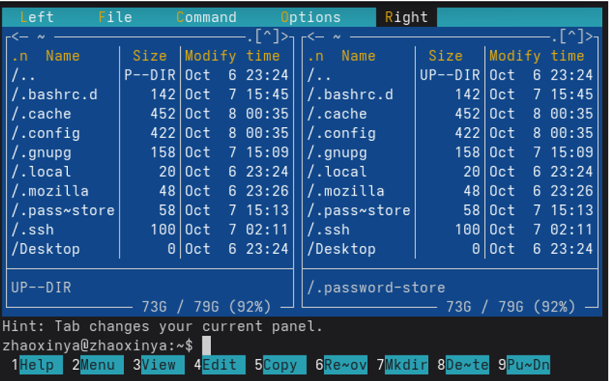
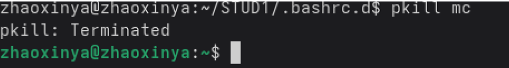

---
author:
  name: Чжао Синья
  email: 1132258332@rudn.ru
  affiliation:
    - name: Российский университет дружбы народов
      country: Российская Федерация
      city: Москва
      address: ул. Миклухо-Маклая, д. 6
title: "Лабораторная работа № 9"
subtitle: "Командная оболочка Midnight Commander"
license: "CC BY"
date: today
date-format: "YYYY-MM-DD"
abstract: |
  Отчёт по лабораторной работе № 9: освоение командной оболочки
  Midnight Commander (mc).
keywords: [лабораторная работа, Midnight Commander, mc, файловый менеджер]
---

# Цель работы

Освоение основных возможностей командной оболочки Midnight Commander. Приобретение навыков практической работы по просмотру каталогов и файлов, манипуляций с ними.

# Задание работы

1. Изучить структуру экрана `mc`.
2. Изучить основное меню `mc`.
3. Освоить операции с панелями и файлами.
4. Освоить встроенный редактор `mc`.
5. Освоить поиск файлов и работу с историей команд.
6. Изучить настройки `mc`.

# Теоретические сведения

Midnight Commander (`mc`) — псевдографическая командная оболочка для UNIX/Linux.

Запуск:

~~~bash
mc
~~~

## Структура экрана

- меню, доступное по `F9`;
- командная строка внизу;
- экранные кнопки `F1`–`F10`.

## Функциональные клавиши

| Клавиша | Действие |
|---------|----------|
| F1 | Помощь |
| F2 | Меню пользователя |
| F3 | Просмотр |
| F4 | Правка |
| F5 | Копирование |
| F6 | Переименование/перемещение |
| F7 | Создание каталога |
| F8 | Удаление |
| F9 | Меню |
| F10 | Выход |

## Управление панелями

- `Tab` — переключение между панелями;
- `Ctrl+U` — обмен панелями (в некоторых версиях — Unselect);
- `Ctrl+O` — временное скрытие панелей;
- `Ctrl+X D` — сравнение каталогов.

## Меню mc

Пять меню: Левая панель, Файл, Команда, Настройки, Правая панель.

# Соглашения об именовании

- Пользователь ВМ: `zhaoxinya`
- Имя хоста: `zhaoxinya`
- Имя виртуальной машины: `Zhaoxinya2`

# Ход выполнения работы

## 1. Запуск mc

~~~bash
mc
~~~

{#fig-09-01 width=90%}

Открылся двухпанельный интерфейс: слева — домашний каталог, справа — домашний каталог.

## 2. Структура экрана

Верхняя строка меню: `Left`, `File`, `Command`, `Options`, `Right`.

Внизу — строка подсказки и функциональные кнопки:

~~~
1Help 2Menu 3View 4Edit 5Copy 6RenMov 7Mkdir 8Delete 9PullDn 10Quit
~~~

{#fig-09-02 width=90%}

## 3. Создание каталога

Нажата клавиша `F7`, введено имя `STUD1`, создан каталог `/home/zhaoxinya/STUD1`.

{#fig-09-03 width=90%}

## 4. Копирование каталога

В правой панели выбран каталог `.bashrc.d`. Нажата клавиша `F5`, открылось окно копирования. В поле «to:» указано `~/STUD1`, подтверждено нажатием `< OK >`.

Каталог `.bashrc.d` скопирован в `~/STUD1`. Размер `STUD1` в панели увеличился с 0 до 18.

{#fig-09-04 width=90%}

## 5. Просмотр содержимого каталога

В левой панели выбран каталог `STUD1`, нажата клавиша `Enter`. Внутри видны файлы:

- fzf.bash
- gpg.bash
- mc.bash
- nodejs.bash
- path.bash
- qt.bash
- term.bash
- wayland.bash

{#fig-09-05 width=90%}

## 6. Меню mc

Клавиша `F9` открывает верхнее меню с пятью пунктами: Левая панель, Файл, Команда, Настройки, Правая панель.

{#fig-09-07 width=90%}

## 7. Управление панелями

- `Tab` — переключение между панелями;
- `Ctrl+U` — Unselect (в текущей версии mc);
- `Ctrl+O` — временное скрытие панелей.

## 8. Выход из mc

Так как `F10` не работала (специфика клавиатуры в VirtualBox), выход выполнен командой:

~~~bash
pkill mc
~~~

{#fig-09-06 width=90%}

## 9. Встроенный редактор mc

Редактор `mc` вызывается по `F4`. Известные комбинации:

- `Ctrl+Y` — удалить строку;
- `Ctrl+K` — вырезать блок;
- `Ctrl+U` — вставить блок;
- `Ctrl+O` — сохранить;
- `Ctrl+X` — выйти;
- `Ctrl+Z` — отменить действие.

## 10. Меню Команда

- Дерево каталогов;
- Поиск файла;
- Переставить панели;
- Сравнить каталоги;
- Размеры каталогов;
- История командной строки;
- Каталоги быстрого доступа;
- Редактировать файл меню;
- Редактировать файл расширений.

# Выводы

В ходе лабораторной работы были освоены:

- структура экрана Midnight Commander;
- управление панелями;
- меню `Файл`, `Команда`, `Настройки` и `Левая/Правая панель`;
- операции с файлами и каталогами через `mc`;
- встроенный редактор `mc`;
- поиск файлов и история команд в `mc`.

# Ответы на контрольные вопросы

## 1. Какие режимы работы есть в mc?

- Список файлов;
- Быстрый просмотр;
- Информация;
- Дерево.

## 2. Какие операции с файлами можно выполнить через mc?

Через меню `Файл`: Просмотр (`F3`), Правка (`F4`), Копирование (`F5`), Переименование (`F6`), Создание каталога (`F7`), Удаление (`F8`), Установка прав (`Ctrl+X C`).

## 3. Структура меню левой панели

- Список файлов;
- Быстрый просмотр;
- Информация;
- Дерево;
- Формат списка;
- Порядок сортировки.

## 4. Структура меню Файл

См. раздел «Меню Файл».

## 5. Структура меню Команда

См. раздел «Меню Команда».

## 6. Структура меню Настройки

- Конфигурация;
- Внешний вид;
- Настройки панели;
- Подтверждение;
- Виртуальный ФС;
- Save setup.

## 7. Встроенные команды mc

`F3`, `F4`, `F5`, `F6`, `F7`, `F8`, `F9`, `F10`, `Ctrl+U`, `Ctrl+O`, `Ctrl+X D`.

## 8. Команды встроенного редактора mc

`Ctrl+Y`, `Ctrl+K`, `Ctrl+U`, `Ctrl+O`, `Ctrl+X`, `Ctrl+Z`.

## 9. Средства mc для создания меню пользователем

`Команда` → `Редактировать файл меню` — редактирует контекстное меню (`F2`).

## 10. Средства mc для действий над текущим файлом

`F3`, `F4`, `F5`, `F6`, `F8`, `Ctrl+X C`, `Ctrl+X O`, `Ctrl+X L/S`.

# Список литературы {.unnumbered}

::: {#refs}
:::