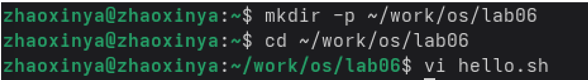
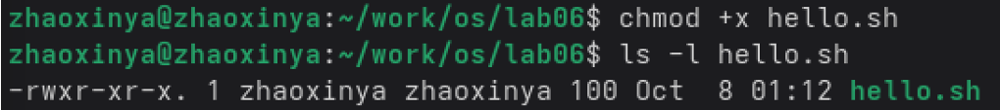
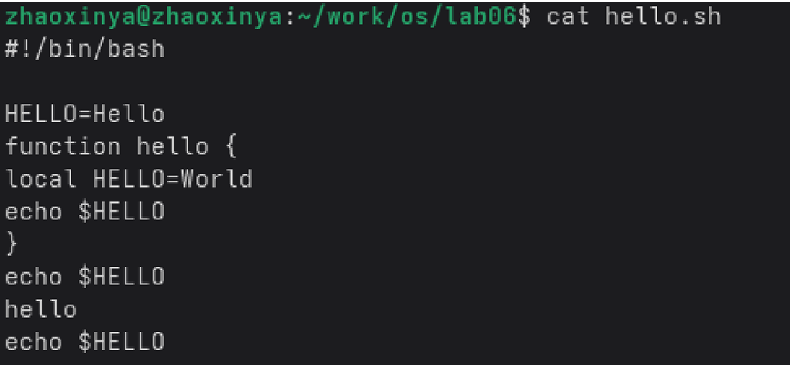

---
author:
  name: Чжао Синья
  email: 1132258332@rudn.ru
  affiliation:
    - name: Российский университет дружбы народов
      country: Российская Федерация
      city: Москва
      address: ул. Миклухо-Маклая, д. 6
title: "Лабораторная работа № 10"
subtitle: "Текстовой редактор vi"
license: "CC BY"
date: today
date-format: "YYYY-MM-DD"
abstract: |
  Отчёт по лабораторной работе № 10: знакомство с операционной системой
  Linux и редактором vi.
keywords: [лабораторная работа, vi, текстовый редактор, Linux]
---

# Цель работы

Познакомиться с операционной системой Linux. Получить практические навыки работы с редактором `vi`, установленным по умолчанию практически во всех дистрибутивах.

# Задание работы

1. Ознакомиться с теоретическим материалом.
2. Ознакомиться с редактором `vi`.
3. Выполнить упражнения по созданию и редактированию файлов.

# Теоретические сведения

Редактор `vi` имеет три режима работы:

- **командный режим** — навигация и команды;
- **режим вставки** — ввод текста;
- **режим последней строки** — запись в файл, выход, установка опций.

## Управление курсором

| Команда | Функция |
|---------|---------|
| `h` `j` `k` `l` | ← ↓ ↑ → |
| `0` | начало строки |
| `$` | конец строки |
| `G` | конец файла |
| `nG` | строка n |
| `Ctrl+D` | пол-экрана вперёд |
| `Ctrl+U` | пол-экрана назад |
| `Ctrl+F` / `Ctrl+B` | страница вперёд / назад |
| `w` / `W` | следующее слово |
| `b` / `B` | предыдущее слово |
| `e` / `E` | конец слова |

## Вставка текста

| Команда | Действие |
|---------|----------|
| `i` | перед курсором |
| `a` | после курсора |
| `A` | в конец строки |
| `I` | в начало строки |
| `o` | новая строка после |
| `O` | новая строка перед |

## Удаление

- `x` — символ;
- `dw` — слово;
- `d$` — до конца строки;
- `d0` — до начала строки;
- `dd` — строку;
- `ndd` — n строк.

## Отмена

- `u` — отмена;
- `U` — отмена изменений строки.

## Режим последней строки

- `:w` — сохранить;
- `:wq` — сохранить и выйти;
- `:q` — выйти;
- `:q!` — выйти без сохранения;
- `:set nu` — номера строк;
- `:set ic` — игнорировать регистр.

# Соглашения об именовании

- Пользователь ВМ: `zhaoxinya`
- Имя хоста: `zhaoxinya`
- Имя виртуальной машины: `Zhaoxinya2`

# Ход выполнения работы

## Задание 1. Создание нового файла

~~~bash
mkdir -p ~/work/os/lab06
cd ~/work/os/lab06
vi hello.sh
~~~

{#fig-10-01 width=90%}

В редакторе `vi` нажали `i`, ввели текст:

~~~bash
#!/bin/bash
HELL=Hello
function hello {
    LOCAL HELLO=World
    echo $HELLO
}
echo $HELLO
hello
~~~

Нажали `Esc`, затем `:wq` для сохранения и выхода.

Файл сделан исполняемым:

~~~bash
chmod +x hello.sh
ls -l hello.sh
~~~

{#fig-10-02 width=90%}

Результат:

~~~
-rwxr-xr-x. 1 zhaoxinya zhaoxinya 100 Oct 8 01:12 hello.sh
~~~

## Задание 2. Редактирование существующего файла

~~~bash
vi ~/work/os/lab06/hello.sh
~~~

Выполненные действия:

1. Переместили курсор на слово `HELL` во второй строке.
2. Нажали `i`, заменили `HELL` на `HELLO`.
3. `Esc` для возврата в командный режим.
4. Переместили курсор на четвёртую строку.
5. Удалили `LOCAL` командой `dw`.
6. Перешли в режим вставки, ввели `local`.
7. Нажали `Esc`.
8. Установили курсор на последней строке.
9. Нажали `o`, ввели `echo $HELLO`.
10. Нажали `Esc`.
11. Удалили строку командой `dd`.
12. Отменили изменение командой `u`.
13. Ввели `:wq` для сохранения и выхода.

Результат `cat hello.sh`:

~~~bash
#!/bin/bash
HELLO=Hello
function hello {
    local HELLO=World
    echo $HELLO
}
echo $HELLO
hello
echo $HELLO
~~~

{#fig-10-03 width=90%}

# Выводы

В ходе лабораторной работы были изучены:

- три режима работы редактора `vi`;
- команды управления курсором (`h`, `j`, `k`, `l`, `0`, `$`, `G`);
- команды вставки (`i`, `a`, `A`, `o`, `O`);
- команды удаления (`x`, `dw`, `dd`, `d$`);
- команды отмены (`u`, `U`);
- команды режима последней строки (`:w`, `:wq`, `:q!`, `:set nu`);
- создание и редактирование файла `hello.sh`;
- установка прав на выполнение.

# Ответы на контрольные вопросы

## 1. Режимы vi

Командный, вставки, последней строки.

## 2. Как выйти без сохранения?

~~~bash
:q!
~~~

## 3. Команды позиционирования

`0`, `$`, `G`, `nG`, `Ctrl+D`, `Ctrl+U`, `w`, `b`.

## 4. Что такое слово в vi?

Последовательность непробельных символов.

## 5. Как перейти в начало/конец файла?

`gg` — начало, `G` — конец.

## 6. Группы команд редактирования

Вставка, удаление, замена, копирование, отмена.

## 7. Как заполнить строку символами $?

В режиме вставки ввести `$` несколько раз.

## 8. Как отменить некорректное действие?

- `u` — отмена последнего действия;
- `U` — отмена изменений текущей строки.

## 9. Основные команды режима последней строки

- Сохранение и выход: `:w`, `:wq`, `:q`;
- Поиск/замена: `:s/old/new/`;
- Настройка: `:set nu`, `:set ic`;
- Работа с файлами: `:e`, `:r`, `:w`.

## 10. Как определить позицию конца строки?

Команда `$`.

## 11. Анализ опций vi

Полный список: `:set all`. Установка/отмена: `:set option` / `:set nooption`.

## 12. Как определить режим работы vi?

По индикатору: `-- INSERT --`, `-- REPLACE --`, или `:` для режима последней строки.

## 13. Граф взаимосвязи режимов

- командный → вставки: `i`, `a`, `A`, `I`, `o`, `O`;
- вставки → командный: `Esc`;
- командный → последней строки: `:`;
- последней строки → командный: `Enter` или `Esc`.

# Список литературы {.unnumbered}

::: {#refs}
:::