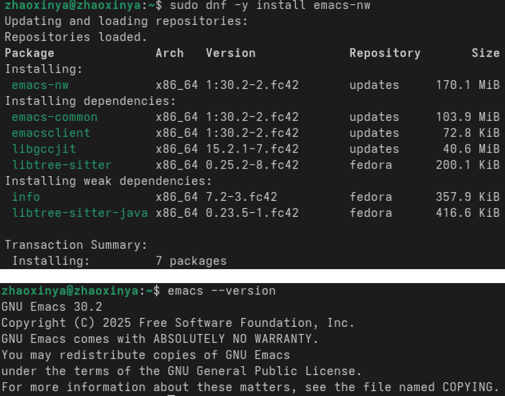
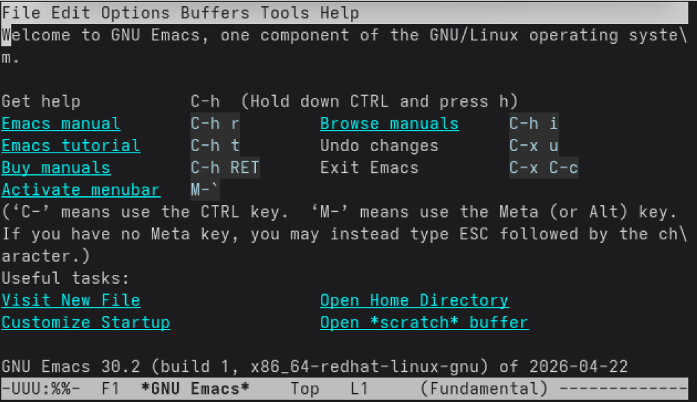
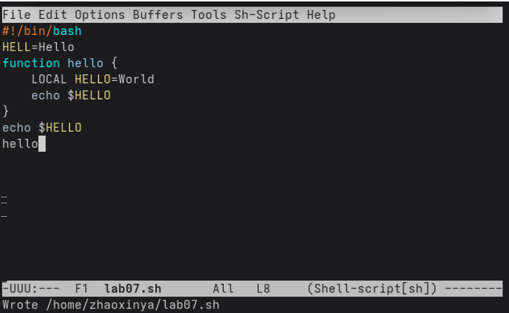
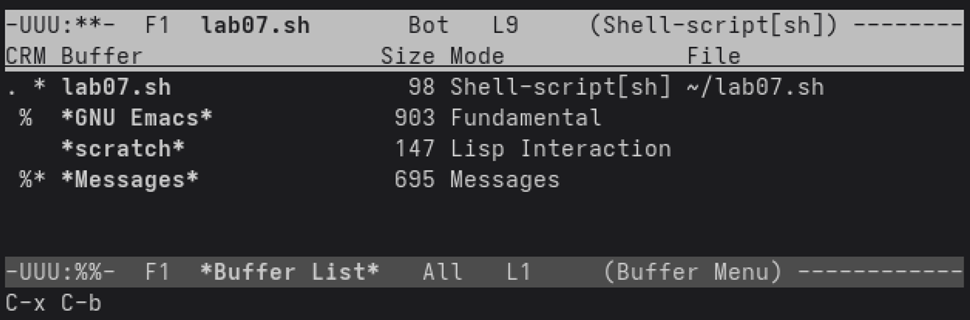
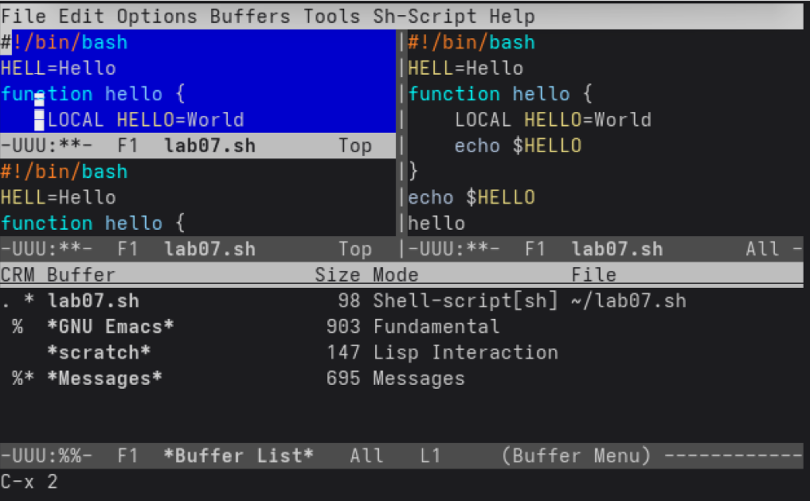

---
author:
  name: Чжао Синья
  email: 1132258332@rudn.ru
  affiliation:
    - name: Российский университет дружбы народов
      country: Российская Федерация
      city: Москва
      address: ул. Миклухо-Маклая, д. 6
title: "Лабораторная работа № 11"
subtitle: "Текстовой редактор emacs"
license: "CC BY"
date: today
date-format: "YYYY-MM-DD"
abstract: |
  Отчёт по лабораторной работе № 11: знакомство с операционной системой
  Linux и редактором Emacs.
keywords: [лабораторная работа, Emacs, текстовый редактор, Linux]
---

# Цель работы

Познакомиться с операционной системой Linux. Получить практические навыки работы с редактором Emacs.

# Задание работы

1. Ознакомиться с теоретическим материалом.
2. Ознакомиться с редактором Emacs.
3. Выполнить упражнения.
4. Ответить на контрольные вопросы.

# Теоретические сведения

## Основные термины

- **Буфер** — объект, содержащий текст.
- **Фрейм** — окно в обычном понимании.
- **Окно** — прямоугольная область фрейма, отображающая буфер.
- **Область вывода** — нижняя часть фрейма для сообщений.
- **Минибуфер** — область ввода.
- **Точка вставки** — место вставки/удаления данных.

## Префиксы команд

- `C-` = `Ctrl`
- `M-` = `Alt` или `Esc`

Пример: `C-x C-f` = нажать `Ctrl+x`, отпустить, нажать `Ctrl+f`.

## Управление курсором

| Комбинация | Действие |
|------------|----------|
| `C-p` / `C-n` | ↑ / ↓ |
| `C-f` / `C-b` | → / ← |
| `C-a` / `C-e` | начало / конец строки |
| `M-f` / `M-b` | → / ← на слово |
| `M-<` / `M->` | начало / конец буфера |
| `C-v` / `M-v` | страница вперёд / назад |

## Редактирование

| Комбинация | Действие |
|------------|----------|
| `C-d` | удалить символ |
| `M-d` | удалить слово |
| `C-k` | удалить до конца строки |
| `C-y` | вставить |
| `M-w` | копировать |
| `C-w` | вырезать |
| `C-space` | начать выделение |
| `C-/` | отмена |

## Файлы и буферы

| Комбинация | Действие |
|------------|----------|
| `C-x C-f` | открыть файл |
| `C-x C-s` | сохранить |
| `C-x C-w` | сохранить как |
| `C-x C-b` | список буферов |
| `C-x b` | переключить буфер |
| `C-x k` | закрыть буфер |

## Окна

| Комбинация | Действие |
|------------|----------|
| `C-x 0` | закрыть текущее окно |
| `C-x 1` | закрыть остальные окна |
| `C-x 2` | разделить по горизонтали |
| `C-x 3` | разделить по вертикали |
| `C-x o` | перейти в другое окно |

## Поиск и замена

| Комбинация | Действие |
|------------|----------|
| `C-s` | поиск вперёд |
| `C-r` | поиск назад |
| `M-%` | поиск и замена |
| `M-s o` | occur (список совпадений) |
| `C-g` | отменить |

# Соглашения об именовании

- Пользователь ВМ: `zhaoxinya`
- Имя хоста: `zhaoxinya`
- Имя виртуальной машины: `Zhaoxinya2`

# Ход выполнения работы

## 1. Установка и запуск emacs

~~~bash
sudo dnf -y install emacs-nw emacs
~~~

Проверка версии:

~~~
GNU Emacs 30.2
Copyright (C) 2025 Free Software Foundation, Inc.
~~~

{#fig-11-01 width=90%}

{#fig-11-02 width=90%}

## 2. Создание файла lab07.sh

Комбинация `C-x C-f`, введено имя `lab07.sh`, нажата клавиша `Enter`.

## 3. Ввод текста

~~~bash
#!/bin/bash
HELL=Hello
function hello {
    LOCAL HELLO=World
    echo $HELLO
}
echo $HELLO
hello
~~~

{#fig-11-03 width=90%}

## 4. Сохранение файла

`C-x C-s`.

В нижней строке появилось сообщение:

~~~
Wrote /home/zhaoxinya/lab07.sh
~~~

## 5. Редактирование текста

- `C-k` — вырезать целую строку;
- `C-y` — вставить строку в конец файла;
- `C-space` — выделить область;
- `M-w` — скопировать область;
- Вставить область в конец файла;
- Вновь выделить и `C-w` — вырезать;
- `C-/` — отменить последнее действие.

## 6. Перемещение курсора

- `C-a` — в начало строки;
- `C-e` — в конец строки;
- `M-<` — в начало буфера;
- `M->` — в конец буфера.

## 7. Управление буферами

- `C-x C-b` — список активных буферов;
- `C-x o` — перейти в окно списка;
- `C-x 0` — закрыть это окно;
- `C-x b` — переключиться между буферами.

{#fig-11-04 width=90%}

## 8. Управление окнами

- `C-x 3` — разделить фрейм по вертикали;
- `C-x 2` — разделить окна по горизонтали;
- В каждом из 4 окон открыт новый буфер с текстом;
- `C-x 1` — оставить только текущее окно.

{#fig-11-05 width=90%}

## 9. Режим поиска

- `C-s` — поиск вперёд;
- Повторное `C-s` — переход к следующему совпадению;
- `C-g` — выйти из режима поиска;
- `M-%` — поиск и замена;
- `M-s o` — режим occur.

## 10. Выход

`C-x C-c` — выход из Emacs.

# Выводы

В ходе лабораторной работы были изучены:

- основные термины Emacs: буфер, фрейм, окно, точка вставки;
- управление курсором (`C-p`, `C-n`, `C-f`, `C-b`, `C-a`, `C-e`, `M-<`, `M->`);
- редактирование (`C-k`, `C-y`, `C-space`, `M-w`, `C-w`, `C-/`);
- работа с файлами и буферами (`C-x C-f`, `C-x C-s`, `C-x C-b`, `C-x b`);
- работа с окнами (`C-x 0`, `C-x 1`, `C-x 2`, `C-x 3`, `C-x o`);
- поиск и замена (`C-s`, `C-r`, `M-%`, `M-s o`).

Создан файл `lab07.sh`, содержащий shell-скрипт.

# Ответы на контрольные вопросы

## 1. Краткая характеристика редактора emacs

Emacs — мощный экранный редактор, написанный на языке Elisp. Поддерживает расширения, режимы, работу с буферами и окнами.

## 2. Особенности, делающие его сложным для новичков

- Множество комбинаций клавиш.
- Специфическая терминология (буфер, фрейм, окно).
- Много режимов и настроек.
- Нестандартная логика вставки/удаления.

## 3. Что такое буфер и окно в терминологии emacs?

- **Буфер** — объект, содержащий текст.
- **Окно** — прямоугольная область фрейма, отображающая буфер.

## 4. Можно ли открыть больше 10 буферов в одном окне?

Да, ограничений нет.

## 5. Какие буферы создаются при запуске emacs?

- `*scratch*` — для временного текста.
- `*Messages*` — для сообщений.
- `*GNU Emacs*` — стартовый буфер.

## 6. Какие клавиши нажать, чтобы ввести C-c | и C-c C-|?

- `C-c |`: `Ctrl+C`, затем `Shift+\`.
- `C-c C-|`: `Ctrl+C`, затем `Ctrl+Shift+\`.

## 7. Как разделить текущее окно на две части?

- По горизонтали: `C-x 2`.
- По вертикали: `C-x 3`.

## 8. В каком файле хранятся настройки редактора emacs?

В файле `~/.emacs` или `~/.emacs.d/init.el`.

## 9. Какую функцию выполняет клавиша C-|? Можно ли её переназначить?

`C-|` зависит от режима. В большинстве режимов не назначена. Переназначить можно в `init.el` через `global-set-key`.

## 10. Какой редактор удобнее: vi или emacs?

Зависит от привычек. `vi` компактнее и есть везде. `emacs` богаче возможностями и расширяем.

# Список литературы {.unnumbered}

::: {#refs}
:::