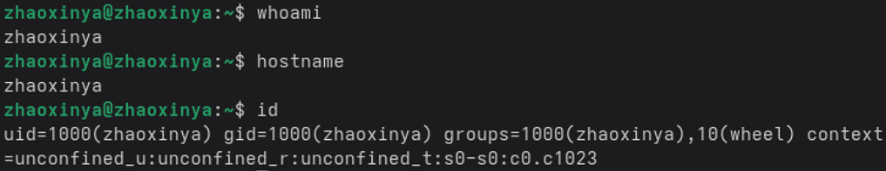
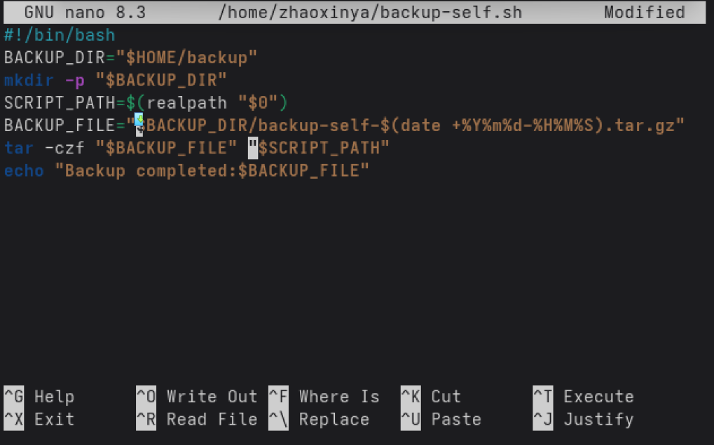
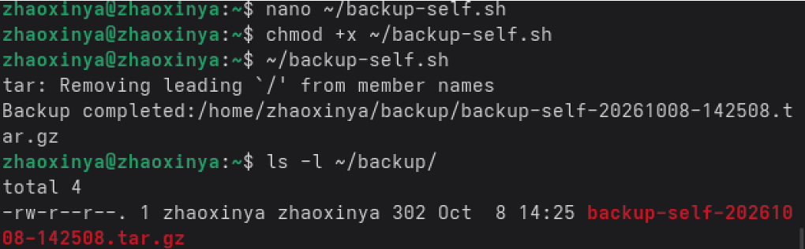
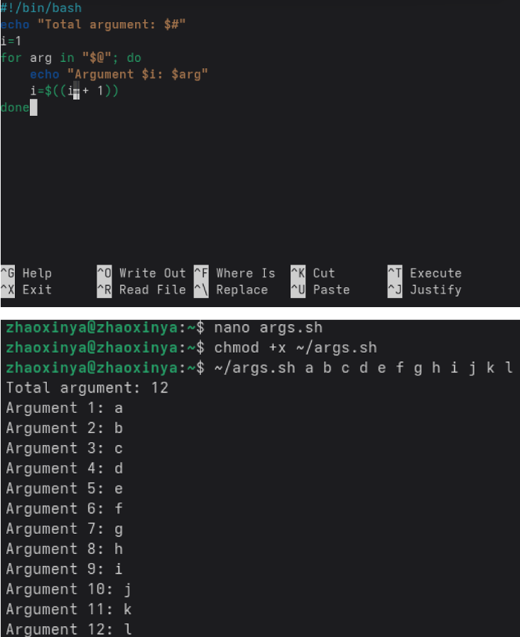
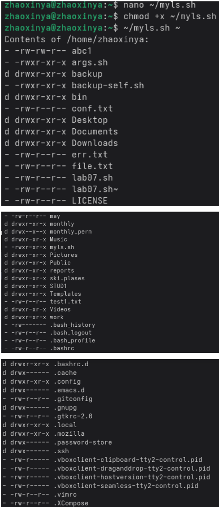
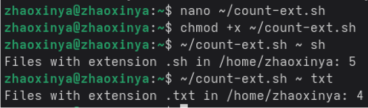

---
author:
  name: Чжао Синья
  email: 1132258332@rudn.ru
  affiliation:
    - name: Российский университет дружбы народов
      country: Российская Федерация
      city: Москва
      address: ул. Миклухо-Маклая, д. 6
title: "Лабораторная работа № 12"
subtitle: "Программирование в командном процессоре ОС UNIX. Командные файлы"
license: "CC BY"
date: today
date-format: "YYYY-MM-DD"
abstract: |
  Отчёт по лабораторной работе № 12: написание командных файлов
  (shell-скриптов) на языке bash.
keywords: [лабораторная работа, bash, shell, скрипты]
---

# Цель работы

Изучить основы программирования в оболочке ОС UNIX/Linux. Научиться писать и отлаживать командные файлы (shell-скрипты) на языке bash.

# Задание работы

1. Написать командный файл, выполняющий резервное копирование самого себя в каталог `~/backup` с использованием архиватора (`tar`, `zip` или `bzip2`).
2. Написать командный файл, обрабатывающий произвольное число аргументов командной строки, в том числе превышающее десять.
3. Написать командный файл — аналог команды `ls` (без использования `ls` и `dir`), выводящий информацию о каталоге и правах доступа к файлам.
4. Написать командный файл, который принимает в качестве аргументов путь к каталогу и расширение файла, и подсчитывает количество файлов с указанным расширением.

# Теоретические сведения

## Командные оболочки

- `sh` — Bourne shell, базовая оболочка;
- `csh` — C shell, C-подобный синтаксис;
- `ksh` — Korn shell, совместим с sh;
- `bash` — Bourne Again Shell, стандарт в Linux.

## POSIX

POSIX (Portable Operating System Interface) — набор стандартов IEEE, обеспечивающих совместимость UNIX/Linux-подобных систем.

## Переменные и массивы в bash

~~~bash
name=value
echo $name

arr=(a b c)
echo ${arr[0]}
echo ${arr[@]}
~~~

## Арифметическая подстановка

~~~bash
i=$((i + 1))
~~~

## Стандартные переменные

`HOME`, `PATH`, `PS1`, `PS2`, `IFS`, `TERM`, `LOGNAME`, `MAIL`, `PWD`, `USER`, `SHELL`.

## Метасимволы

- `*` — произвольная строка;
- `?` — один символ;
- `[c1-c2]` — диапазон;
- `\` — экранирование;
- `'...'` — буквально;
- `"..."` — с подстановкой переменных.

## Командные файлы

~~~bash
touch script.sh
chmod +x script.sh
./script.sh
~~~

## Позиционные параметры

`$0`, `$1`, `$2`, …, `$#`, `$*`, `$@`, `$?`, `$$`, `$!`.

## Управляющие конструкции

- `if ... then ... elif ... else ... fi`
- `case ... esac`
- `for ... do ... done`
- `while ... do ... done`
- `until ... do ... done`

# Соглашения об именовании

- Пользователь ВМ: `zhaoxinya`
- Имя хоста: `zhaoxinya`
- Имя виртуальной машины: `Zhaoxinya2`

Проверка:

~~~bash
whoami
hostname
id
~~~

{#fig-12-01 width=90%}

# Ход выполнения работы

## Задание 1. Резервное копирование скрипта

Создан файл `~/backup-self.sh` с помощью редактора `nano`:

~~~bash
nano ~/backup-self.sh
~~~

{#fig-12-02 width=90%}

Исходный код:

~~~bash
#!/bin/bash
BACKUP_DIR="$HOME/backup"
mkdir -p "$BACKUP_DIR"
SCRIPT_PATH=$(realpath "$0")
BACKUP_FILE="$BACKUP_DIR/backup-self-$(date +%Y%m%d-%H%M%S).tar.gz"
tar -czf "$BACKUP_FILE" "$SCRIPT_PATH"
echo "Backup completed:$BACKUP_FILE"
~~~

Установлены права и выполнен запуск:

~~~bash
chmod +x ~/backup-self.sh
~/backup-self.sh
ls -l ~/backup/
~~~

{#fig-12-03 width=90%}

Первоначально возникала ошибка:

~~~
tar: Cowardly refusing to create an empty archive
~~~

Причина — между аргументами `"$BACKUP_FILE"` и `"$SCRIPT_PATH"` отсутствовал пробел. После добавления пробела и использования `realpath "$0"` скрипт заработал корректно.

Результат:

~~~
Backup completed:/home/zhaoxinya/backup/backup-self-20261008-142508.tar.gz
~~~

Сообщение `tar: Removing leading '/' from member names` не является ошибкой — это стандартное поведение `tar`.

## Задание 2. Обработка произвольного числа аргументов

Создан файл `~/args.sh`:

~~~bash
nano ~/args.sh
~~~

{#fig-12-04 width=90%}

Исходный код:

~~~bash
#!/bin/bash
echo "Total arguments: $#"
i=1
for arg in "$@"; do
    echo "Argument $i: $arg"
    i=$((i + 1))
done
~~~

Запуск:

~~~bash
chmod +x ~/args.sh
~/args.sh a b c d e f g h i j k l
~~~

Результат:

~~~
Total arguments: 12
Argument 1: a
Argument 2: b
...
Argument 11: k
Argument 12: l
~~~

`"$@"` корректно обрабатывает любое число аргументов, включая более десяти.

## Задание 3. Аналог команды ls

Создан файл `~/myls.sh`:

~~~bash
nano ~/myls.sh
~~~

Исходный код:

~~~bash
#!/bin/bash
DIR="${1:-.}"
if [ ! -d "$DIR" ]; then
    echo "Error: $DIR is not a directory."
    exit 1
fi
echo "Contents of $DIR:"
for f in "$DIR"/* "$DIR"/.[!.]*; do
    [ -e "$f" ] || continue
    if [ -d "$f" ]; then type="d"
    elif [ -f "$f" ]; then type="-"
    else type="?"
    fi
    perms=$(stat -c %A "$f")
    echo "$type $perms $(basename "$f")"
done
~~~

Запуск:

~~~bash
chmod +x ~/myls.sh
~/myls.sh ~
~~~

{#fig-12-05 width=90%}

Скрипт корректно обрабатывает как обычные, так и скрытые файлы (`.` и `..` исключены шаблоном `.[!.]*`), выводит тип (`d` — каталог, `-` — файл), права доступа и имя файла.

## Задание 4. Подсчёт файлов по расширению

Создан файл `~/count-ext.sh`:

~~~bash
nano ~/count-ext.sh
~~~

Исходный код:

~~~bash
#!/bin/bash
if [ $# -ne 2 ]; then
    echo "Usage: $0 <directory> <extension>"
    exit 1
fi
DIR="$1"
EXT="$2"
if [ ! -d "$DIR" ]; then
    echo "Error: Not a directory: $DIR"
    exit 1
fi
COUNT=0
for f in "$DIR"/*."$EXT"; do
    [ -e "$f" ] || continue
    COUNT=$((COUNT + 1))
done
echo "Files with extension .$EXT in $DIR: $COUNT"
~~~

Запуск:

~~~bash
chmod +x ~/count-ext.sh
~/count-ext.sh ~ sh
~/count-ext.sh ~ txt
~~~

{#fig-12-06 width=90%}

Результат:

~~~
Files with extension .sh in /home/zhaoxinya: 5
Files with extension .txt in /home/zhaoxinya: 4
~~~

Первоначально в последней строке была ошибка `echo"Files..."` (без пробела между `echo` и `"`). После добавления пробела скрипт заработал корректно.

# Выводы

В ходе лабораторной работы были изучены:

- переменные в bash и оператор `$`;
- арифметические операции через `$(( ))`;
- стандартные переменные оболочки;
- метасимволы и их экранирование;
- создание и запуск командных файлов;
- позиционные параметры и команда `getopts`;
- управляющие конструкции (`if`, `case`, `for`, `while`, `until`).

Написаны и отлажены 4 командных файла: `backup-self.sh`, `args.sh`, `myls.sh`, `count-ext.sh`. В процессе работы были выявлены и устранены две типичные ошибки: отсутствие пробела между аргументами `tar` и отсутствие пробела между `echo` и строкой.

# Ответы на контрольные вопросы

## 1. Понятие командной оболочки

Командная оболочка (shell) — программа, обеспечивающая взаимодействие пользователя с операционной системой через команды. Примеры: `sh`, `csh`, `ksh`, `bash`.

## 2. Что такое POSIX?

POSIX — набор стандартов описания интерфейсов взаимодействия ОС и прикладных программ, разработан IEEE для совместимости UNIX/Linux-подобных систем.

## 3. Как определяются переменные и массивы в bash?

Переменные:

~~~bash
name=value
~~~

Массивы:

~~~bash
arr=(a b c)
echo ${arr[0]}
echo ${arr[@]}
~~~

## 4. Назначение операторов let и read

- `let` — выполнение арифметических операций над переменными;
- `read` — чтение строки со стандартного ввода и присваивание её переменной.

## 5. Арифметические операторы в bash

`+ - * / % ** << >> & | ^ ~ && || !`

## 6. Что означает $(( ))?

Арифметическая подстановка: содержимое вычисляется как арифметическое выражение, результат подставляется в командную строку.

## 7. Стандартные имена переменных

`HOME`, `PATH`, `PS1`, `PS2`, `IFS`, `TERM`, `LOGNAME`, `MAIL`, `PWD`, `OLDPWD`, `SHELL`, `USER`.

## 8. Что такое метасимволы?

Символы, имеющие специальное значение для shell: `* ? [ ] \ ' " $ ; & | < > ( ) { }`.

## 9. Как экранировать метасимволы?

- `\` перед символом — экранирует один символ;
- `'...'` — экранирует всё содержимое;
- `"..."` — экранирует всё, кроме `$`, `` ` ``, `\`, `!`.

## 10. Как создавать и запускать командные файлы?

~~~bash
touch script.sh
chmod +x script.sh
./script.sh
~~~

## 11. Как определяются функции в bash?

~~~bash
function name {
    commands
}
# или
name() {
    commands
}
~~~

## 12. Как выяснить, является ли файл каталогом?

~~~bash
[ -d "$file" ] && echo "directory"
~~~

## 13. Назначение команд set, typeset, unset

- `set` — показать/установить переменные и опции shell;
- `typeset` — объявить переменную с атрибутами;
- `unset` — удалить переменную.

## 14. Как передаются параметры в командный файл?

Позиционные параметры: `$1`, `$2`, …, `$#`, `$*`, `$@`.

## 15. Специальные переменные bash

`$?` — код завершения последней команды, `$$` — PID текущего shell, `$!` — PID последнего фонового процесса, `$#` — число аргументов, `$*`/`$@` — все аргументы, `$-` — флаги shell, `$_` — последний аргумент предыдущей команды.

# Список литературы {.unnumbered}

::: {#refs}
:::