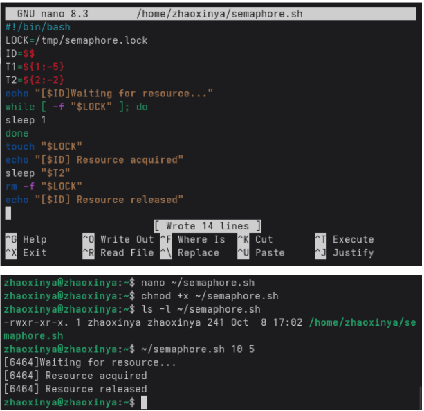
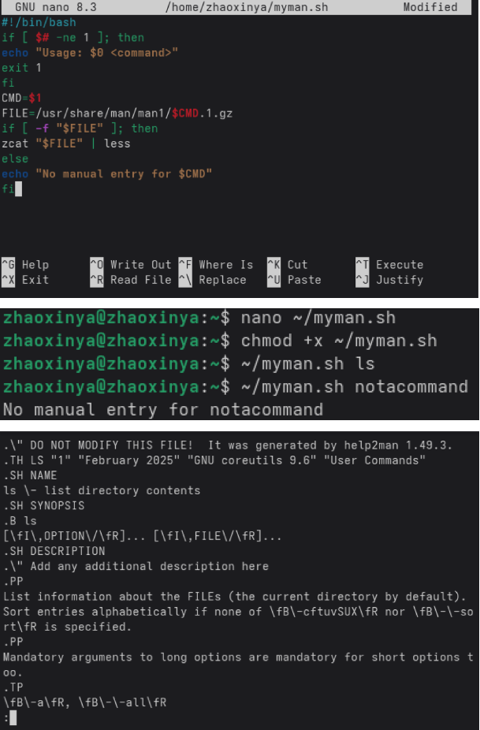
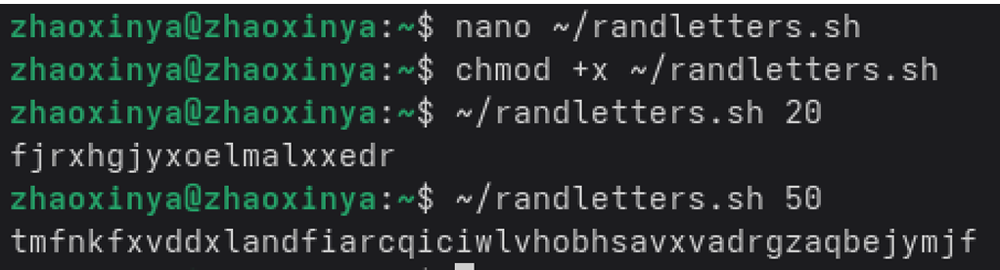

---
author:
  name: Чжао Синья
  email: 1132258332@rudn.ru
  affiliation:
    - name: Российский университет дружбы народов
      country: Российская Федерация
      city: Москва
      address: ул. Миклухо-Маклая, д. 6
title: "Лабораторная работа № 14"
subtitle: "Программирование в командном процессоре ОС UNIX. Ветвления и циклы"
license: "CC BY"
date: today
date-format: "YYYY-MM-DD"
abstract: |
  Отчёт по лабораторной работе № 14: семафоры, аналог man,
  генерация случайных букв.
keywords: [лабораторная работа, bash, семафор, RANDOM, man]
---

# Цель работы

Изучить основы программирования в оболочке ОС UNIX/Linux. Научиться писать более сложные командные файлы с использованием логических управляющих конструкций и циклов.

# Задание работы

1. Упрощённый механизм семафоров (ожидание / использование ресурса, t2 < t1).
2. Командный файл — аналог `man` (через `/usr/share/man/man1` и `less`).
3. Генерация случайных букв латинского алфавита с помощью `$RANDOM`.

# Теоретические сведения

- `$$` — PID процесса; `sleep n` — задержка.
- Семафор — синхронизация через файл-замок.
- Справки man: `/usr/share/man/man1/*.1.gz`, `zcat | less`.
- `$RANDOM` — 0..32767; `% 26` → 0..25.
- `printf '%03o'` — восьмеричный код символа.

# Соглашения об именовании

- Пользователь ВМ: `zhaoxinya`
- Имя хоста: `zhaoxinya`
- Имя виртуальной машины: `Zhaoxinya2`

Проверка:

~~~bash
whoami
hostname
id
~~~

# Ход выполнения работы

## Задание 1. Семафор

~~~bash
#!/bin/bash
LOCK=/tmp/semaphore.lock
ID=$$
T1=${1:-5}
T2=${2:-2}
echo "[$ID] Waiting for resource..."
while [ -f "$LOCK" ]; do
    sleep 1
done
touch "$LOCK"
echo "[$ID] Resource acquired"
sleep "$T2"
rm -f "$LOCK"
echo "[$ID] Resource released"
~~~

{#fig-14-01 width=90%}

Результат:

~~~
[6464] Waiting for resource...
[6464] Resource acquired
[6464] Resource released
~~~

Несколько экземпляров скрипта получают ресурс по очереди: пока файл-замок существует, остальные ждут.

## Задание 2. myman.sh

~~~bash
#!/bin/bash
if [ $# -ne 1 ]; then
    echo "Usage: $0 <command>"
    exit 1
fi
CMD=$1
FILE=/usr/share/man/man1/$CMD.1.gz
if [ -f "$FILE" ]; then
    zcat "$FILE" | less
else
    echo "No manual entry for $CMD"
fi
~~~

{#fig-14-02 width=90%}

Результат:

Для существующей команды:

~~~
~/myman.sh ls
ls \- list directory contents
.SH SYNOPSIS
...
~~~

Для несуществующей команды:

~~~
~/myman.sh notacommand
No manual entry for notacommand
~~~

## Задание 3. randletters.sh

~~~bash
#!/bin/bash
N=${1:-10}
for i in $(seq 1 $N); do
    R=$((RANDOM % 26))
    L=$(printf "\\$(printf '%03o' $((97 + R)))")
    echo -n "$L"
done
echo
~~~

{#fig-14-03 width=90%}

Результат:

~~~
~/randletters.sh 20
fjrxhgjxyxoelmalxxedr

~/randletters.sh 50
tmfnkfxvddxlandfiarcqiciwlvhobhsavxvadrgzaqbejymjf
~~~

Длина последовательности задаётся аргументом, по умолчанию — 10.

# Выводы

В ходе лабораторной работы были изучены:

- механизм семафоров на основе файла-замка;
- `$$`, `sleep`, фоновый запуск, перенаправление в другой терминал;
- чтение сжатых man-страниц через `zcat | less`;
- генерация случайных букв через `$RANDOM` и `printf`.

Написаны и отлажены 3 файла: `semaphore.sh`, `myman.sh`, `randletters.sh`.

# Ответы на контрольные вопросы

## 1. Найдите синтаксическую ошибку

~~~bash
while [$1 != "exit"]
~~~

Ошибка: отсутствуют пробелы после `[` и перед `]`. Правильно:

~~~bash
while [ "$1" != "exit" ]
~~~

Квадратные скобки в bash — это команда `test`, и она требует пробелов между собой и аргументами.

## 2. Как объединить (конкатенация) несколько строк в одну?

~~~bash
a="Hello, "
b="world!"
c="$a$b"
echo "$c"       # Hello, world!

c+=" more"
~~~

## 3. Замена seq

- C-подобный цикл `for`:
  ~~~bash
  for ((i=1; i<=N; i++)); do echo $i; done
  ~~~
- Арифметика в `while`:
  ~~~bash
  i=1; while [ $i -le $N ]; do echo $i; i=$((i+1)); done
  ~~~
- Фигурные скобки: `echo {1..10}`.

## 4. Результат `$((10/3))`

Результат `3`. В bash деление целочисленное, остаток отбрасывается.

## 5. Отличия zsh от bash

- zsh поддерживает более мощное автодополнение;
- лучшая поддержка массивов и параметров;
- темы оформления (oh-my-zsh);
- расширенные глоб-шаблоны;
- почти полная, но не 100% совместимость с bash;
- в большинстве дистрибутивов не установлен по умолчанию.

## 6. Проверьте синтаксис конструкции

~~~bash
for ((a=1; a <= LIMIT; a++))
~~~

Синтаксис неполный: отсутствует тело цикла. Полная форма:

~~~bash
for ((a=1; a <= LIMIT; a++)); do
    echo $a
done
~~~

Также `LIMIT` должна быть определена как переменная.

## 7. bash vs C/Python

**Преимущества bash:**

- нет необходимости компилировать;
- удобен для автоматизации;
- мощная работа с конвейерами и перенаправлениями.

**Недостатки bash:**

- медленнее скомпилированных языков;
- ограниченные структуры данных;
- слабая типизация и обработка ошибок;
- неудобен для численных вычислений.

# Список литературы {.unnumbered}

::: {#refs}
:::